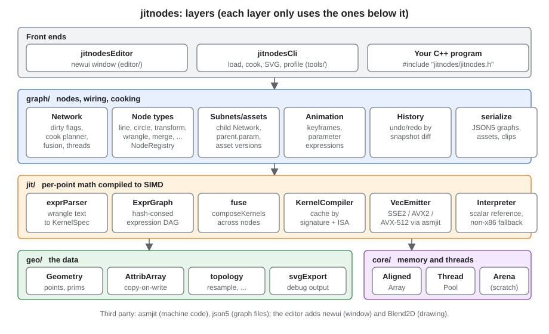
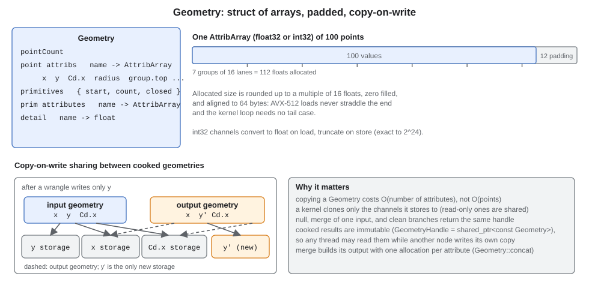
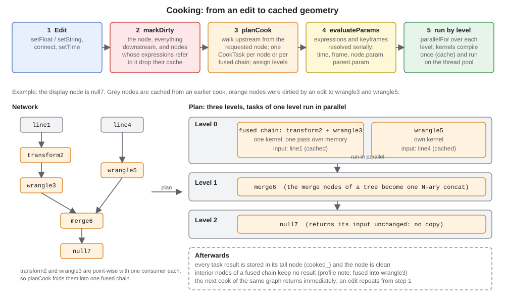
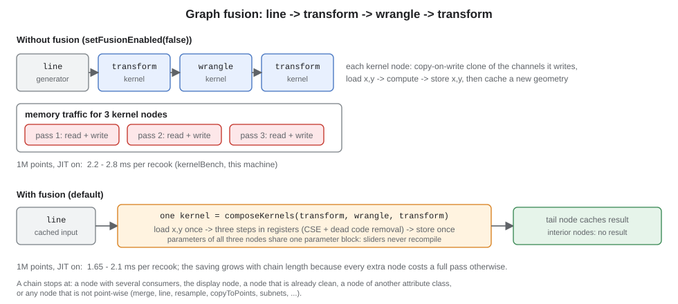
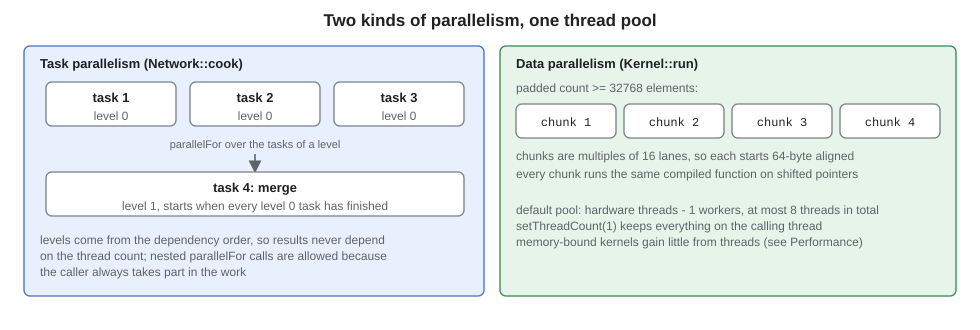
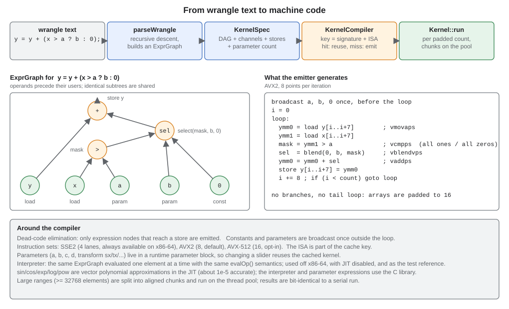
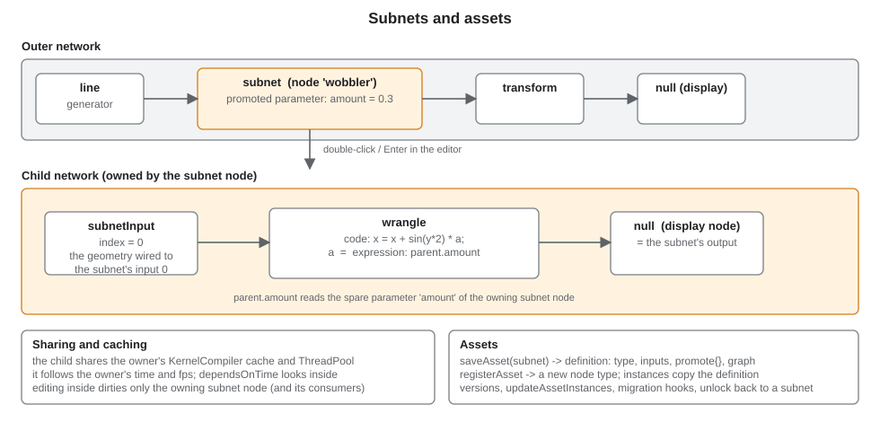

# jitnodes: code and execution architecture

This document explains how the library is put together and how a node graph is executed ("cooked"). It is
written for someone who wants to read, extend or embed the code. Two companion documents go deeper on the parts
users touch directly:

- [wrangle.md](wrangle.md): the per-point scripting language that the `wrangle` node compiles to SIMD machine code.
- [editor.md](editor.md): the desktop editor built on top of the library.

[design.md](design.md) holds the research notes and the phased plan, and [performance.md](performance.md) the
benchmark method; this document summarises both and links to them for detail.

## Contents

1. [What jitnodes is](#what-jitnodes-is)
2. [Layers and source map](#layers-and-source-map)
3. [The data: Geometry and attributes](#the-data-geometry-and-attributes)
4. [Nodes, networks and parameters](#nodes-networks-and-parameters)
5. [Executing a graph (cooking)](#executing-a-graph-cooking)
6. [Fusion and merge flattening](#fusion-and-merge-flattening)
7. [Parallelism, cancellation and time](#parallelism-cancellation-and-time)
8. [The JIT: from wrangle text to machine code](#the-jit-from-wrangle-text-to-machine-code)
9. [Subnets and assets](#subnets-and-assets)
10. [Persistence, undo and clips](#persistence-undo-and-clips)
11. [Extending the library](#extending-the-library)
12. [Performance](#performance)
13. [Tests and tools](#tests-and-tools)

## What jitnodes is

A C++20 library for procedural node graphs in the style of SideFX Houdini. A graph is a set of nodes connected by
wires; every node turns the geometry on its inputs into new geometry. Nothing runs until a result is requested, and
only nodes whose inputs or parameters changed are recomputed ("cooking"). The per-point arithmetic that dominates
real graphs is written in a small scripting language (the *wrangle*), compiled at run time to SSE2, AVX2 or AVX-512
machine code with [asmjit](https://asmjit.com), and cached by structure so that editing a slider never recompiles.

```cpp
Network net;
NodeId line = net.addNode("line");
NodeId wr   = net.addNode("wrangle");
net.node(wr).setString("code", "x = x * 2; y = y + (x > a ? b : 0);");
net.node(wr).setFloat("a", 5);
net.node(wr).setFloat("b", 100);
net.connect(line, wr);
net.setDisplayNode(wr);
GeometryHandle geo = net.cookDisplay();   // compiles one kernel, runs it over 100 points
```

## Layers and source map



Each layer only depends on the ones below it, and the core library has no UI dependency at all: the editor, the
command line tool and your own program are all front ends over the same `Network` API.

| Directory | Files | Responsibility |
|---|---|---|
| `include/jitnodes/core`, `src/core` | `alignedArray.h`, `threadPool.*`, `arena.*`, `bitCast.h` | 64-byte aligned, lane-padded arrays; a fixed thread pool with nested `parallelFor`; a scratch arena (kept, but no cook path needs it any more) |
| `geo/` | `geometry.*`, `attribute.h`, `topology.*`, `svgExport.*` | `Geometry` (points, primitives, attributes, detail values), copy-on-write `AttribArray`, resample / subdivide / copy-to-points / blast algorithms, SVG output for debugging |
| `jit/` | `expr.*`, `exprParser.*`, `fuse.*`, `kernel.*`, `vecEmitter.*`, `scalarEval.*`, `opEval.h`, `isa.h` | the expression IR (`ExprGraph`, `KernelSpec`), the wrangle parser, kernel composition for fusion, `KernelCompiler` / `Kernel` (asmjit), the SIMD emitter, and the scalar interpreter that defines the reference semantics |
| `graph/` | `node.*`, `network.*`, `builtinNodes.cpp`, `topologyNodes.cpp`, `subnet.*`, `animation.*`, `serialize.*`, `history.*` | `Node` and `NodeRegistry`, the `Network` (wiring, dirty flags, cook planner, fusion, threads, time), built-in node types, subnets and assets, keyframes, JSON5 persistence, undo/redo |
| `tools/` | `jitnodesCli.cpp` | load a graph, cook, write SVG, print the profile |
| `examples/` | `basicGraph.cpp`, `kernelBench.cpp`, `graphs/`, `assets/` | API sample, the benchmark behind [performance.md](performance.md), sample graphs and an asset |
| `editor/` | see [editor.md](editor.md) | the newui desktop editor (opt-in build) |
| `3rdparty/` | `asmjit`, `json5` | machine code generation (v1.21, snake_case API) and JSON5 parsing |

`include/jitnodes/jitnodes.h` pulls in the public headers an application needs.

## The data: Geometry and attributes



- **Classes.** Attributes belong to a class: `AttribClass::point` or `AttribClass::primitive`. There are also
  float-only *detail* values (one per geometry). Points always have `x` and `y`; any other channel (`z`, `N.x`,
  `radius`, `group.top`, ...) is just another named array, so adding a dimension needs no framework change.
- **Primitives** are ranges of points (`start`, `count`, `closed`): polylines and polygons. Indexed
  triangle meshes are not implemented yet.
- **Types.** `AttribType::float32` and `int32`. Kernels compute in float: integer channels convert on load and
  truncate toward zero on store, so integers are exact up to 2^24.
- **Vectors and groups are naming conventions.** A vector attribute is the float components `N.x`, `N.y`, ... and a
  group is an attribute named `group.<name>` where any non-zero value means "in the group". Both are therefore
  readable and writable from a wrangle with ordinary assignments.
- **Layout.** Every array is aligned to 64 bytes and zero-padded to a multiple of 16 floats, which is the widest
  register (AVX-512). Generated loops never need a tail case.
- **Copy-on-write.** Copying a `Geometry` copies the *list* of attributes; the arrays are shared until the first
  non-const access clones one. A kernel therefore clones only the channels it stores to. Cooked results are
  immutable (`GeometryHandle` is `shared_ptr<const Geometry>`), so another thread can read them while a node writes
  its own copy. `null` and clean (cached) branches just pass the handle on.

## Nodes, networks and parameters

**`Node`** (`graph/node.h`) has a type name, a user-visible name (an identifier, unique in its network), a number of
inputs, parameters, an editor position and a cached result. A node implements
`GeometryHandle cook(CookContext&, const std::vector<GeometryHandle>& inputs)`. Behaviour flags tell the planner what
it may do with the node:

| Virtual | Meaning |
|---|---|
| `isPointwise()` / `pointKernel()` | one input, topology unchanged, only rewrites point channels, and can describe its work as a `KernelSpec`: may be **fused** with neighbours |
| `isMerge()` | accepts any number of inputs: trees of merges are flattened into one concatenation |
| `hasVariableInputs()` | the network keeps exactly one free input slot after the last connected one (`merge`) |
| `childNetwork()` | container (subnet, asset instance) that owns a nested `Network` |

**`NodeRegistry`** maps type names to creators. The built-in types are `line`, `circle`, `transform`, `wrangle`,
`merge`, `attribCreate`, `null`, `resample`, `subdivide`, `flatten`, `copyToPoints`, `blast`, the point and image nodes
`generate`, `scatter`, `noise`, `warp`, `colorRamp`, `relax`, `attribBlur`, `wave`, `attractor`, `flow`, `voronoi`, `lloyd`, `particles`, `boids`, `springs`, `reactionDiffusion` and `render` (see
[fx.md](fx.md); sources in `src/graph/generateNodes.cpp`, `fxNodes.cpp`, `patternNodes.cpp` and `particleNodes.cpp`, the splat renderer in `src/geo/raster.cpp`), `subnet0` ... `subnet4`
and `subnetInput`; assets register more.

**`Network`** owns the nodes in slots (`Node` + its input ids), assigns ids, checks for cycles on `connect`, keeps the
kernel cache and thread pool, and implements cooking. One node is the *display node*, the one `cookDisplay()` cooks.
Besides the slots it keeps three indexes in step with every edit, so that no operation has to scan the whole graph:
the **consumers** of each node (one entry per wired input), the **referrers** of each node name (nodes whose expressions
mention it) and the **names** themselves. They make `markDirty`, cycle detection, the "exactly one consumer" test of
fusion and `findNode` / `uniqueName` independent of the size of the graph (`Network::indexesConsistent()` checks them
against a scan; the tests call it). Graphs of 30,000 nodes connect, edit, plan and paste in well under a second.

**Parameters** come in two kinds:

- *Float parameters* have a stored base value and may instead be driven by **one** of an expression or a keyframe
  curve. `getFloat` returns the value resolved at the latest evaluation. Expressions reuse the wrangle language and IR,
  evaluated by the scalar interpreter with the symbols `time` (seconds), `frame` (`time * fps`), `pi`, the node's own
  parameter names, `nodeName.param` for another node and `parent.param` inside a subnet. Keyframes support constant,
  linear and smoothstep segments (the mode belongs to the segment that starts at the key) and hold the first/last value
  outside their range. Expressions and keyframes are the way to animate; the language is described in
  [wrangle.md](wrangle.md#parameter-expressions).
- *String parameters* hold text (`code`, `class`, `type`, `group`, ...). They are not animatable.
- *Spare parameters* are float parameters added at run time (promoted subnet parameters). They behave like declared
  ones and are saved with the node.

## Executing a graph (cooking)



Cooking is lazy, demand driven and cached:

1. **An edit marks nodes dirty.** `setFloat`, `setString`, `setExpression`, `connect`, `disconnect`, `setTime` (for time
   dependent nodes only) and similar calls go through `Network::markDirty`, which walks *downstream* along wires and
   also to every node whose expressions reference the dirtied node by name (both through the indexes above), dropping
   their cached geometry. Moving a
   node in the editor or any other layout hint does not dirty anything.
2. **`cook(id)` plans.** `planCook` walks *upstream* from the requested node and creates one `CookTask` per dirty
   (or never cooked) node, or per fused chain, or per flattened merge tree. Clean nodes with a cached result are
   leaves. Each task gets a *level*: one more than the highest level among the tasks it depends on.
3. **Animated parameters are evaluated**, serially, for every node that will cook (including every member of a fused
   chain), so `getFloat` is a plain read afterwards and expression cycles or unknown symbols are reported with the
   offending name.
4. **Tasks run level by level.** `ThreadPool::parallelFor` runs the tasks of one level concurrently; a task either
   calls `Node::cook`, or, for a fused chain, composes the member kernels, compiles (or finds in the cache) and runs
   one kernel over a single copy of the chain's input geometry.
5. **Results are cached** in the task's tail node, which becomes clean. A second `cook` of an unchanged graph returns
   immediately.

Errors (`std::runtime_error`) propagate out of `cook` with a message that names the node: an unconnected input,
a bad expression, an unknown parameter, a missing display node. `Network::executionOrder(id)` lists the upstream
nodes in dependency order, and `profileReport()` prints per-node timings.

## Fusion and merge flattening



When `planCook` reaches a point-wise node it walks upstream while the previous node is point-wise, of the same
attribute class, dirty or uncached, has exactly one consumer and is not the display node. The members are merged by
`composeKernels` / `appendKernel` (each member is appended to the accumulated graph in place, so a chain of *k* nodes is
composed in O(*k*)): the later node's loads of a channel are *replaced by the expression the earlier node computed*, so
intermediate values stay in registers and common-subexpression and dead-code elimination apply across node
boundaries. All parameters are concatenated into one block, so changing any slider of any member still reuses the
cached machine code.

Consequences worth knowing:

- Only the chain's last node caches a result; interior nodes report `fused into <tail>` in the profile and keep
  `cookCount() == 0`. Editing the tail re-runs the whole fused kernel instead of reusing a cached prefix (cheap, but
  worth knowing when reading profiles).
- `setFusionEnabled(false)` cooks node by node; tests compare both paths for identical results. That includes int attributes: a value one fused node writes into an int attribute is truncated (toward zero, `INT_MIN` for NaN or out of range) before the next fused node reads it, exactly as if the nodes had run separately and the geometry had been stored in between.
- Fusion pays off together with the JIT. With the scalar interpreter it is about 15% *slower* (see [Performance](#performance)).
- `merge` trees: a merge that is dirty, has one consumer and is not the display node is *absorbed* into the merge
  above it, so a balanced or left-deep tree of merges costs one `Geometry::concat` (one allocation per attribute,
  the copies run on the pool).

## Parallelism, cancellation and time



- **Task parallelism:** tasks of one level run concurrently. Results never depend on the thread count.
- **Data parallelism:** `Kernel::run` splits ranges of at least 32,768 padded elements into 16-lane-aligned chunks and
  runs the same compiled function on shifted channel pointers. Output is bit-identical to a serial run.
- **Thread pool:** `parallelFor` lets the caller participate, so nested calls and a zero-worker pool both work.
  The default is hardware threads minus one workers, capped at 8 threads in total; `setThreadCount(1)` keeps
  everything on the caller.
- **Rules for node authors:** `cook` may run concurrently with other nodes' `cook`. Touch only your own state, treat
  input geometry as immutable, and use `ctx.pool` for data-parallel work.
- **Cancellation:** `Network::cancel()` (any thread) makes the cook in progress throw `CookCancelled` before it
  starts its next task. Finished nodes keep their results, unfinished ones stay dirty. Granularity is one node.
- **Time:** `setTime(t)` only dirties nodes whose parameters depend on time: keyframes, `time` / `frame` in an
  expression, or references (transitively, also through `parent.`) to such parameters. Everything else keeps its cache,
  which is why scrubbing or playing a mostly static graph is cheap. A node that reads `CookContext::time` itself (the
  `particles` simulation) says so by overriding `Node::dependsOnPlayhead()`, and is then dirtied by every `setTime`. Such a
  node may keep state between cooks (the simulation keeps its latest step) as long as the result stays a pure function of
  inputs, parameters and time.

## The JIT: from wrangle text to machine code



**Expression IR (`jit/expr.h`).** A wrangle program becomes an `ExprGraph`: a *hash-consed* DAG of `Op`s
(`constant`, `param`, `load`, arithmetic, comparisons, `select`, `sin`, `cos`, `exp`, `log`, `pow`, `floor`, `ceil`,
...). Structurally identical subexpressions are one node, which gives common-subexpression elimination for free, and
operands always precede their users. A `KernelSpec` is the DAG plus the channel names it reads and writes, their
types, the `(channel, expression)` stores and the number of runtime parameters. `KernelSpec::signature()` is its
canonical text (structure, constants, channel types **and channel names**) and the cache key. Names are part of the key because a compiled `Kernel` binds its channels by the names of the spec it was built from: two programs that differ only in the attributes they touch (`x = x * 2;` and `y = y * 2;`) therefore compile separately, while programs that differ only in the values of parameters share one kernel. The graph interns nodes through a hash index, so building even a graph of thousands of nodes (a long fused chain) is linear in its size.

The kernel cache holds at most `KernelCompiler::maxCachedKernels` (4,096) kernels, about 3-4 KB each. When it is full the
least recently used quarter is dropped; kernels a running cook still holds stay alive through their `shared_ptr`. Editing
a wrangle's code makes a new program per keystroke, so without the cap a long session would grow without bound.

**Masks.** A comparison produces a per-lane *mask* (all one bits or all zero bits), never 0.0 or 1.0. `select(mask, a, b)`
blends by mask, so `?:` compiles without branches. The parser converts non-comparison conditions into `value != 0`,
and converts a comparison that is *assigned* into 1.0 / 0.0. See [wrangle.md](wrangle.md#booleans-and-masks).

**Compilation (`jit/kernel.cpp`).** `KernelCompiler::compile(spec)` looks up `signature + "#" + isa`; on a miss it
creates a `Kernel`, and `compileJit` emits code through `asmjit::x86::Compiler`:

- only expression nodes that reach a store are emitted (dead-code elimination);
- constants and runtime parameters are broadcast once before the loop while there are at most 32 of them; a kernel fused from thousands of nodes has thousands of parameters, so beyond the limit each is broadcast from the parameter block where it is used (one load, no spill) instead of filling a stack frame of tens of kilobytes;
- the loop loads each used channel once, evaluates the DAG with every intermediate in a register, stores each written
  channel once, and advances by the lane count; arrays are padded, so there is no remainder loop;
- `VecEmitter` hides the instruction sets: SSE2 (4 lanes, always available on x86-64, uses legacy two-operand
  encodings and emulates blend / floor / ceil), AVX2 (8 lanes, the default), AVX-512 (16 lanes, opt-in with
  `setIsa`, masks built with `vcmpps` + `vpmovm2d`, select with `vpternlogd`);
- the kernel ABI is `void(float* const* channels, const float* params, const float* consts, size_t paddedCount)`.
  Channel pointers come from the geometry, `params` is the runtime parameter block;
- AVX code must set `func->frame().set_avx_enabled()`, otherwise asmjit spills ymm registers with legacy `movaps`
  and silently loses the upper 128 bits (this was a nondeterministic bug before it was fixed).
  `JITNODES_JIT_LOG=1` dumps the generated assembly to stderr;
- generated code does not probe the stack, and on Windows the stack only grows through its guard page, so a frame larger than a page can crash a thread whose stack has not grown yet. `Kernel` therefore commits 256 KB of the stack of every thread once, before the first generated function runs there.

**Interpreter.** The same `ExprGraph` evaluated one element at a time with `evalOp()` (`jit/opEval.h`), which also
backs parameter expressions. It is the reference the tests compare the JIT against, and the path taken on non-x86-64
hosts or with `setJitEnabled(false)`.

**Math.** `sin`, `cos`, `exp`, `log` and `pow` are vector polynomial approximations (Cephes single precision, the
same on all instruction sets). About 5e-6 absolute for `sin`/`cos` with |x| up to a few hundred, 1e-5 relative for
`exp`/`log`; `exp` saturates at about 2.4e38 instead of overflowing; `log(0)` is `-inf` and `log` of a negative is NaN;
`pow(a, b)` is `exp(b * log(a))` and therefore only meaningful for `a > 0`. The interpreter and parameter expressions use
the C library, so a kernel can differ from the "JIT off" result in the last digits for these functions. `floor` and `ceil` on SSE2 go through an int32 round trip and return `+0` for an input of `-0.0`, where AVX2 and AVX-512 return `-0.0`; the values compare equal, but a later `1 / x` would tell them apart.

## Subnets and assets



A `SubnetNode` owns a child `Network` and cooks it as part of its own cook. Inside, a `subnetInput` node (parameter
`index`) delivers the geometry wired to the subnet's input, and the result is the child's display node. The child
shares the owner's kernel cache and thread pool (identical kernels in different instances compile once) and follows
its time and fps. Promoted parameters are spare parameters of the subnet node, read inside as `parent.<name>`.
Editing inside a child dirties only the owning subnet node, and `Network::setPropagateToParent` is switched off
while a subnet updates its own child during a cook, so no worker thread touches the outer network.

An **asset** is a subnet saved as a reusable node type: `saveAsset` writes a definition (`format: "jitnodes-asset"`,
type name, input count, `promote` defaults, the child graph, an `assetVersion`), `registerAsset` adds it to the
`NodeRegistry`, and instances (`AssetNode`) copy the definition. Graph files embed the definitions they use, so they
are self-contained. `updateAssetInstances` rebuilds instances whose definition changed (keeping every parameter that
still exists), migration hooks can rename or rescale parameters across versions, and `unlockAssetInstance` turns an
instance back into an editable subnet. A guide to writing, using and updating assets, in code and in the editor, is [assets.md](assets.md); more
details are in [design.md](design.md#subnets-and-assets).

**Depth limits.** Planning, merge flattening and `executionOrder` are iterative, so a chain or a left-leaning merge tree of
any length cooks. What still recurses is limited so that it fails with an error instead of overflowing the stack:
subnets and assets nest at most `Network::maxSubnetDepth` (64) levels (cooking, saving, loading and undo recurse through
them), parameter expressions that refer to each other at most 400 deep, wrangle text at most 256 levels of nesting.
Beyond the counts, the recursive paths check `stackHeadroom()` (`core/stackGuard.h`) because the size of a frame differs
between release, debug and sanitizer builds.

## Persistence, undo and clips

**Graph files** (`graph/serialize.h`). `saveNetwork` writes strict JSON, `loadNetwork` accepts JSON5 (comments,
trailing commas, unquoted keys). Floats are written as the shortest text that round-trips, so save, load, save is
byte-identical. Cooked geometry is never saved. Loading is atomic (a scratch network is loaded first) and errors name
the node. A file looks like this (`examples/graphs/wobble.json`):

```json5
{
  format: "jitnodes", version: 1, fps: 24, display: 5,
  nodes: [
    { id: 1, type: "circle", name: "base", floats: { count: 24, radius: 3 }, inputs: [] },
    { id: 2, type: "subdivide", name: "smooth", floats: { iterations: 2 }, inputs: [1] },
    { id: 3, type: "wrangle", name: "wobble",
      strings: { code: "x = x + sin(y * 2 + a) * b; y = y + cos(x * 2 + a) * b;" },
      floats: { b: 0.35 },
      expressions: { a: "time * 3" },     // animated phase
      inputs: [2] },
    { id: 4, type: "transform", name: "place", floats: { sx: 1.5, sy: 1.5, tx: 4 }, inputs: [3] },
    { id: 5, type: "null", name: "out", inputs: [4] },
  ],
}
```

Per node: `id` (preserved on load, so editors can keep references), `type`, `name`, `floats`, `strings`, optional
`expressions`, `keyframes`, `spare`, `pos` (editor layout) and `inputs` (ids; `0` is an unconnected slot).

**Undo/redo** (`graph/history.h`). `History::commit(label)` records a `GraphSnapshot` (per node: its JSON text without
wiring, type, name, spare names, input ids; plus display node and fps). Unchanged nodes share their text with the
previous snapshot through `shared_ptr`, so 30 edits of a 60-node graph store about one graph plus 30 node texts.
`restoreSnapshot` diffs the live graph against the target and touches only what differs: nodes are removed, rebuilt
(type, name or spare set changed), updated in place or added, then wiring is diffed (disconnects first, so no
intermediate state can contain a cycle). Every node not touched and not downstream of a touched one keeps its cooked
result. The playhead and asset definitions are not part of the history.

**Clips** (`copyNode`, `pasteNodes`, `clipsToText`, `clipsFromText`). A copied node is its JSON text plus the *names*
of its inputs, so pasting reconnects by name and works across graphs and processes. `pasteNodes` pastes a set:
wires and `old.param` expression references between the copied nodes follow their new names, and a failure removes
the nodes already created. `clipsToText` wraps clips in a `format: "jitnodes-nodes"` document for the system clipboard.

## Extending the library

A node type is a class derived from `Node`, registered under a name. A node that edits points in plain C++:

```cpp
class OffsetXNode : public Node {
public:
    OffsetXNode() : Node("offsetX", 1) { declareFloat("amount", 1.0f); }

    GeometryHandle cook(CookContext&, const std::vector<GeometryHandle>& in) override {
        auto geo = std::make_shared<Geometry>(*in[0]);   // cheap: attributes are shared until written
        float* x = geo->x();                              // the first write clones only x
        for (size_t i = 0; i < geo->pointCount(); ++i) x[i] += getFloat("amount");
        return geo;
    }
};

NodeRegistry::instance().registerType("offsetX", [] { return std::make_unique<OffsetXNode>(); });
```

A node that can take part in **fusion** exposes its work as a `KernelSpec` and says it is point-wise. Its own `cook`
runs the same kernel when it is not fused:

```cpp
class ScaleBothNode : public Node {
public:
    ScaleBothNode() : Node("scaleBoth", 1) {
        declareFloat("s", 1.0f);
        spec_ = parseWrangle("x = x * s; y = y * s;", {"s"});   // "s" is a runtime parameter, not an attribute
    }

    bool isPointwise() const override { return true; }
    bool pointKernel(PointKernel& out) override {
        out.spec = spec_;
        out.params = {getFloat("s")};        // same order as the parameter names given to parseWrangle
        return true;
    }

    GeometryHandle cook(CookContext& ctx, const std::vector<GeometryHandle>& in) override {
        PointKernel k;
        pointKernel(k);
        auto geo = std::make_shared<Geometry>(*in[0]);
        ctx.compiler.compileFor(k.spec, *geo, AttribClass::point)->run(*geo, k.params, AttribClass::point, ctx.pool);
        return geo;
    }

private:
    KernelSpec spec_;
};
```

Both snippets are compiled and run against this library (the `scaleBoth` node fuses with a neighbouring point-wise
node). Custom nodes are saved and loaded like built-ins as long as the type is registered before the file is
loaded; a dynamically loaded plugin ABI is not implemented. Other extension points: `NodeRegistry::setAssetMigration`
for asset upgrades, `KernelCompiler::setIsa` / `setJitEnabled`, and `geometryToSvg` for debugging output.

## Performance

The numbers below come from `kernelBench` (Release, 2026-10-17) on an AMD Ryzen 9 7900X (12 cores / 24 threads,
AVX2 and AVX-512), Windows 11, MSVC `/O2`, asmjit 1.21. Reproduce with
`out/build/x64-release/kernelBench.exe`. Each cell is the median of 5 rounds; sub-millisecond JIT timings vary by up
to about 2x between runs, so treat differences under 20% as noise. "JIT off" is the scalar interpreter.

### Kernels over 4,194,304 points (ms per run)

| kernel | JIT off | native C++ | SSE2 | AVX2 | AVX-512 | best, 4 threads | best vs off | compile (AVX2) |
|---|---:|---:|---:|---:|---:|---:|---:|---:|
| arithmetic `x*s+t; y*s-x*0.5` | 65.1 | 0.81 | 0.71 | 0.56 | 0.61 | 0.34 | 116x | 0.083 ms |
| conditional `y + (x>th ? off : 0) + sqrt(abs(x))` | 93.4 | 4.09 | 1.15 | 0.69 | 0.67 | 0.42 | 139x | 0.080 ms |
| nested masks (3 levels of select) | 191.2 | - | 1.86 | 0.95 | 0.84 | 0.44 | 227x | 0.101 ms |
| `sin(x*0.01) + cos(y*0.1)` | 70.2 | - | 11.3 | 4.35 | 3.63 | 0.98 | 19x | 0.127 ms |
| `exp + log + pow` | 122.1 | - | 37.6 | 12.9 | 8.36 | 2.27 | 15x | 0.169 ms |

### Recooking a graph (ms per recook, one parameter edited each time)

`line(1M points) -> transform -> wrangle -> transform`:

| configuration | ms |
|---|---:|
| no fusion, JIT off | 40.2 |
| fusion, JIT off | 49.6 |
| no fusion, JIT on | 2.77 |
| fusion, JIT on | 2.10 |
| fusion, JIT on, 4 threads | 1.96 |

Eight branches of 1M points each (`transform -> wrangle`, fused), joined by a balanced merge tree:

| configuration | ms |
|---|---:|
| JIT off, 1 thread | 210.6 |
| JIT on, 1 thread | 22.4 |
| JIT off, 4 threads | 71.1 |
| JIT on, 4 threads | 17.4 |

### What the numbers show

- **The JIT removes the interpretation cost.** Simple kernels run 100-230x faster than the interpreter and the
  one-off compile cost (about 0.1 ms) is repaid by the first run; the three-node chain on 1M points recooks in about
  2 ms instead of 50 ms.
- **Simple kernels are memory-bound.** Arithmetic, conditional and mask kernels touch about 32 MB per run, so SSE2,
  AVX2 and AVX-512 are within a factor of two of each other. Against a plain `/O2` C++ loop the JIT is about even for
  arithmetic (for the conditional kernel the JIT is about 6x faster, but only because MSVC does not vectorise `sqrt` under `/fp:precise`).
  Read "JIT vs native" as "JIT vs an ordinary optimised build", not as a ceiling for hand-vectorised code.
- **Compute-bound kernels do scale with the instruction set.** `sin`/`cos` takes 11.3 ms on SSE2, 4.35 on AVX2 and
  3.63 on AVX-512; `exp + log + pow` 37.6 / 12.9 / 8.4 ms. AVX2 stays the default because AVX-512 only helps this kind
  of kernel and some Intel parts lower their clock under it.
- **Threads help the interpreter far more than the JIT.** The interpreter scales 2.3-3x on four threads; with the JIT a
  recook is dominated by memory traffic (cloning and merging 1M-point geometries), so four threads give about 1.3x on
  the branch network and nothing on the single chain.
- **Fusion needs the JIT.** 2.77 ms unfused versus 2.10 ms fused with the JIT; about 20% *slower* fused with the
  interpreter, because its cost is per operation and the fused graph does the same work with a bigger working set.
- **Copies were the bottleneck, and mostly are gone.** Copy-on-write attributes (a kernel only clones what it writes)
  and one N-ary concat per merge tree took the eight-branch recook from about 60 ms to about 22 ms single-threaded.
  What remains is the one unavoidable copy of 8M points.

A profile of one four-thread recook of the branch network (`Network::profileReport()`):

```
node                 type          cooks  last ms  total ms  compile  kernel  note
transform2           transform         0    0.000     0.000    0.000   0.000  fused into wrangle3
wrangle3             wrangle           1    2.423     2.423    0.005   2.410  fused chain of 2
...  (three more identical branches)
merge13              merge             0    0.000     0.000    0.000   0.000  fused into merge15
merge14              merge             0    0.000     0.000    0.000   0.000  fused into merge15
merge15              merge             1    5.049     5.049    0.000   0.000
null16               null              1    0.001     0.001    0.000   0.000
kernels compiled: 1 (0.076 ms), threads: 4
```

One kernel was compiled for all four branches (the cache is keyed by structure), and the whole merge tree is one task.

Caveats: one machine, one compiler; sizes were chosen to be measurable, not to model a workload (real graphs are
usually smaller, where planning and allocation matter more than the kernels); Debug builds, AArch64 and a thread
sanitizer run were not measured. The method and the numbers of the earlier run are in [performance.md](performance.md).

## Tests and tools

- `jitnodesTests` (86 tests in `tests/testMain.cpp`, run by `ctest`): the JIT against the interpreter on every supported
  instruction set (including vector math accuracy and edge cases), fusion on and off, parallel against serial cooking,
  expressions, keyframes and time dependence, subnets and assets (versions, migration, unlock), serialization round
  trips, undo/redo, clips, merge trees, cancellation, topology algorithms.
- `jitnodesCli graph.json [--time T] [--node NAME] [--threads N] [--isa sse2|avx2|avx512] [--svg out.svg [--points]]
  [--save out.json] [--profile] [--asset file]...` and `jitnodesCli --types`.
- `jitnodesStress`: thousands of nodes and tens of thousands of points per node, checked against an independent reference and across every configuration; see [stress-test.md](stress-test.md). `ctest` runs its quick size.
- `editorModelTests` and the newui GUI tests are described in [editor.md](editor.md#testing).

```
cmake --preset x64-release
cmake --build --preset x64-release
ctest --preset x64-release
```

On Windows run from a Visual Studio developer prompt so Ninja finds `cl.exe`. asmjit is taken from `3rdparty/asmjit`.
