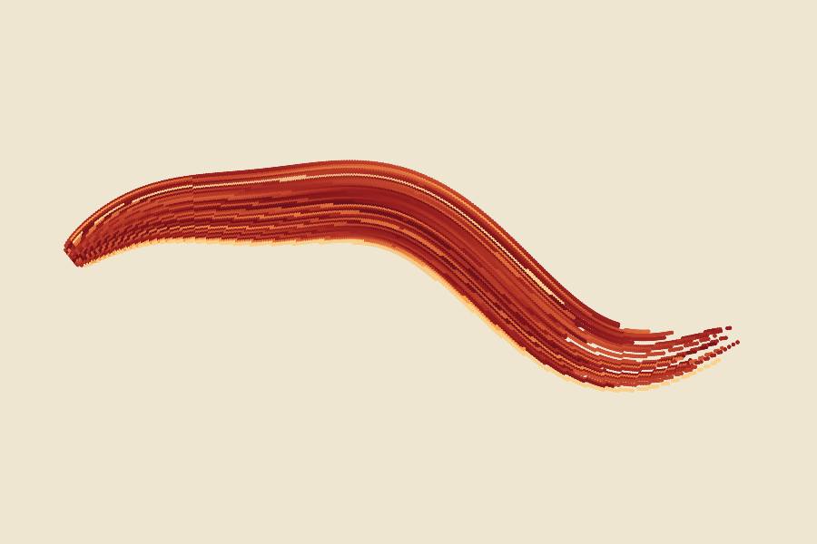
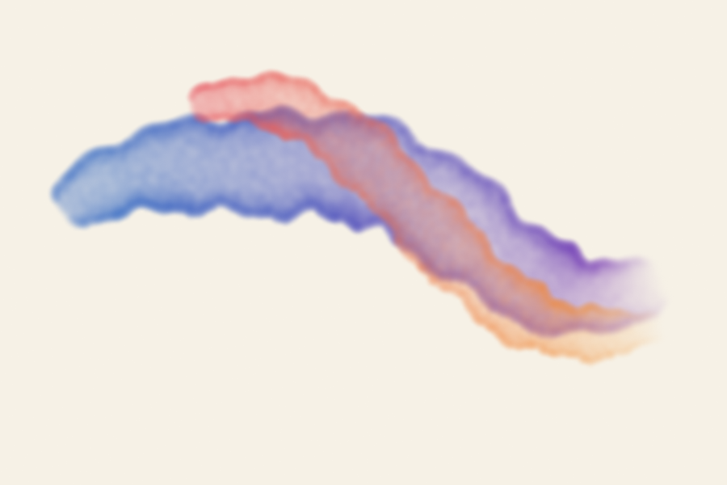
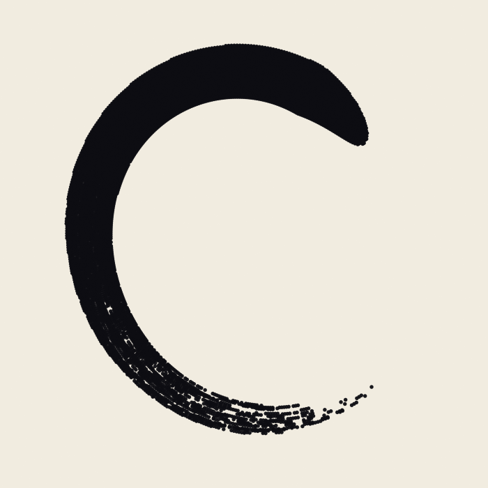
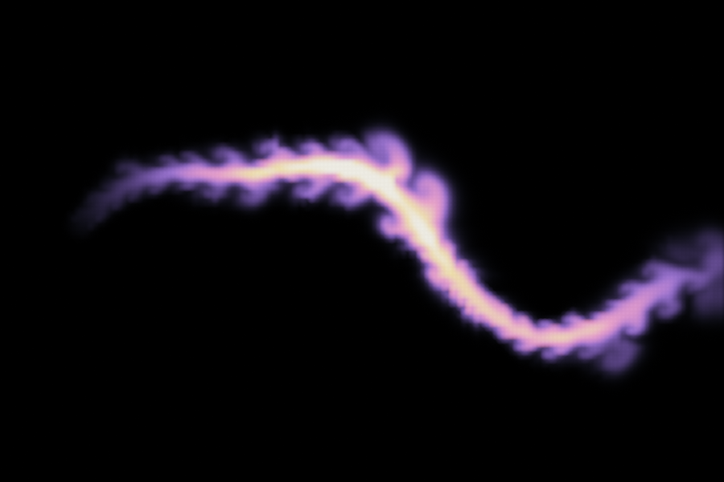
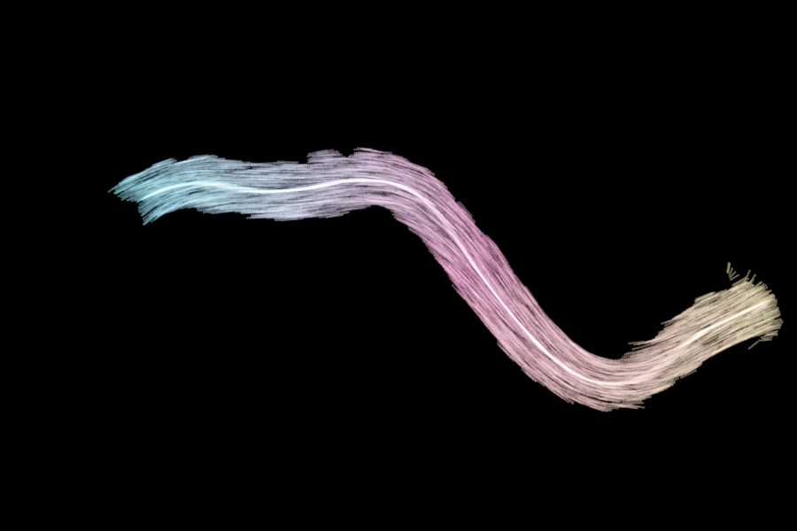
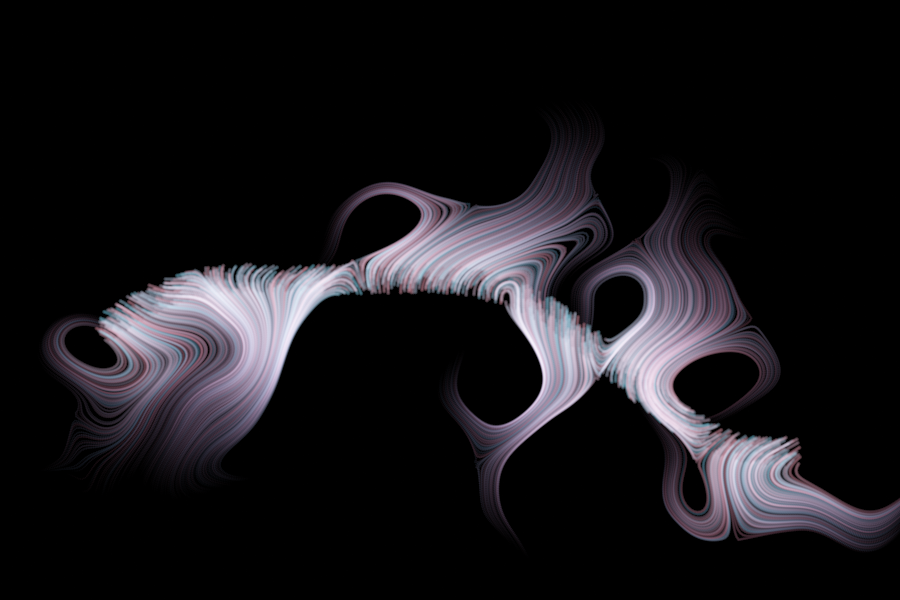
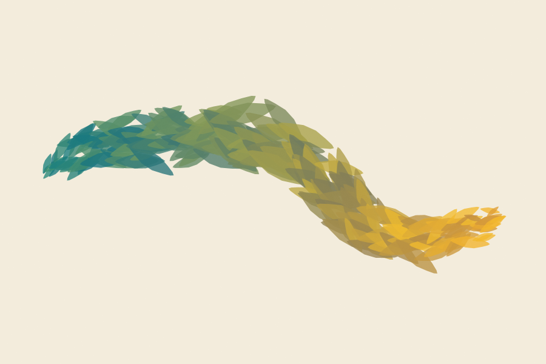

# Brush strokes along a curve

Seven example graphs in `examples/graphs/brush/`, from natural media to fluid, light and vector shapes. Each one draws a stroke that follows a guide curve;
render one with `jitnodesCli examples/graphs/brush/<name>.json --png out.png` (the simulations need the `--time` shown). The nodes are
described in [fx.md](fx.md) and [shapes.md](shapes.md), the wrangle language in [wrangle.md](wrangle.md).

## The recipe shared by the natural strokes

1. **Guide.** A `line` bent by a `wrangle` (`y = 1.7 * sin(...)`) gives the path. The same wrangle writes a point attribute `w`, the
   pressure along the stroke (a swell and a taper).
2. **Fan out.** `ribbon` with `output = rungs` and `widthAttrib = w` lays a short line across the stroke at every guide point, so the
   stroke follows the curve's normal and its width follows the pressure. A wrangle stores `along = u` (the position along the guide),
   because the next node overwrites `u`.
3. **Dots.** `curveSample` turns each rung into a row of points; now `u` runs across the stroke (0 left, 1 right) and `along` runs
   along it.
4. **Paint.** One `wrangle` sets `Cd`, `radius`, `alpha` and `softness` from those two coordinates, and `render` composites the dots in
   order (`additive: 0`) over a paper colour.

Everything after the guide is a function of (`u`, `along`), so changing the paint means editing one wrangle. Wrangle names `a`, `b`, `c`
and `d` are the node's parameters and cannot be assigned, which is why the code below uses `k`, `cr` and so on.

A bristle is a band of `u`: `k = floor(u * 34)` is the bristle number, and the idiom `h = sin(k * 12.9898 + 78.233) * 43758.5453;
h = h - floor(h)` turns it into a stable random number, so a bristle keeps one colour along the whole stroke.

## Oil paint (`brushOil.json`)

A flat brush loaded with crimson and orange. Each of 34 bristles has its own colour (`h`), the pigment drifts a little along the stroke
(`sin(along * 11 + g * 6.28)`), the edges pile up lighter (`e = abs(u - 0.5) * 2`, cubed), a few bristles carry cream highlights, and the
bristles run dry one by one towards the end: a bristle stops where `along` passes `0.68 + 0.32 * g`. Dots are fairly hard (`softness 0.3`)
and opaque, so later dots cover earlier ones like thick paint.

## Watercolour (`brushWatercolor.json`)

Two washes that cross. The dots are large (`radius 0.2`), soft and nearly transparent (`alpha` about 0.05), so hundreds of them pool.
Pigment gathers at the edge (alpha plus `0.1 * e`, `e` the fourth power of the distance from the middle), the width wobbles through `w`
like a wet edge, a hash of the position makes granulation, the colour moves from one pigment to another along the stroke, and the wash
fades out over the last sixth. Where the washes overlap the colours mix because each dot is composited over what is below.

## Ink (`brushInk.json`)

An enso. The guide is a circle written in the bend wrangle (`x = r * cos(ang)`), `w` swells quickly and thins slowly, and the ink is one
flat dark colour. Dryness grows with the square of `along`: bristles are dropped when their hash is below it, and single dots are dropped
by a position hash, which leaves the broken streaks of the tail.

## Painting with fluid (`brushGasInk.json`)

The stroke is not drawn but poured. `curveSample` puts a source point every 0.3 units along the guide; a wrangle gives each one
`vx`, `vy` from the tangent (`tx`, `ty`), a `density` that follows the pressure and a `radius`. A `gasField` takes those points as sources,
so the paint is shoved along the curve and then folds into curls under vorticity confinement (`vorticity 14`, 180 cells across,
`open 1`). The grid's `density` goes through a `colorRamp` (indigo, magenta, amber, cream) and is drawn one dot per cell. Render at
`--time 2.5`; at 0 the stroke is a smooth band, later it feathers and drifts. The sources are read when the run starts, so the whole
stroke appears at once; a brush that moves with the playhead would need injectors that move, which `gasField` does not have yet.

## Light painting (`brushLightPaint.json`)

7000 particles are scattered along the guide (`scatter`, `spread 0.7`) and fed to `particles` together with the guide as a second
input, where `follow` and `followPull` push them along and towards it within `followRadius`. The particles' own gas (`gas 1`) lets
them stir each other, which frays the band. `trail` turns each velocity into a streak (`pu`, the position along the guide, was saved
before it because `trail` overwrites `u`), and `curveSample` dots the streaks. The result looks like long-exposure bristles. The bright line in
the middle is where many particles converge on the guide; lower `followPull` or widen the seeds to remove it. Render at `--time 1.6`.

## Flow hair (`brushFlowHair.json`)

1800 seeds are scattered along the guide and each starts a `flow` trail through a curl-noise field. The stroke starts as a tight band
and fans out into curling filaments. The trail's `u` fades and thins each hair towards its tip and the seed's `rand` picks the hue, because
`flow` copies the seed attributes to every vertex of its trail. Change `scale` for broader or finer curls and `seed` for another pattern;
`phase` animates the field.

## Vector shapes along the curve (`brushLeaves.json`)

Instead of dots, this brush stamps one **polygon** many times. A `circle` of 14 points is squeezed into a pointed leaf by a wrangle and
`copyToPoints` copies it onto the points `curveSample` placed along the guide (220 of them). The shapes are real geometry: 14-point
closed primitives, 220 of them, about 3000 points in all, which cook in about 1.3 ms cold (nearly all of it compiling the four wrangles) and stay sharp at any image size.

- **Orientation.** `copyToPoints` rotates each copy by the target's `angle` (radians) and scales it by `scale`. The angle is the
  direction of the tangent (`tx`, `ty`), but the wrangle language has no `atan2`, so the example builds one: `q = z * (0.7853982 + 0.273 *
  (1 - z))` with `z = min / max` of the absolute components is atan on the first octant (error under 0.004 rad), then the octant,
  half and quadrant are fixed with `?:`.
- **Variation.** Hashes of the target position shake the position across the stroke (along the normal `nx`, `ny`), the angle and the
  size; the pressure `w` scales the leaf. Targets carry these attributes and are consumed by `copyToPoints`; they are not copied to
  the shapes. Anything the shapes need later (colour) is derived afterwards from `copyIndex`, the index of the target, which every
  copied point and primitive carries: `copyIndex / 220` is the position along the stroke, a hash of it gives per-leaf variation.
- **Drawing.** The renderer fills closed primitives when the `render` node's `fill` is 1, using the `Cd` and `alpha` of each
  primitive's first point, so the paint wrangle sets them on every point and all points of a shape agree. Shapes go over each other in
  primitive order (here: along the stroke) with the usual alpha compositing.
- **Other shapes.** Any closed outline works: petals, scales, feathers, tiles, a hand-drawn blot. To make a bristle-like brush, stamp a thin long
  sliver with a small angle jitter; for a stipple, a small hexagon. `offset`, `bevel`, `smooth` and `mirror` produce shapes too.

Limits: open primitives and strokes are not drawn (a closed shape needs its own outline polygon, for example from `ribbon`
`outline`), and there is no per-shape gradient or texture, only a flat fill. The SVG exporter still writes outlines in one colour.

## Live brushes: using the graph to paint under a pen

This section is for someone building a drawing program on the library: the user drags a pen, and a node graph turns the path into a
natural-media stroke. The examples above are the starting point; what changes when the path is still being drawn is described here.

### How it fits together

- **A brush is a graph.** The guide curve goes in at the top, the paint comes out at the bottom: `resample` and `smooth` clean the
  path, a wrangle writes the pressure `w`, `ribbon` (rungs) and `curveSample` fan it out, and a wrangle paints. Switching brushes
  means switching graphs (or loading one with `loadNetwork`), so a brush library is a folder of `.json` files, and the editor can be
  used to design them. Brush settings (size, colour, dryness) are graph parameters: put them on a wrangle's `a`..`d` or on node
  parameters and change them with `setFloat`; a change to a wrangle's `a`..`d` never recompiles it.
- **The guide is data.** Authored geometry can be stored in a node's geometry parameter (`Node::setGeometryParam`), which is saved
  with the graph and takes part in undo. The library has no source node that reads such a parameter yet, so an input node (or a
  `fileRead` of a `.jngeo`, see [geometryFiles.md](geometryFiles.md)) is the way to get the pen path in; adding a small node that
  outputs a geometry parameter is the clean route. Per-point pen data (pressure, tilt, speed, time) goes in as point attributes of
  the guide; `resample`, `smooth` and `subdivide` carry attributes along, and `ribbon` can use any of them through `widthAttrib`.
- **The stroke is a set of dots.** The examples output points with `radius`, `Cd`, `alpha`, `softness` (and optionally `aspect`,
  `shape`), the sprite contract of `renderSplats`; `render` composites them in index order, so a later dot covers an earlier one, and
  the stroke order inside the graph is the paint order. Several strokes are layered by `merge` order.
- **Dots or shapes.** Dots are stamps: a stroke is smooth at any zoom only if the dots are cooked again for that zoom (spacing and
  radius are in world units). For resolution-independent paint stamp **polygons** with `copyToPoints` and set `fill` on the `render`
  node (see `brushLeaves.json` above); the shapes are real closed primitives with per-shape colour, which the host can also draw with
  its own vector renderer. `geometryToSvg` still draws primitives in one stroke colour, so there is no coloured SVG export yet.

### Cost, and what stays cheap

Measured on a Ryzen 9 7900X (the CLI used 8 threads), release build, cold cook (`--profile`):

| Stroke | Cook |
|---|---|
| oil, ink (about 10k dots) | 1.5 ms |
| watercolour, two washes | 3 ms |
| flow hair (1800 trails of 70 steps) | 16 ms |
| gas ink, 180 x 120 cells, 2.5 s of simulation | about 400 ms |

Rasterising the dots (`renderSplats`) is not in those numbers and grows with the covered pixel area: watercolour's large soft dots
cost the most. Costs scale like this:

- **Dots = rungs x dots per rung.** Rungs come from the guide's point spacing (`resample`), dots per rung from the `curveSample`
  spacing and the stroke width. Halving either doubles the dots. Spacing should follow the dot radius (about 0.5 to 1 radius), not the
  other way round.
- **Every edit of the guide recooks everything below it,** because the whole pipeline is downstream of it. That is fine for a few
  thousand dots per cook (about 16 ms leaves room for a 60 Hz pen) but not for a long stroke. The usual answer is to **chunk the
  stroke**: freeze the finished part (a separate geometry or a second graph that is cooked once and merged in) and keep the graph
  that is cooked per pen sample to the last few centimetres, with the guide overlapping the frozen part by a rung or two. At the
  end of the stroke the chunks are `merge`d, or the dots are baked into the canvas.
- **Cancel stale cooks.** `Network::cancel()` is safe from any thread and makes the cook in progress throw `CookCancelled`
  before its next node; cook on a worker thread and cancel when a newer pen sample arrives, so the picture follows the pen instead
  of lagging behind it.
- **Point-wise chains are fused** into one kernel, and an edit near the end of a long chain keeps the part above it cooked
  ([performance.md](performance.md)); the wrangle compile (about 0.2 ms each, cached by program text) happens once per brush, so
  keep the code constant and change numbers through `a`..`d`.
- **Threads** help from a few thousand dots upward; below that run with `setThreadCount(1)` to avoid the hand-off.

### Things that go wrong while the stroke is still growing

- **Normalised coordinates move.** `ribbon` and `curveSample` give `u` from 0 to 1 over the whole curve, so anything written as a
  function of `along` (colour drift, dry-out near the end, the taper) is stretched every time the stroke gets longer, and the stroke
  seems to crawl. Use distance instead: `u * length` with the guide's length in a wrangle parameter (`a`), updated per cook, and
  define dryness as a function of distance travelled or of paint remaining, not of the fraction of the stroke. The ends of a growing
  stroke are not known, so avoid effects that need `u` near 1 while drawing (the tapering end is a pen-up effect).
- **Randomness must be keyed on something stable.** The bristle hash on `floor(u * 34)` is stable while the stroke grows (across
  position does not change). A hash of the dot's `x, y` is stable for finished dots but shimmers in the part being cooked; hash a
  quantised distance along the stroke where the grain should not move.
- **A noisy pen path makes noisy rungs.** Normals follow the polyline, so jitter in the pen samples becomes ragged edges and
  crossing rungs on tight turns. `resample` to an even spacing, then `smooth` (Taubin, so it does not shrink), before the
  `ribbon`; very tight curves with a wide brush still fold over, as an offset curve does ([shapes.md](shapes.md)).
- **Order is paint order.** Over compositing uses the dot index; a stroke drawn right to left, or a chunk merged in the wrong order,
  covers differently. Additive strokes (light, fluid) do not depend on order.
- **Over-compositing hides the paper.** `additive: 0` with low-alpha dots builds wash by repeated overlap, so changing the dot
  spacing changes the density of the wash; compensate `alpha` with the spacing (alpha proportional to spacing times radius) when
  the brush size is a user setting.
- **Determinism is useful.** A cook is a function of the graph, so an undo history can store the guide and the brush and replay
  the stroke exactly; no random numbers are used that depend on thread count.

### Fluid and simulation brushes

`gasField`, `fluid`, `particles` (with gas), `boids` and the other simulations are pure functions of time: they are stepped from their
start time and cached, and **any change to their input restarts the run**. For a brush that is still being drawn that means:

- Every new pen sample restarts the simulation, so the cost is the whole run, not the step (gas ink: about 400 ms).
- Sources that move with the playhead restart it every frame; `gasField` reads its sources once, when the run starts.
- Scrubbing is cheap (state copies every few steps, see [fx.md](fx.md)), editing is not.

Ways to use them anyway:

1. **Settle, then bake.** Let the stroke finish (pen up), cook the simulation for the time wanted, and write the result with
   `fileCache` / `saveGeometryToFile` as a `.jngeo`, or keep the dots in the canvas. A short animation is a `fileCache` with `$F` per frame.
2. **Fake the live part with a cheap stand-in.** Draw the stroke with a natural-style brush while the pen is down, and swap in the
   fluid graph at pen-up (a `switch` node with an animated `index`, or just swapping graphs).
3. **Cheap simulation, small grid.** 64 cells across with `redBlack: 1` runs a step in well under a millisecond; a stroke that is
   a few seconds long at 60 steps per second is then a few hundred milliseconds, which is a reasonable "settle" delay.
4. **A live-stepping gas (not built).** The real answer for painting with a fluid under a moving pen is a simulation that keeps its
   state, steps a few times per frame and accepts new sources as the pen moves. It needs injectors that can be added to a running
   gas, and gives up the guarantee that the same time always gives the same frame; the solver itself is fast enough.

### Checklist for a new brush

1. Guide: `resample` (even spacing), `smooth`, and a pressure attribute from the pen, not from a formula of `u`.
2. `ribbon` rungs with `widthAttrib`, a wrangle that saves `along` (use distance, not the fraction), then `curveSample` with spacing
   tied to the dot radius.
3. One paint wrangle that only depends on the cross coordinate `u`, the distance along, and stable hashes.
4. Set the dot count budget first (a few thousand per cook), then tune radius and alpha for the look.
5. Check the stroke while growing it one sample at a time: it must not crawl, shimmer or change colour behind the pen.
6. Decide where it is baked: per chunk, at pen up, or never.

## Ideas not done

- A brush that moves with the playhead (paint appearing along the curve over time) needs a way to reveal the dots by time (`time` in a
  wrangle parameter works for the natural strokes: `alpha = along < a ? ...` with `a` animated) and, for the fluid ones, moving sources;
  see "Live brushes" above for why the fluid ones cannot yet be driven live.
- Several strokes with the same paint (a hatch): `copyToPoints` with the guide, or `offset` of the guide, then the same fan-out.
- Oriented bristle marks: sprites have no rotation, so a mark that follows the stroke direction has to be built from many dots.
