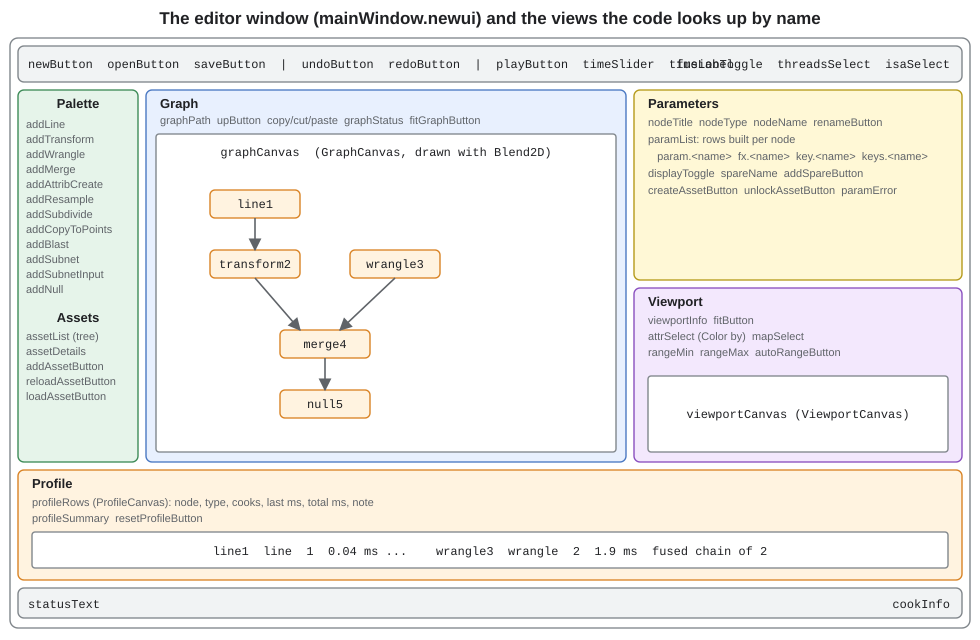
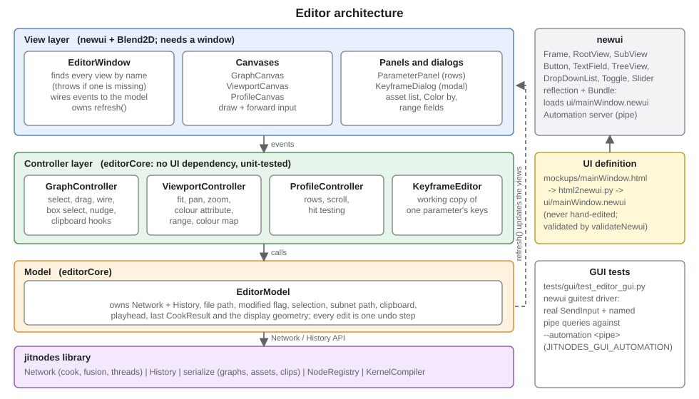
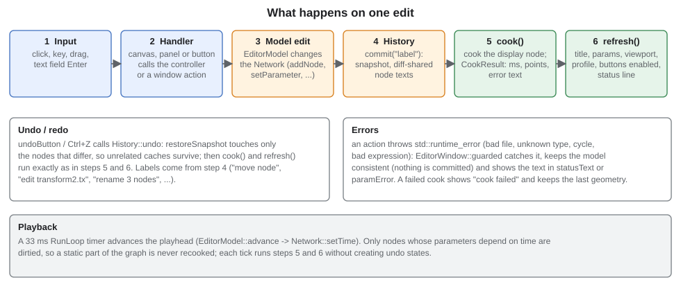

# The jitnodes editor

`jitnodesEditor` is a desktop front end for the library: a node-graph canvas, a parameter panel, a 2D viewport, a
profile list and a keyframe dialog. It is built on [newui](https://github.com/jimcrafton/newui) (Win32 windows, Blend2D
drawing, a reflection-based view tree) and lives in `editor/`. This document explains how to use it and how it is built.
[architecture.md](architecture.md) describes the engine underneath, [wrangle.md](wrangle.md) the language you type into
`wrangle` nodes, and `editor/README.md` is the exhaustive reference for every wired control.

## Contents

1. [Running it](#running-it)
2. [A tour of the window](#a-tour-of-the-window)
3. [Working with the graph](#working-with-the-graph)
4. [Parameters, expressions and keyframes](#parameters-expressions-and-keyframes)
5. [The viewport](#the-viewport)
6. [The profile list](#the-profile-list)
7. [Subnets and assets](#subnets-and-assets)
8. [How the editor is built](#how-the-editor-is-built)
9. [How one edit flows through it](#how-one-edit-flows-through-it)
10. [The UI pipeline: mockup to `.newui`](#the-ui-pipeline-mockup-to-newui)
11. [Testing](#testing)
12. [Extending the editor](#extending-the-editor)

## Running it

The editor is an opt-in target (Windows, single-config generators such as the Ninja presets) and needs a newui checkout
next to this repository (`JITNODES_NEWUI_DIR`, default `../newui`) whose reflectgen virtual environment is set up
(`tools/reflectgen/README.md`):

```
cmake --preset x64-release-editor
cmake --build --preset x64-release-editor
out\build\x64-release-editor\editor\jitnodesEditor.exe                       # an empty graph
out\build\x64-release-editor\editor\jitnodesEditor.exe examples\graphs\clouds.json
out\build\x64-release-editor\editor\jitnodesEditor.exe examples\graphs\attributes.json --attribute height
out\build\x64-release-editor\editor\jitnodesEditor.exe --check              # loads the UI, verifies every view, exits
```

newui is built in its own `ExternalProject` tree so that the asmjit embedded in Blend2D (namespace `abi_bl`) never
clashes with jitnodes' asmjit. The first build compiles Blend2D and takes a few minutes. Build output includes
`Resources/mainWindow.newui`, `Resources/keyframeDialog.newui` and an `Assets/` folder (copied from `examples/assets`),
whose `*.asset.json` files are registered at start-up.

Sample graphs in `examples/graphs/`: `clouds.json` (sprites: sky, sun, drifting clouds), `bokeh.json` (soft discs),
`rosette.json` (copyToPoints), `attributes.json` (colour by attribute), `wobble.json` (animated wrangle),
`assetDemo.json` (an asset instance) and `nebula.json` (650k additive sprites, see [fx.md](fx.md)).

## A tour of the window



- **Toolbar:** New, Open, Save (graph files are JSON5, see [architecture.md](architecture.md#persistence-undo-and-clips)),
  Undo / Redo, Play with a time slider, the **add node by name** field, and the global engine settings: fusion on/off, thread
  count, instruction set. Type a node type in the field and press Enter: an exact name (any case) adds it, so does a prefix
  or part of a name that only one type has (`groupbys`); an ambiguous or unknown text is reported in the status line with the
  candidates. It reaches every registered type, including the ones without a palette button and loaded assets.
- **Palette:** one button per common node type (58, two per row in a list that scrolls with the mouse wheel or its scroll bar;
  the Assets section stays below it). Clicking one adds a node and wires the *selected* node into its first input,
  makes it the display node and selects it, so building a chain is "click, click, click". The last twenty-one buttons
  (generate, scatter, noise, warp, colorRamp, relax, attribBlur, wave, attractor, flow, voronoi, lloyd, particles, boids, springs, reaction, lsystem, curveSample, ribbon, trail, render) are the [fx nodes](fx.md). The Assets section lists registered
  assets.
- **Graph:** the canvas. Nodes are boxes with input ports on top and an output port at the bottom; the display node
  is highlighted.
- **Parameters:** the selected node's name, type and one row per parameter.
- **Viewport:** the display node's geometry, with colouring controls.
- **Profile:** per-node cook statistics.
- **Status line:** the last error or "Ready", and the last cook time and point count.

The window title shows the file name, with `*` when there are unsaved changes.

## Working with the graph

**Building.** Palette buttons add nodes; drag from a node's output port (bottom centre) to another node or input port
(top) to connect; drag a connected input port away to detach and re-drop the wire. A connection that would create a
cycle is refused and the message shown. `merge` has an unlimited number of inputs: there is always one free slot after
the last connected one.

**Selecting.** Click selects a node; Shift- or Ctrl-click toggles; dragging on empty space draws a selection box
(with Shift/Ctrl it adds to the selection); Ctrl+A selects everything in the current network. Panning is middle- or
right-button drag, the wheel zooms around the cursor, and Fit (or opening a file) frames the whole graph.

**Moving.** Drag any selected node to move the whole selection as one undo step. The arrow keys nudge the selection by
10 units (Shift: 50), one undo step per key press. Positions are saved with the graph and follow undo.

**Display node.** Double-click a node, or tick *Display node*, to choose what the viewport shows and what `cookDisplay`
cooks. With several nodes selected the toggle applies to the last of them.

**Deleting and clipboard.** Delete removes the selection. Copy, Cut and Paste (toolbar buttons or Ctrl+C / X / V
over the canvas) carry parameters, expressions, keyframes, spare parameters and a subnet's contents. A paste gets
unique names (`wrangle1`, `wrangle3`, ...), is offset a little further for every paste of the same copy, keeps the
wires *between* the copied nodes, points expressions that referred to a copied node at its copy, and reconnects wires
from outside the set to nodes of the same names. The clipboard also goes to the **system clipboard** as JSON text
(`format: "jitnodes-nodes"`), so nodes can be pasted into another editor window or a text file; other clipboard text is
ignored. Asset definitions are not part of the text.

**Renaming.** The Name field renames the selected node (Enter or Rename; **F2** over the canvas jumps to it with the
text selected). Names are identifiers (letters, digits, underscore, not starting with a digit) and unique in the
network; expressions that refer to `oldName.param` are rewritten. With several nodes selected the field renames all of
them as one undo step: `wall` gives `wall1`, `wall2`, ... in id order.

**Undo and redo.** Every user action is one undo step with a label (`move node`, `edit transform2.tx`,
`rename 3 nodes`, `keys wrangle1.a`, `paste`, ...), shown as the button tooltip. Undo restores only what differs, so
unrelated nodes keep their cooked results and editing stays fast on big graphs.

## Parameters, expressions and keyframes

Select a node and its parameters appear: float parameters first, then text parameters (`class`, `code`, `type`,
`name`, `group`). Press Enter or leave the field to apply it.

- A **number** sets the value and removes any expression or keyframes.
- **Anything else is an expression**: `sin(time) * 2`, `frame / 24`, `line1.length * 0.5`, `parent.amount` (inside a
  subnet). A bad expression is rejected with its message and the field reverts. The expression language is the wrangle
  language, see [wrangle.md](wrangle.md#parameter-expressions).
- **`fx`** turns a value into an expression holding that value, and an expression back into its value.
- **`key`** sets a linear keyframe at the playhead holding the current value (a second press at the same time updates
  it). **`...`** opens the **keyframe dialog**.
- Colours: expression fields are orange, keyframed ones green (showing the value at the playhead).
- The multi-line **`code`** field of a wrangle commits when it loses focus.

**Keyframe dialog.** A modal window showing the curve (blue, keys as squares, the playhead as an orange line) and one
row per key: time, value, interpolation (constant, linear or smooth; it applies to the segment that starts at the key)
and a delete button. Changing a time re-sorts the keys; a time another key already uses, or text that is not a number,
is refused with a message. *Add key at playhead* adds a key on the current curve so the animation does not change. OK
replaces the keys as one undo step; with no keys left the parameter becomes a plain value.

**Playback.** Play advances the playhead on a 33 ms timer; the slider scrubs. Only nodes whose parameters depend on time
are recooked, so a static part of the graph costs nothing per frame.

## The viewport

The viewport draws the display node's geometry after every cook. Primitives are stroked as polylines (closed ones are
closed); points are dots for geometry without primitives or with at most 64 points; very large geometries are drawn
with every n-th point. Drag pans, the wheel zooms around the cursor, and Fit frames the geometry. The grid
steps by powers of ten and shows its step in the corner.

**Maximize and export.** The viewport starts as a thumbnail in the side column. **Double-click** it and it takes over the
whole main area (the node palette, the graph and the parameters are hidden; the toolbar, the profile list and the status line
stay) and is fitted to the new size. Double-click again to put everything back. **Right-click** it (a right *drag* still
pans) for a context menu with **Export...**, which asks for a file name and saves a PNG (`.png`) or a JPEG (`.jpg`,
`.jpeg`, quality 92) chosen by the extension or the file type list. What is saved:

- geometry that went through a `render` node: the full image at that node's `width` x `height` and view window, the
  same picture `jitnodesCli --png` writes, independent of how big the viewport is;
- anything else: the viewport as it looks right now (grid, lines, sprites, colour legend), at the viewport's size.

The status line shows the file name and size when the export worked, or the error.

**Sprites.** When the geometry has a point attribute `radius` and no colour attribute is chosen, each point is drawn as
an alpha-blended sprite in index order. Optional point attributes: `Cd.x`, `Cd.y`, `Cd.z` (colour 0-1, default white),
`alpha` (default 1), `softness` (0 hard disc, 1 radial gradient; default 1), `aspect` (width over height) and
`shape` (0.5 or more draws a box). Missing attributes read as 0 after a merge, so set what you need explicitly. This is
how `clouds.json` and `bokeh.json` draw pictures out of points; see the sprite examples in [wrangle.md](wrangle.md#examples).

**Images.** Geometry that went through a `render` node is drawn by the additive splat renderer instead: every point with a
`radius` adds light to a floating-point image of the viewport's size, with no limit on the number of sprites, then the
picture is tone mapped and optionally blooms (see [fx.md](fx.md)). Pan and zoom re-render it for the new view; choosing a
*Color by* attribute returns to the normal drawing, and hover labels are off in image mode.

**Colour by attribute.** The *Color by* list holds the point attributes (including `x`, `y`), the length of every vector
attribute (`N (length)`) and primitive attributes (`prim: name`). Choosing one colours lines and dots and draws a legend
with the range. The **Map** list picks the colour map (Viridis, Magma, Grayscale, Cool-warm). The **Range** fields set
the smallest and largest value by hand (empty means automatic for that end; an inverted range reverses the map) and
**Auto** clears both; the range resets when another attribute is chosen. Hovering within 14 px of a point shows its
index, position and attribute value.

## The profile list

One row per node: type, number of cooks, last and total cook time, and a note: `fused chain of N`, `fused into <node>`
or the kernel compile time; nodes inside a subnet follow it, indented. It refreshes after every cook; clicking a root
row selects that node; Reset clears the statistics. The summary line shows how many kernels were compiled and the
thread count. This is the place to see the engine's behaviour from [architecture.md](architecture.md#fusion-and-merge-flattening):
fused interior nodes show `-` for time because they were never cooked on their own.

## Subnets and assets

Double-click a subnet node (or select it and press Enter) to enter it; **Up** or Backspace leaves it and selects the
subnet again. The header shows the path (`/subnet2/inner`), and everything works as at the top level; the first node you
add becomes the subnet's output. Add `subnetInput` nodes (palette) and set their `index` to read the subnet's inputs. Select a
subnet and use **Add parameter** to promote a float parameter, which nodes inside read as `parent.<name>`.

**Create asset...** saves the selected subnet as an asset definition (`<type>.asset.json`; the part of the file name
before the first dot is the type name, the version is one more than the registered one) and replaces the subnet by an
instance with the same name, wiring and parameter values. Instances of older versions are updated (which resets the undo
history, and the status line says so). The **asset library** in the palette lists the registered assets; the line under
the list shows the selected asset's version, inputs, promoted parameters, how many instances are in the graph and its
source file. **Add asset** instantiates it, **Reload asset** reads its source file again (so edits made outside the
editor are picked up and instances rebuilt), **Load asset...** registers a definition file, and **Unlock** turns an
instance back into an ordinary, editable subnet. Asset instances cannot be entered. [assets.md](assets.md) covers the
whole workflow: what a definition contains, writing one by hand or in code, where the editor looks for them, and
updating or migrating them.

## How the editor is built



The code is deliberately split so that everything with logic is testable without a window:

| Layer | Files | Notes |
|---|---|---|
| **Model** (`editorCore`) | `editorModel.*` | `EditorModel` owns the `Network` and its `History`, the file path and modified flag, the selection, the path of subnets entered, the clipboard, the playhead and the last cook result with the display geometry. Every user action is a method here that edits the network and commits one undo step. |
| **Controllers** (`editorCore`) | `graphController.*`, `viewportController.*`, `profileController.*`, `keyframeEditor.*`, `graphLayout.*` | Interaction logic driven by plain screen-space events: hit testing, dragging, wiring, box selection, nudging, view transforms, colour ranges, row scrolling, a working copy of one parameter's keys. No UI types. |
| **Views** | `editorWindow.*`, `graphCanvas.*`, `viewportCanvas.*`, `profileCanvas.*`, `parameterPanel.*`, `keyframeDialog.*`, `drawText.h` | newui code. `EditorWindow` finds every view of the mockup by *name* (throwing with the name if one is missing or has the wrong class) and connects events to the model. The canvases are `SubView`s drawn with Blend2D that forward mouse and key events to their controller. |
| **UI definition** | `mockups/*.html`, `ui/*.newui` | see [below](#the-ui-pipeline-mockup-to-newui) |
| **Entry point** | `main.cpp` | loads the frame, builds model and window, handles `--check`, `--attribute`, `--automation <pipe>` |

Some design points:

- **One history, one root.** The model keeps a root-level `History` even while a subnet is entered; an inner edit
  changes the subnet node's text, so undo works across levels. `network()` is the network being edited and
  `rootNetwork()` the root; the canvas, panel and every edit follow without special cases.
- **Layout never counts as an edit.** `placeNewNodes` gives new nodes a position (below their first input, otherwise in
  the top row moving right) before every commit, and `Node::setPosition` never dirties a node.
- **Errors do not corrupt state.** Actions run inside `EditorWindow::guarded`: a `std::runtime_error` (bad file, unknown
  type, cycle, bad expression) is caught, nothing is committed and the message goes to the status line or the
  parameter panel.
- **Modal dialogs and the run loop.** The modal loop runs idle tasks but drops the thread message `RunLoop::post` uses, so
  dialog code defers work with `postIdle`. The same applies to the automation server (newui uses `postIdle` for every
  request so queries are answered while a dialog is open).
- **The system clipboard** is reached through `GraphController::writeClipboard` / `readClipboard` hooks, so the controller
  stays UI free; `EditorWindow` connects them to `newui::ClipboardManager`.

## How one edit flows through it



An input event reaches a canvas or panel handler, which calls a controller or model method; the model edits the
`Network` and calls `History::commit(label)`; `EditorWindow::edited()` cooks the display node (`EditorModel::cook`
records time, point count and any error) and `refresh()` updates every label, the parameter rows, the viewport, the
profile and which buttons are enabled. Undo and redo run the same last two steps after `History::undo`/`redo`.
During playback each timer tick advances the playhead and runs the cook and refresh steps without creating undo states.

## The UI pipeline: mockup to `.newui`

Screens are designed as HTML mockups, converted once to newui `.newui` documents and loaded at run time with
`newui::Bundle::loadFrame()`. The `.newui` files are generated, never hand-edited:

```
python .claude/skills/html-mockup-to-newui/scripts/html2newui.py editor/mockups/mainWindow.html -o editor/ui/mainWindow.newui --name mainWindow --title "jitnodes Editor"
python .claude/skills/newui-view-json5/scripts/validateNewui.py editor/ui/mainWindow.newui
```

Give every element the code needs an `id`: it becomes the view's `name`. The converter has no CSS engine (only flex
layout, absolute bounds and a fixed widget set), so what it cannot express is done in code: the three canvases and the
asset list (placeholder `<canvas>` elements that become `SubView`s the code fills), drop-down models, and the parameter
rows of the selected node. Open `mockups/mainWindow.html` in a browser to see the design (1280 x 800).

## Testing

| What | Where | How to run |
|---|---|---|
| Model and controllers, no window | `editor/editorModelTests.cpp` (51 tests: graph interaction, selection, clipboard, parameters, subnets, assets, keyframes, viewport, profile) | `editorModelTests.exe` (also under `ctest` when tests are enabled) |
| Wiring | `jitnodesEditor --check` loads `Resources/mainWindow.newui`, verifies that every view the code looks up exists with the right class, drives the wired buttons through their delegates, paints the canvases into images and checks pixels | `jitnodesEditor.exe --check` |
| The real window | `editor/tests/gui/test_editor_gui.py` (66 tests) | newui's `guitest` driver: it launches the editor with `--automation <pipe>`, sends **real** mouse and keyboard input with `SendInput`, and asks the app over a named pipe where named views are and what they show |

```
python editor\tests\gui\test_editor_gui.py --exe out\build\x64-release-editor\editor\jitnodesEditor.exe
```

The GUI tests need a desktop nobody is using with nothing covering the editor window (the driver waits for the machine
to be idle and aborts if outside input arrives), they overwrite the system clipboard, and they cover: palette, undo,
node selection, dragging, box select, shift-click, nudging, clipboard (including a second editor instance), rename and
F2, parameter editing, sprites and colour mapping from screenshots, the colour-by dropdown and range fields, the
profile, subnets, the asset library, and the modal keyframe dialog. `JITNODES_GUI_AUTOMATION` (default ON) links the
automation server into the editor; turn it off for a shipping build. The protocol is in newui's `automation.md`.

## Extending the editor

- **A new palette button** for a node type: add the `<button id="addFoo">` to `mockups/mainWindow.html`, regenerate
  `ui/mainWindow.newui`, and add `{"addFoo", "foo"}` to the palette table at the top of `editorWindow.cpp`
  (button name, node type; the click calls `EditorModel::addNode("foo")`). Types registered by assets appear in the asset list without any change.
- **A new parameter widget** goes into `ParameterPanel::addRow`; give views a `name` so the GUI tests can reach them
  (`param.<name>`, `fx.<name>`, `key.<name>`, `keys.<name>` are examples).
- **New interaction logic** belongs in a controller (testable without a window), with the canvas only forwarding events.
- **A new GUI test** goes into `tests/gui/test_editor_gui.py`; use named views and `app.wait_until(...)` rather than
  sleeping, and ask before running tests that take over the mouse.
