# Generating points and drawing pictures with them

Twenty-one nodes turn jitnodes into a small particle-image tool: four make points (`reactionDiffusion` makes a grid and `lsystem`
plants), sixteen shape them (noise, warp, colour, spacing, sampling curves, widening curves into ribbons, motion streaks,
smoothing, waves, strange attractors, flow lines, Voronoi cells, Lloyd relaxation, and three simulations: particles, boids,
springs), and one (`render`) says
how the points become an image. Together they draw pictures such as the nebula in
`examples/graphs/nebula.json` (about 650,000 sprites; cooking and drawing it takes about 0.35 s) and the DNA helix and
frequency wave in `examples/graphs/dnaWave.json` (see [the DNA and frequency wave graph](#the-dna-and-frequency-wave-graph)).

```
jitnodesCli examples/graphs/nebula.json --png nebula.png
jitnodesEditor examples/graphs/nebula.json
```

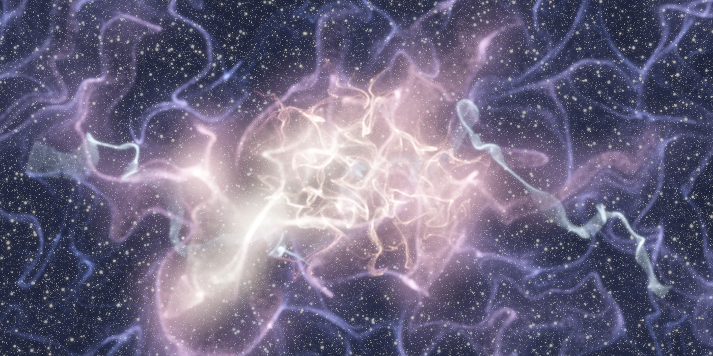

In the editor the twenty-one nodes are buttons in the palette (generate, scatter, noise, warp, colorRamp, relax,
attribBlur, wave, attractor, flow, voronoi, lloyd, particles, boids, springs, reaction, lsystem, curveSample, ribbon, trail, render): select a
node, click a button and the new node is wired to the selected one. Each example below is a small graph in
`examples/graphs/fx/`, rendered with `jitnodesCli <graph> --png <file>`; load it in the editor to change its
parameters and watch the picture change (the `render` node switches the viewport to the image view; double-click the
viewport to enlarge it).

## Contents

1. [The nodes](#the-nodes)
2. [From points to an image](#from-points-to-an-image)
3. [The nebula graph](#the-nebula-graph)
4. [The DNA and frequency wave graph](#the-dna-and-frequency-wave-graph)
5. [Writing your own look](#writing-your-own-look)
6. [Performance and limits](#performance-and-limits)

## The nodes

All of them run on the thread pool for large point counts, and the same graph always gives the same points, whatever
the thread count: random numbers are a pure function of `(seed, point index)`.

### generate (no input)

Makes `count` points in a box, an ellipse or a Gaussian blob. Up to 50 million points.

| Parameter | Default | Meaning |
|---|---|---|
| `count` | 100000 | number of points |
| `seed` | 1 | random seed |
| `shape` | `rect` | `rect`: uniform in the box. `disc`: uniform in the ellipse inscribed in the box. `gaussian`: normal distribution, the box is about three standard deviations to each side |
| `cx`, `cy` | 0 | centre |
| `width`, `height` | 20, 10 | size of the box |

Point attributes: `rand` and `rand2` (independent, uniform in 0..1) and `id` (int, the index). There are no primitives.

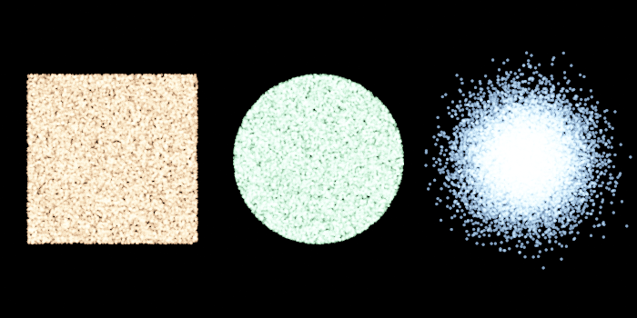

`examples/graphs/fx/fxGenerate.json`: three `generate` nodes (`shape` rect, disc, gaussian; `cx` -11, 0, 11), each
followed by a wrangle that sets `radius`, `alpha` and colour, merged into a `render`. Note that a `generate` node
makes bare points: without a `radius` and `alpha` a downstream `render` draws nothing, so something has to set them.

### scatter (one input)

Scatters points on the shapes of its input: **inside closed primitives, along open ones**.

| Parameter | Default | Meaning |
|---|---|---|
| `count` | 10000 | points for all closed primitives together, shared out by area |
| `lineCount` | 1000 | points for all open primitives together, shared out by length |
| `spread` | 0 | open primitives only: random offset sideways, up to this distance either way |
| `seed` | 1 | random seed |
| `tolerance` | 0.1 | cubic Bezier curves are flattened to this accuracy first, as in `flatten` |

Each closed primitive is a simple polygon (concave is fine, holes are not: a primitive nested inside another is not
subtracted from it). A closed shape gets `count * area / total area` points, so density is uniform across shapes. The
points are found by rejection sampling inside the primitive's bounding box; a very thin shape wastes samples and, after
256 failed attempts for one point, that point is placed on a vertex of the polygon. Degenerate primitives (fewer than
three or two points, zero area or length) are skipped.

Point attributes: `rand`, `rand2`, `srcPrim` (int, the index of the input primitive) and `u` (0..1 along an open
primitive, 0 for a closed one). Input attributes are not carried over: scatter creates new points.

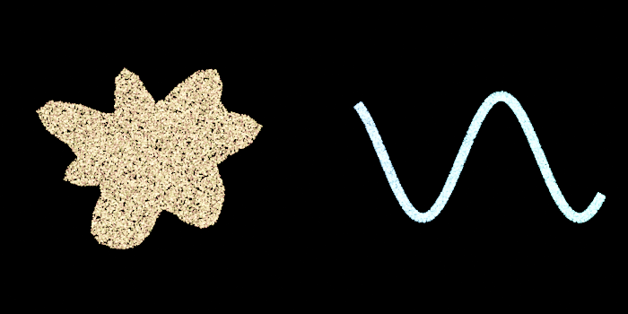

`examples/graphs/fx/fxScatter.json`: `circle` bent by a wrangle into a lumpy closed shape and filled with
`count` = 20000 (left); `line` bent into a wave and walked with `lineCount` = 12000 and `spread` = 0.25 (right, tinted
by `u`, the position along the curve). A `scatter` with both kinds of primitive in its input does both at once; set
`count` or `lineCount` to 0 to switch one off.

### curveSample (one input)

Places points along the input curves and gives each one a frame and the curve's attributes. Open curves get a point at each end;
closed ones do not repeat the first point. Unlike `scatter`, which only keeps `rand`, `u` and `srcPrim`, every point attribute of
the curve (`Cd`, `radius`, `speed`, `strain`, ...) is **interpolated** along the segment it falls on (integer attributes take the
nearer end), so a colour, a size or a simulation attribute survives and the result can be coloured, warped or rendered afterwards.
Cubic curves are flattened first (`tolerance`, as in `scatter`).

| Parameter | Default | Meaning |
|---|---|---|
| `count` | 100 | points per curve (ignored when `spacing` is above 0) |
| `spacing` | 0 | if above 0, one point every `spacing` units of length along each curve (a curve of length L gets `floor(L / spacing) + 1` points, `floor(L / spacing)` if closed) |
| `random` | 0 | 1: random positions along the curve instead of even ones (`count` per curve, from `seed`) |
| `offset` | 0 | moves each point this far along its normal (to the left of the direction of travel); negative moves it right |
| `seed`, `tolerance` | 1, 0.1 | random seed; curve flattening tolerance |

The output has points only (no primitives), with `x`, `y`, every input point attribute, and: `u` (0 to 1 along the curve), `tx`, `ty`
(unit tangent), `nx`, `ny` (unit normal, the tangent turned a quarter turn left) and `curve` (the input primitive's index). Curves
with fewer than two points or no length produce nothing. The cost is linear in the samples and the attributes (2 million samples
of a curve with 8 attributes take about 50 ms) and the result is the same on any thread count. Use it after `springs` (`output` `springs`), `lsystem`,
`flow` or any other node that makes polylines, to turn lines into points that the renderer and `colorRamp` can use.

### noise (one input)

Writes a noise field, sampled at each point's `x`, `y`, into a point attribute.

| Parameter | Default | Meaning |
|---|---|---|
| `name` | `noise` | attribute to write |
| `mode` | `fbm` | `fbm`: smooth clouds, centred on 0.5 (about 0.1..0.9). `ridged`: 0..1 with bright creases, good for filaments and veins. `turbulence`: 0..0.7, absolute value of the noise |
| `scale` | 0.1 | frequency: features are about `1 / scale` units wide |
| `offsetX`, `offsetY` | 0 | shift the field |
| `phase` | 0 | third noise dimension: animate it (`time * 0.2`) and the field evolves smoothly instead of sliding |
| `octaves` | 5 | layers of detail, 1 to 12 |
| `lacunarity`, `gain` | 2, 0.5 | frequency and amplitude factors from one octave to the next |
| `seed` | 1 | picks another field |
| `amplitude`, `bias` | 1, 0 | result is `value * amplitude + bias` |

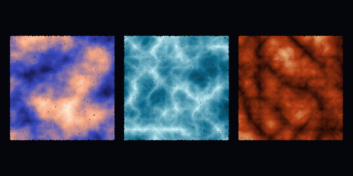

`examples/graphs/fx/fxNoise.json`: the same `scale` and `seed` in each mode (fbm, ridged, turbulence), 60,000 points on
a box each, coloured with a `colorRamp` whose `min` and `max` cover the range of that mode (fbm 0.15..0.85, ridged
0..1, turbulence 0..0.6). The noise is a function of the point's `x` and `y`, so the three boxes show different parts
of the same field; give them the same `offsetX` to see the modes on identical coordinates.

### warp (one input)

Moves the points through a noise field. Attributes (including ones computed by `noise` earlier) travel with the points,
so the pattern is carried into the new shapes.

| Parameter | Default | Meaning |
|---|---|---|
| `mode` | `noise` | `noise`: offset by two independent noise values (a domain warp, gives billowy distortion). `curl`: follow the curl of a noise potential, a flow that neither compresses nor stretches, which pulls clouds of points into swirls and wisps |
| `amount` | 1 | distance moved, in world units per unit of noise slope (`curl`) or per noise value (`noise`), over all iterations |
| `scale`, `octaves`, `lacunarity`, `gain`, `seed`, `phase` | as in `noise` | the field that moves the points |
| `iterations` | 1 | the move is split in this many steps and the field is re-sampled at each new position (and phase); more steps give longer, more curled streaks. 1 to 64 |

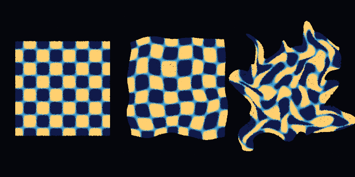

`examples/graphs/fx/fxWarp.json`: a checker pattern made by a wrangle (left, unwarped), then through `warp` in `noise`
mode (middle, `amount` 1.2: the grid wobbles but stays connected) and in `curl` mode (right, `amount` 1.5,
`iterations` 3: the pattern is dragged into swirls and tears apart, since curl flow moves points rather than
stretching a surface). Both warps read the same unwarped points, and the colour travels with each point.

### colorRamp (one input)

Maps a float attribute onto a gradient and writes `Cd.x`, `Cd.y`, `Cd.z`.

| Parameter | Default | Meaning |
|---|---|---|
| `attribute` | `noise` | point attribute to read (float or int) |
| `ramp` | `0 #000000, 1 #ffffff` | stops separated by commas, semicolons or new lines; each is a position then a colour, either `#rgb`, `#rrggbb` or three numbers 0..1 (`0.5 1 0.2 0.1`). Colours are interpolated linearly in RGB; positions outside the stops clamp to the end colours |
| `min`, `max` | 0, 1 | attribute values that map to ramp positions 0 and 1 (an inverted range reverses the ramp) |
| `gamma` | 1 | the position is raised to this power first; above 1 favours the dark end |

The ramps in the pictures above are, for example, `0 #0b0630, 0.35 #3b4cc0, 0.7 #f4a582, 1 #fff7e0` (the fbm box in
`fxNoise.json`) and `0 #101a4a, 0.5 #3aa0d8, 1 #ffd070` (the checker in `fxWarp.json`).

### relax (one input)

Pushes points that are closer than `radius` apart until they are not: even, blue-noise-like spacing instead of the clumps
and gaps of random points. Each iteration every point moves away from all its neighbours within `radius` by half the
overlap (times `strength`); all points move at once, so the result does not depend on the order or the thread count.

| Parameter | Default | Meaning |
|---|---|---|
| `radius` | 0.5 | the distance points are pushed apart to. Start a little above the average spacing, `sqrt(area / points)`; a radius far larger than that cannot be satisfied, so the points pack tight and pile up at the edges |
| `iterations` | 20 | 1 to 500 |
| `strength` | 0.4 | fraction of the overlap corrected per iteration; high values can overshoot in dense clusters, low ones just need more iterations |
| `keepInside` | 1 | 1: points stay inside the bounding box of the input. 0: they may drift out; the cloud then grows slightly |
| `seed` | 1 | only picks the direction in which two points at exactly the same place separate |

Attributes are untouched and travel with the points. Points sit on a uniform grid, so the cost is the number of points times
the number of neighbours within `radius`: 2,500 points and 60 iterations take about 20 ms.

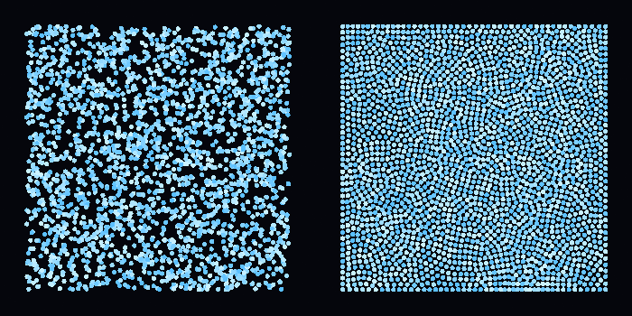

`examples/graphs/fx/fxRelax.json`: the same points (same `seed`, different `cx`) with and without `relax`
(`radius` 0.3, `iterations` 60, `strength` 0.5). The right-hand side settles into a loose hexagonal packing, which is what
the even distribution of equal discs looks like; the `scatter` node's random points are the left-hand kind.

### attribBlur (one input)

Replaces a point attribute with the average of its neighbours within `radius`, each weighted by distance, and repeats
that `iterations` times. It turns the noise of a random attribute into soft regions, and it smooths colours, `alpha`, or
any other float or int attribute (the output is always a float).

| Parameter | Default | Meaning |
|---|---|---|
| `attribute` | `rand` | the attribute to blur; several are separated by commas or spaces (`Cd.x, Cd.y, Cd.z` blurs a colour) |
| `output` | empty | where to write the result, one name per attribute. Empty: overwrite the input attributes (they must be floats); a name that already exists as an int is an error |
| `falloff` | `linear` | weight by distance: `linear` (1 at the point, 0 at `radius`), `box` (everyone counts the same), `gaussian` (`exp(-4 d^2 / r^2)`) |
| `radius` | 0.5 | neighbourhood size |
| `iterations` | 1 | 1 to 64; each pass blurs the result of the last, which behaves like a wider radius |

A point always counts itself with weight 1, so an isolated point keeps its value. The blur uses the positions of the input, so
positions are not part of it unless you name `x` or `y`. Cost is points times neighbours times iterations; `fxBlur.json` below
has about 900 neighbours per point in the last panel and takes 0.66 s for its 20,000 points: keep `radius` a few times the point
spacing, and use more iterations rather than a larger radius for a wide smooth blur.

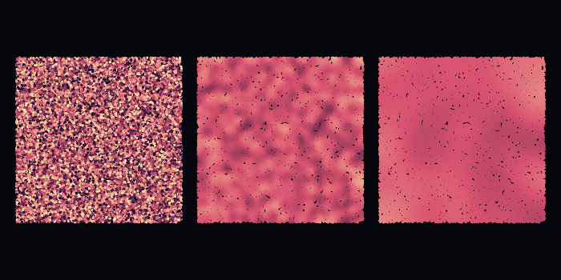

`examples/graphs/fx/fxBlur.json`: the same `rand` values drawn through one colour ramp, raw (left), after one pass with
`radius` 0.5 (middle) and after four passes with `radius` 1.2 (right). Blurring pulls every value towards 0.5, so the
panels use narrower `min`/`max` on their `colorRamp` to keep the contrast; the black specks are gaps between the points.

### wave (one input)

Writes a travelling sine wave into an attribute, and can move the points by it.

| Parameter | Default | Meaning |
|---|---|---|
| `name` | `wave` | attribute to write, in `-amplitude..amplitude` |
| `mode` | `radial` | `radial`: rings spreading from the sources. `plane`: straight fronts moving in the direction `angle` |
| `cx`, `cy` | 0 | the source (`radial`), or a point on the front where the phase is zero (`plane`) |
| `cx2`, `cy2`, `sourceCount` | 0, 0, 1 | `radial` only: with `sourceCount` above 1 the sources are spread evenly from (`cx`,`cy`) to (`cx2`,`cy2`) and their waves are averaged; 2 gives interference fringes, many gives a line source (1 to 256) |
| `angle` | 0 | `plane` only: direction of travel in degrees from +x |
| `wavelength` | 2 | distance between crests; must not be 0 |
| `phase` | 0 | radians; animate it with `time * speed` and the wave travels (crests move outwards with a positive `time` coefficient) |
| `amplitude` | 1 | the wave is `amplitude * sin(2 pi r / wavelength - phase)` |
| `falloff` | 0 | multiplies the wave by `exp(-falloff * distance)`; use it so rings fade away from their source |
| `displaceX`, `displaceY` | 0 | each point is also moved by `wave * displaceX` in x and `wave * displaceY` in y, in world units. A plane wave with `displaceX` bunches points into bands (a compression wave); `displaceY` gives a rippling sheet |

The wave is a pure function of the point's position, so there is no state and it works at any frame; `phase` is the only time
dependence.

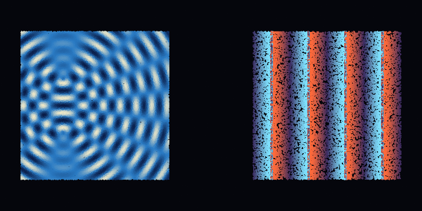

`examples/graphs/fx/fxWave.json`: left, two sources 5 units apart (`cx`..`cx2`, `sourceCount` 2, `wavelength` 1.4,
`falloff` 0.02) shown with a `colorRamp` on `wave`; right, a plane wave (`angle` 0, `wavelength` 3.5) with
`displaceX` 0.7: the displacement is as large as the wavelength allows, so the points fold into dense bands with empty gaps
between them.

### attractor (one input)

Runs every input point through a chaotic two-dimensional map a number of times and moves it to where it ends up. The input
points are the starting positions, in the map's own units (a `generate` of `width` and `height` 4 is a good seed cloud; the
orbit stays within `1 + |c|` for Clifford, 2 for de Jong and `1 + |d|` for Svensson, in both directions). With enough seeds the final positions trace the attractor, and drawn additively their density shows its
structure: filaments and sheets that are brighter where the orbit passes often.

| Parameter | Default | Meaning |
|---|---|---|
| `type` | `clifford` | `clifford`: `x' = sin(a y) + c cos(a x)`, `y' = sin(b x) + d cos(b y)`. `dejong`: `x' = sin(a y) - cos(b x)`, `y' = sin(c x) - cos(d y)`. `svensson`: `x' = d sin(a x) - sin(b y)`, `y' = c cos(a x) + cos(b y)` |
| `a`, `b`, `c`, `d` | -1.4, 1.6, 1, 0.7 | the map's constants (the defaults are a classic Clifford attractor). Small changes give very different shapes, and some sets collapse to a point or a closed loop |
| `iterations` | 30 | how many times the map is applied (1 to 10000); the first tens of steps carry the seed onto the attractor |
| `scale`, `cx`, `cy` | 3, 0, 0 | world position = (`cx`, `cy`) + map position * `scale` |

Point attributes written: `speed` (length of the last step in map units) and `dir` (direction of the last step, 0..1 around the
circle), both good for a `colorRamp`. Everything else is kept.

Parameter sets that make good pictures:

| Type | a | b | c | d |
|---|---|---|---|---|
| clifford | -1.4 | 1.6 | 1.0 | 0.7 |
| clifford | -1.7 | 1.3 | -0.1 | -1.2 |
| dejong | 1.641 | 1.902 | 0.316 | 1.525 |
| dejong | 1.4 | -2.3 | 2.4 | -2.1 |
| svensson | 1.5 | -1.8 | 1.6 | 0.9 |

The `a`..`d` fields are parameters like any other, so animating them (`sin(time) * 0.1 + 1.5`) morphs the shape smoothly.

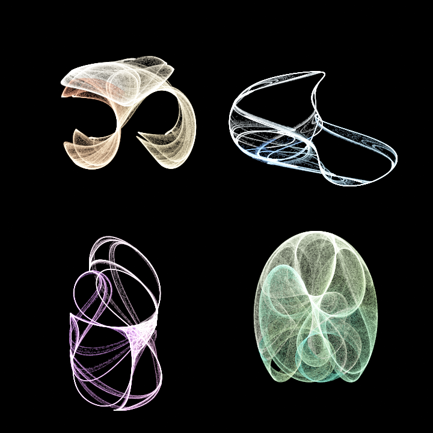

`examples/graphs/fx/fxAttractor.json`: four attractors of 400,000 seed points each (the first and second Clifford rows of the table,
the first de Jong row and the Svensson row) placed in the four quarters with `cx`/`cy`, coloured by `dir`, drawn additively with
`radius` 0.02 (under a pixel, so each point adds a faint dot) and `alpha` 0.12. The whole picture, 1.6 million points through 30
iterations, cooks in about 0.3 s.

### flow (one input)

Follows each input point through a noise-driven vector field and outputs the path as an open polyline: streamlines of a flow
field. The input points are the seeds (scatter or generate them); the output has one primitive of `steps + 1` points per seed
(`2 * steps + 1` with `bothWays`).

| Parameter | Default | Meaning |
|---|---|---|
| `mode` | `curl` | `curl`: the curl of a noise potential, a flow that never converges, so trails wind around without piling up. `angle`: the noise value is the heading (`turns` full turns across its range), the classic flow-field look, where trails run together into bright ridges |
| `steps` | 64 | steps per direction, 1 to 4096 |
| `stepLength` | 0.1 | distance moved per step; the vertex spacing, so choose a sprite `radius` of about this size or more to draw a continuous line |
| `bothWays` | 0 | 1: also trace backwards, so the seed is the middle of the trail |
| `normalize` | 1 | 1: every step has length `stepLength`. 0: the step is the field vector times `stepLength` (curl) or `strength` times it (angle), so the trail speeds up and slows down |
| `strength`, `turns` | 1, 1 | the length scale for `normalize` 0, and the number of turns the heading makes in `angle` mode |
| `scale`, `octaves`, `lacunarity`, `gain`, `seed` | as in `noise` | the field |
| `phase`, `drift` | 0, 0 | the field's third dimension. `phase` picks a frozen field (animate it and the whole pattern evolves); `drift` also advances it by that much each step, so trails are paths through a changing field |

Every point attribute of the seed is copied to all vertices of its trail, and these are added: `u` (0 at the start of the trail
to 1 at its end; colour and fade along the trail) and `trail` (int, the seed's index). Cost is seeds times steps: 6,000 seeds of 80
steps (480,000 points) take about 170 ms in curl mode and 55 ms in angle mode.

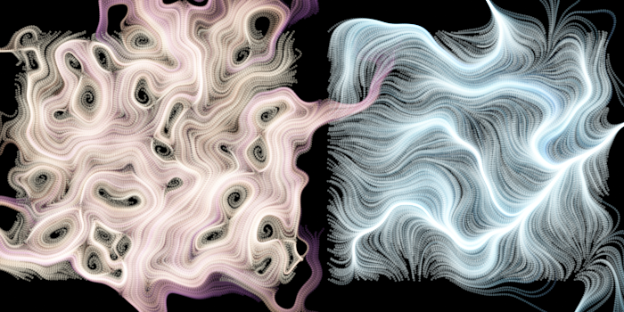

`examples/graphs/fx/fxFlow.json`: 6,000 seeds each on the two halves. Left, `curl` (`scale` 0.12, 80 steps of 0.14): the trails curl
into closed eddies around the field's maxima and minima. Right, `angle` with `turns` 1.2: trails bunch into bright ridges and
spread out again. `colorRamp` on `u` colours them and a wrangle fades `alpha` with `u`.

### voronoi (one input)

The Voronoi diagram of the input points: one polygon per point, the region of the plane closer to that point than to any other,
clipped to the bounding box of the points. Each cell is built by cutting a rectangle with the perpendicular bisectors of its
nearest neighbours (found ring by ring in a grid), so the cells are exact and cheap: 5,000 sites take 8 ms and 100,000 sites 40 ms.

| Parameter | Default | Meaning |
|---|---|---|
| `margin` | 0 | grows the clipping rectangle on every side; with 0 the cells of the outermost points end exactly at the bounding box |
| `closed` | 1 | 1: closed polygons (fill them with `scatter count`). 0: open outlines that repeat the first corner (walk them with `scatter lineCount`) |

Each cell is a primitive whose points all carry the attribute values of its site, plus `site` (int, the input point's index) and
`area` (the cell's area). Coincident sites give the same cell twice. A site whose cell is empty produces no primitive. Position
attributes are replaced by the cell corners; there is no per-site point output, so keep the input if you want the sites too.

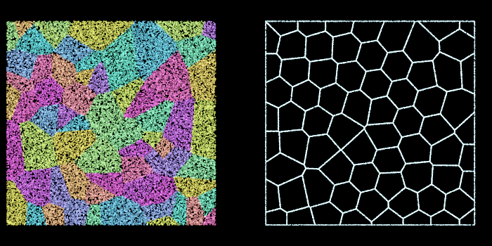

`examples/graphs/fx/fxVoronoi.json`: the same 70 random sites; left, closed cells filled by `scatter` (45,000 points) and coloured
by `srcPrim` (the cell's index) in a wrangle; right, the sites spread by `relax` first, outlines walked by `scatter lineCount`.
Cells of relaxed sites are close to hexagons; those of random sites are the usual mix of tiny and huge.

### lloyd (one input)

Lloyd relaxation: every point moves to the centroid (centre of mass) of its Voronoi cell, `iterations` times. Random points
become evenly spread ones with cells of nearly equal size. The cells are clipped to the bounding box of the input points (plus
`margin`), and that box stays fixed during the iterations, so the points spread out to fill it. Unlike `relax`, which only
pushes apart points that are closer than a radius, `lloyd` needs no radius and gives a more regular, hexagon-like pattern.
Each iteration builds the diagram as `voronoi` does: 5,000 points take roughly 8 ms per iteration.

| Parameter | Default | Meaning |
|---|---|---|
| `iterations` | 5 | number of relaxation steps (1 to 200); the pattern converges slowly, most of the change happens in the first few |
| `strength` | 1 | fraction of the way to the centroid that each point moves (0 leaves the points alone, 1 jumps to the centroid) |
| `margin` | 0 | grows the clipping box on every side |

All point attributes are kept; only `x` and `y` change. Points whose cell is empty (coincident duplicates) stay where they are.
Feed the result to `voronoi` to draw the cells.

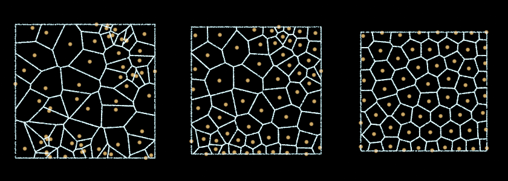

`examples/graphs/fx/fxLloyd.json`: the same 60 random sites three times, left untouched, after 2 iterations and after 30, each
with its Voronoi outlines (`voronoi` with `closed` 0, walked by `scatter lineCount`). The cells go from a mix of tiny and huge to
nearly uniform.

### particles (the particles, plus any number of guide inputs)

A particle simulation. The input points are the particles at `startTime`; the result is where they are at the playhead, after
fixed steps of force integration (semi-implicit Euler at `stepsPerSecond`). It is the one node that reads the playhead itself, so it
recooks as soon as the time changes and needs no `time` expression. Press play and it runs.

| Parameter | Default | Meaning |
|---|---|---|
| `startTime`, `stepsPerSecond`, `seed` | 0, 120, 1 | the particles stay at their start before `startTime`; steps per second (10 to 2000); seed of the random emission |
| `gravityX`, `gravityY` | 0, -2 | constant acceleration |
| `drag` | 0.1 | velocity decays by `exp(-drag * dt)` each step |
| `noiseForce`, `noiseScale`, `noiseSpeed` | 0, 0.2, 0.2 | acceleration from a curl-noise field: strength, size of the features (`scale` as in `noise`) and how fast the field evolves with time |
| `attract`, `attractX`, `attractY`, `attractSoftening` | 0, 0, 0, 0.5 | pull towards a point: `attract * d / (r^2 + softening^2)^1.5`, an inverse-square force that does not blow up at the centre |
| `swirl` | 0 | the same force turned a quarter turn: acceleration around the attractor point |
| `repel`, `repelRadius` | 0, 0.3 | particles closer than `repelRadius` push each other apart (soft collisions); the strongest push is `repel` at distance 0. This builds a grid every step, so it is the expensive force |
| `vortex`, `vortexX`, `vortexY`, `vortexRadius` | 0, 0, 0, 2 | a point vortex: acceleration around the centre (counter-clockwise for positive `vortex`) of `vortex * (1 - d / vortexRadius)^2`, zero beyond the radius. Unlike `swirl` it has a finite reach |
| `jetForce`, `jetX`, `jetY`, `jetAngle`, `jetLength`, `jetWidth` | 0, 0, 0, 90, 3, 1 | a fan: inside the rectangle that starts at (`jetX`, `jetY`), points along `jetAngle` degrees and is `jetLength` long and `jetWidth` wide, particles are accelerated along `jetAngle` by `jetForce`, fading linearly to 0 at the far end and at the sides |
| `windX`, `windY`, `windDrag` | 0, 0, 0 | drag towards the velocity (`windX`, `windY`): `windDrag * (wind - v)` per second, so a particle ends up carried at the wind speed instead of accelerating forever |
| `follow`, `followPull`, `followRadius` | 0, 0, 1 | guide curves (see below): within `followRadius` of the nearest guide segment, acceleration along the curve's direction (`follow`) and towards it (`followPull`), both weighted by `1 - distance / followRadius` |
| `collide` | 0 | 1 makes the guide curves walls: a particle whose step crosses a guide segment is reflected with `bounce` and `friction` as at the box |
| `lifetime` | 0 | seconds a particle lives (0: forever). When it ends the particle restarts from its input position and velocity. Starting ages are staggered, so the respawns are spread over the lifetime instead of all happening at once |
| `initialSpeed`, `speedVariation`, `direction`, `spread` | 0, 0, 90, 360 | emission velocity added to the particle's own: speed (with a random fraction `speedVariation` either way), heading in degrees from +x and the cone width in degrees. A particle gets a new random velocity at each respawn |
| `boundary` | `none` | `none`; `bounce` (reflect at the box with the velocity scaled by `bounce`, and `friction` slows the sliding velocity); `wrap` (leave on one side and come back on the other) |
| `boundsMinX`, `boundsMaxX`, `boundsMinY`, `boundsMaxY` | -10, 10, -6, 6 | the box for `bounce` and `wrap` |
| `bounce`, `friction` | 0.6, 0 | restitution and sliding friction at the box |

**Guide curves.** Every input after the first is a guide: the consecutive points of each of its primitives form the segments (a closed
primitive also joins its last point to its first, and a cubic primitive counts as its control polygon, so pass it through `resample` or
`curveSample` first). `follow` and `followPull` look for the nearest segment of all guides, `collide` tests every segment, so both cost
particles times segments per step; keep guides to a few hundred segments for tens of thousands of particles. Guides are read when a run
starts, and the run restarts when their content changes, not when a re-cook only makes new geometry objects; a guide that moves with the
playhead therefore restarts the run when it moves, and a moving wall needs the sampling that `boids` has (`obstacleTime`, not done here).
A particle crossing two segments in one step is reflected off the first only.

Input attributes `vx` and `vy` give each particle a starting velocity (a wrangle can set them, as in the orbit example); the
output has `vx`, `vy`, `age` (seconds since the last respawn), `life` (`age / lifetime`, 0 to 1, 0 without a lifetime) and `speed`,
and keeps every other attribute, so colour and `rand` survive.

**How the simulation relates to time.** The result is a pure function of the input, the parameters and the playhead: the same time
always gives the same points, on any number of threads, and a graph reopened tomorrow gives the same frame. The node remembers the
state of its latest cook. Playing forward only advances the new steps (cheap); changing a parameter or the input restarts from the
input and simulates up to the playhead (cost proportional to the elapsed time). It also keeps copies of the state at regular steps
(every 16 steps, then every 32, 64, ... as a run gets long: at most 64 copies and 64 MB per node; steps slower than 6 ms shorten the interval
so that replaying one interval stays near `SimulationCache::replayBudgetMs` = 100 ms; see `SimulationCache`), so
scrubbing back, or jumping forward past a stretch it has already simulated, resumes from the nearest copy and replays at most one
interval instead of the whole run. Every simulation node does this: `particles`, `boids`, `springs`, `reactionDiffusion`, `gasField`,
`fluid`, `grow` and `solver`. The step count is limited to 1,000,000 (about 2.3 hours at the default rate); a simulation that long is
better baked than cooked.

Cost per second of animation is points times `stepsPerSecond` times the work of the forces: the fountain and the orbit below
(14,000 and 12,000 particles, 6 s, 720 steps) take about 45 ms each. `noiseForce` adds about eight noise samples per particle per
step, and `repel` a grid build and neighbour search.

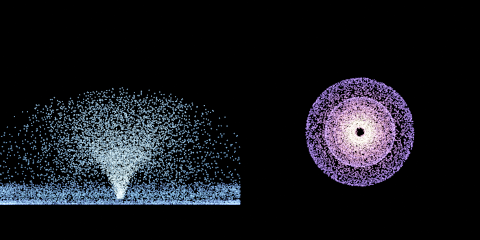

`examples/graphs/fx/fxParticles.json` rendered with `jitnodesCli ... --time 6`. Left, a fountain: a tiny gaussian `generate` as
the nozzle, `initialSpeed` 11 in a 50 degree cone, gravity -9.8, a bouncing floor and `lifetime` 4 (coloured by `life`). Right, 12,000
particles on a disc around an attractor of strength 30, each given 55% of the circular speed by a wrangle (`vx`, `vy`); by t = 6 the
disc has wound up into concentric shells, coloured by `speed`. In the editor, press play and both move.

### gasField (any number of source inputs, or none)

A 2D gas on a grid: smoke that is blown, rises, curls and fills a box. It follows Stam's *Stable Fluids*: semi-Lagrangian
advection, optional viscosity, and a pressure projection (Gauss-Seidel) that keeps the velocity divergence free, plus Fedkiw's
vorticity confinement, which puts back the swirls that advection smooths away. Hot gas rises (`buoyancy`), dense gas can sink
(`weight`). The result is the grid at the playhead, one point per cell centre with `density`, `temperature`, `vx`, `vy` and `speed`,
so `colorRamp` and `render` show it directly (set the point `radius` to the cell size, `bounds width / resolution`, for a continuous
look) and any node can read its velocities. It is stepped from `startTime` and cached like `particles`: a pure function of time on any
thread count (the solver is serial), and scrubbing back resumes from a saved copy like the other simulations.

| Parameter | Default | Meaning |
|---|---|---|
| `startTime`, `stepsPerSecond` | 0, 60 | as in `particles` (10 to 500 steps per second; at most 100,000 steps) |
| `live` | 0 | 1: changed sources (or a changed `nozzle`) no longer restart the run from `startTime`; the gas keeps its state and the new sources act on the steps taken from now on. Cost per cook is only the steps the playhead advanced, so a pen stroke can feed the gas while it plays. The result is no longer a pure function of time: no checkpoints, scrubbing back (or changing any other parameter) restarts and replays with the current sources. Nothing is injected while the playhead is paused. Measured: `brushGasInk.json` (180 by 120 cells, 1 thread) takes about 2.3 ms per step, so one step per 60 Hz frame is affordable; rendering the cell dots costs extra |
| `boundsMinX`, `boundsMaxX`, `boundsMinY`, `boundsMaxY` | -10, 10, -6, 6 | the box; cells are square, `resolution` of them across, so the grid is `resolution` by `round(height / cell)` |
| `resolution` | 64 | cells across (8 to 512). Cost per step is cells times (`iterations` * 2 + about 40) operations |
| `iterations` | 20 | Gauss-Seidel sweeps for the pressure and the viscosity. More means a more divergence free field |
| `open` | 0 | 0: closed walls, gas piles up and rolls along them. 1: gas flows out through the walls |
| `redBlack` | 0 | 1: relax the pressure and viscosity in two checkerboard passes instead of row by row. About 1.4 to 2.7 times faster per step (and a little more with threads on grids above 16,384 cells); results differ slightly from 0 and are still the same for any thread count. In `particles` it is `gasRedBlack` |
| `viscosity` | 0 | diffusion of the velocity (world units squared per second) |
| `dissipation`, `cooling` | 0.2, 0.5 | density and temperature fade by `exp(-rate * dt)` |
| `buoyancy`, `weight` | 0, 0 | acceleration up per unit temperature, and down per unit density |
| `vorticity` | 5 | confinement strength (0 turns it off) |
| `density`, `heat`, `radius` | 1, 0, 0.5 | what a source point injects per second, and its disc radius, when the point has no `density`, `heat` or `radius` attribute of its own |
| `nozzleX`, `nozzleY`, `nozzleRadius`, `nozzleDensity`, `nozzleHeat`, `nozzleSpeed`, `nozzleAngle` | 0, 0, 0.5, 0, 0, 0, 90 | a built-in injector so a gas needs no input: it adds `nozzleDensity` and `nozzleHeat` per second over a disc and blends the gas there towards a velocity of `nozzleSpeed` along `nozzleAngle` degrees. A nozzle with only a speed blows without adding smoke |

**Sources.** Every point of the inputs injects like the nozzle: density and heat per second with a smooth falloff to its `radius`, and
the point's `vx`, `vy` as the velocity to blend the gas towards. Sources are read when the run starts; a run restarts when their
content changes (not when a re-cook only makes new geometry objects). A source that moves with the playhead, or an animated nozzle
parameter, therefore restarts the run at every frame; moving injectors are not supported yet (`boids` has `obstacleTime = sampled`
for the same problem). With no input at all the node uses the nozzle.

**Gas in `particles`: blowing a gas into a particle simulation.** Set `gas` to 1 and `particles` runs its own gas, stepped together with
the particles from the same state, so the coupling is a pure function of time too. The solver parameters are the ones above with a `gas`
prefix (`gasResolution`, `gasBuoyancy`, `gasVorticity`, `gasOpen`, `gasNozzleX`, `gasNozzleSpeed`, ...; the box is the node's
`boundsMin/Max`). The coupling:
- `gasInfluence` (3 per second): each particle is accelerated towards the gas velocity at its position, `(gas - v) * gasInfluence`, which is
  how Houdini's Field Force drag and Advect by Volume behave; 0 leaves the particles alone.
- `gasEmit` (0, density per particle per second) and `gasPush` (5, per second): particles deposit smoke into the cell they are in and drag
  the gas there towards their own velocity, so a dense fountain stirs the air around it. The default push of 5 applies as soon as `gas` is
  on (particles then stir the gas even without `gasEmit`); set `gasPush` to 0 for a gas that only acts on the particles.
- The output gains `gas`, the smoke density at each particle, for colouring.
It is a separate gas from any `gasField` node (nothing is shared between nodes); give both the same parameters to draw the grid under
the particles.

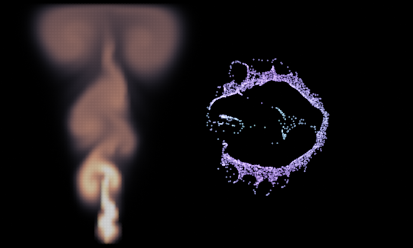

`examples/graphs/fx/fxGas.json` at t = 4: left a `gasField` with a hot nozzle at the bottom (the plume rolls up, spreads along the lid and
curls into two vortices); right `particles` with `gas` on and a nozzle firing right, which the dust is swept into a ring. Cost: the left
64 by 77 grid for 240 steps and the right 48 by 58 for 240 steps render in about half a second together. The solver is serial, so it
does not use the thread pool; big grids (256 and up) are the place to look for speed first.

Limits: the solver is first order (semi-Lagrangian advection is dissipative, vorticity confinement compensates), the grid is
collocated, so a few cells of the velocity can show a checkerboard when `iterations` is low, there are no obstacles inside the box, and
density is not strictly conserved.

### grow (one input)

Differential growth. Every polyline of the input (open or closed, at least 2 points; points outside primitives are ignored) becomes a
chain of nodes that push each other apart, stay joined to their chain neighbours and split their long segments, so a short curve buckles
into coral-like folds. Per step, from the positions at the start of the step (so the result does not depend on the thread count):
- **repel**: a node moves away from every node within `repelRadius` that is not its chain neighbour, by `repel * (1 - d / repelRadius)` per second;
- **attract**: it moves towards both chain neighbours by `attract` per second (a fraction of the distance), which keeps the chain joined;
- **smooth**: it moves towards the midpoint of its two neighbours by `smooth` per second, which straightens kinks;
- **split**: a segment longer than `maxLength` gets a new node at its midpoint (one split per segment per step, until `maxPoints`).
The total move of a node is limited to `maxSpeed` per second. Like `particles` it is stepped from `startTime` at `stepsPerSecond` (10 to
1000), cached, and a pure function of time (restarted when a parameter or the input changes or the time goes back; 100,000 steps at most).

| Parameter | Default | Meaning |
|---|---|---|
| `startTime`, `stepsPerSecond` | 0, 60 | when the growth starts and its step rate |
| `repel`, `repelRadius` | 6, 0.6 | the push between nodes that are not neighbours, and its reach. Make the radius a few times `maxLength` |
| `attract`, `smooth` | 8, 4 | the pull towards the neighbours and towards their midpoint |
| `maxSpeed` | 3 | the largest move of a node, units per second |
| `maxLength`, `maxPoints` | 0.25, 20000 | split longer segments; stop splitting at this many nodes in total |
| `useBounds`, `boundsMinX/MaxX/MinY/MaxY` | 0, -10..10, -6..6 | 1: nodes stay inside the box (they pile up along its walls) |

The output has one polyline per input chain (closed ones stay closed) with the point attributes `age` (seconds since the node was
created, 0 for the input's own nodes at the start), `u` (0 to 1 along the chain) and `chain` (int). Attributes of the input points are not
carried over (new nodes would have none to inherit). Cost grows with the point count and the number of neighbours within `repelRadius`. Growth in a box ends in a maze when every segment is at `maxLength` and nothing can move; a ring left to grow
without bounds keeps expanding.

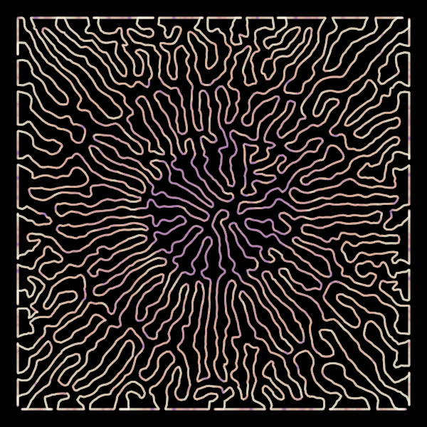

`examples/graphs/fx/fxGrow.json` at t = 2.5: a 12-node circle of radius 0.8 growing in a box of 11 by 11. `curveSample` puts dots on the
curve and `colorRamp` colours them by `age`, so the newest folds are the paler ones at the outside. At t = 12 the box is full (20,000 nodes) and
the render takes about 8 s.

### fluid (one input)

A liquid made of particles, after Macklin and Mueller-Fischer's *Position Based Fluids*. The input points are the particles (with optional float
`vx`, `vy` attributes as start velocities). Per step: gravity is applied and positions are predicted; neighbours within the kernel radius
`spacing * radiusScale` are found once (the `PointGrid` of `boids`); then `iterations` Jacobi passes solve the density constraint of every
particle (poly6 density, spiky gradient, `relaxation` is the constraint-force-mixing term) and move it; the velocity is the distance moved over
the step; finally XSPH viscosity and vorticity confinement are applied. Every sum runs in neighbour-list order and every pass reads the previous
iterate, so the result does not depend on the thread count. Like `particles` it is stepped from `startTime` at `stepsPerSecond` (10 to 1000),
cached, and a pure function of time (restarted when a parameter or the input changes or the time goes back; 100,000 steps and 1,000,000
particles at most).

| Parameter | Default | Meaning |
|---|---|---|
| `startTime`, `stepsPerSecond` | 0, 120 | when the simulation starts and its step rate |
| `spacing`, `radiusScale` | 0.1, 2.2 | the particle spacing that is the rest density (a square lattice of this spacing is at rest), and the kernel radius in spacings (at least 1.2) |
| `gravityX`, `gravityY` | 0, -9.8 | acceleration |
| `iterations`, `relaxation` | 4, 100 | solver passes per step (more is less compressible and slower); a larger `relaxation` is softer and more stable |
| `tension` | 0 | 0 to 1: how strongly an under-dense particle is pulled back in. 0 gives no cohesion (spray flies apart), small values give surface tension |
| `viscosity` | 0.01 | XSPH velocity smoothing, 0 to 1 |
| `vorticity` | 0 | vorticity confinement, keeps small swirls alive (small values, around 0.1 to 1) |
| `maxSpeed` | 30 | velocity limit, units per second |
| `boundsMinX/MaxX/MinY/MaxY` | -5..5, -3..3 | the box; its walls are inelastic (particles are clamped and lose the normal velocity) |

The output has the point attributes `vx`, `vy`, `speed` and `density` (1 at rest density); attributes of the input points are not carried over.
The displacement of one particle in one iteration is limited to a tenth of the spacing, so a clump of overlapping particles (a random
`generate` as the start) is pushed apart over a few steps instead of exploding. Start from a lattice (rows of `line` merged) for a block that
begins exactly at rest. Cost is about particles times neighbours (about 15 within the radius) times `iterations`; no obstacles or emitters yet.
The palette is full, so there is no button: type `fluid` in the editor's add-by-name field.

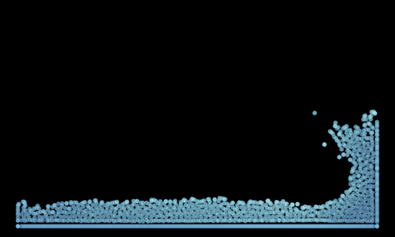

`examples/graphs/fx/fxFluid.json` at t = 2.5: a dam break, 1100 random points in a 3 by 4 column at the left of a 10 by 6 box, coloured by speed.

### colonize (attractor points, root points)

Space colonization (Runions et al.): branches grow from the root points towards the attractors. Input 0 holds the attractors, input 1 the
roots. Each iteration every attractor pulls on its nearest node within `influence`; a node with pulls grows a new node `segment` away along
the mean direction of its pulls; an attractor that a node comes within `killDistance` of is used up. It is not time dependent: it runs until
nothing can grow or a limit is hit, and the result is deterministic.

| Parameter | Default | Meaning |
|---|---|---|
| `influence` | 2 | how far an attractor reaches; a root further than this from every attractor never grows, so make it larger than the gap |
| `killDistance` | 0.3 | an attractor closer than this to a node is removed (must be smaller than `influence`); larger gives a sparser tree |
| `segment` | 0.15 | length of every new branch piece |
| `maxIterations`, `maxNodes` | 500, 200000 | limits |

The output has one polyline per branch: a branch ends at a fork and the branches after it start at the fork's point (so fork points appear
once per branch). Point attributes: `depth` (nodes from the root), `size` (nodes in the sub-tree, for widths by the pipe model, e.g. `ribbon`
with `widthAttrib`) and `branch`. Roots with several children and single-point roots produce no polyline of their own. There is no tropism or
gravity bias. Cost per iteration is attractors plus nodes, with a grid rebuild; 1200 attractors take a few milliseconds in total.

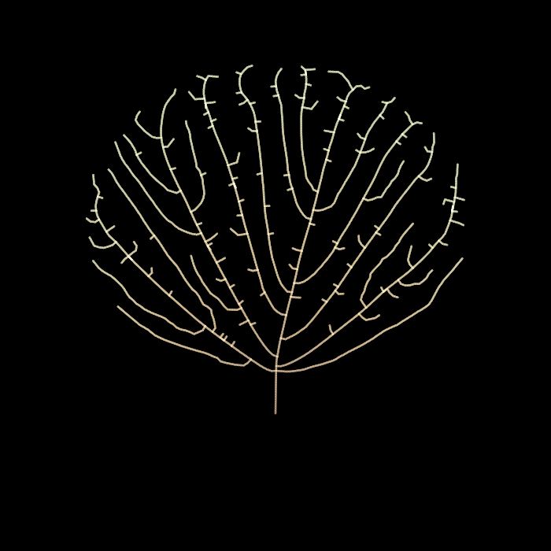

`examples/graphs/fx/fxColonize.json`: one root below a disc-shaped crown of scattered attractors; the veins fan out like a leaf.

### streamlines (seed points, optionally a field grid)

Curves that follow a vector field, ending where they should: each point of the first input is a seed, traced forwards and/or backwards
with a midpoint integrator, one polyline per accepted seed. It differs from `flow`, which always takes a fixed number of steps from every
seed and copies the seed's attributes: `streamlines` stops at the bounds, where the field vanishes and where a line comes too close to
another, drops seeds that would crowd, reads a gas grid, and outputs variable-length lines, but runs serially and keeps no seed attributes.

The field is one of:
- `curl` (default): the curl of an fbm noise potential, which never converges, so lines swirl around its extrema;
- `angle`: the noise value is the heading (`turns` full turns across its range), Tyler Hobbs's flow field;
- **a grid in the second input**: a regular grid of points, row by row from bottom to top and left to right inside a row, with float
  `vx` and `vy` attributes, sampled bilinearly. The output of `gasField` is exactly that, so the velocity of the smoke can be drawn as lines
  (`field` and the noise parameters are then ignored). A line ends when it leaves the grid. The inputs are variable: the seeds are the
  first connected input and the field the next one.

| Parameter | Default | Meaning |
|---|---|---|
| `field` | `curl` | `curl` or `angle`, when there is no field grid |
| `scale`, `octaves`, `lacunarity`, `gain`, `seed`, `phase` | 0.1, 3, 2, 0.5, 1, 0 | the noise field, as in `noise` |
| `turns` | 1 | `angle` only: turns of the heading across the noise range (0 gives straight lines along +x) |
| `direction` | `both` | `forward`, `backward` or `both` (the seed is the middle of the line) |
| `stepSize`, `maxSteps` | 0.05, 400 | the length of a step (also the point spacing) and the steps per direction (1 to 100,000) |
| `separation` | 0 | the spacing (Jobard and Lefer's evenly spaced streamlines): a seed closer than this to a point of an earlier line is dropped; 0 switches spacing off. Seeds are tried in input order, so earlier ones win |
| `endRatio` | 0.5 | a line ends when its next point would be closer than `separation * endRatio` to another line (the line's own recent points do not count, so a line may turn sharply) |
| `minSpeed` | 0 | a line ends where the field is weaker than this |
| `minLength` | 0 | lines shorter than this are discarded (their points free the space again) |
| `useBounds`, `boundsMinX/MaxX/MinY/MaxY` | 0, -10..10, -6..6 | 1: lines end at the box and seeds outside it are dropped |

The output has `u` (0 to 1 along the line), `speed` (the field strength; for `curl` and `angle` the raw vector length before normalising),
`line` (int, the line's index) and `seed` (int, the index of its seed point). A closed orbit runs for `maxSteps` unless `separation` is on, which can end it
when it comes back to an older part of itself. More than 50 million output points is an error.

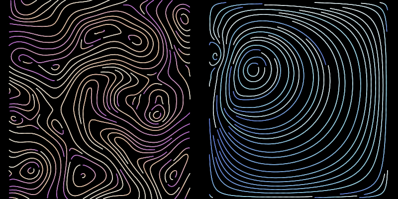

`examples/graphs/fx/fxStreamlines.json`: left a curl field, 6,000 random seeds with `separation` 0.3 reduced to evenly
spaced lines; right the velocity of a `gasField` with a rightward jet in a closed box at t = 2 (one large vortex, as it should be: nothing
escapes), seeded the same way and read through the second input. Both take about 0.2 s.

### boids (a flock input and any number of obstacle inputs)

A flock. Every input point is a boid that steers by Reynolds' three rules, looking only at the boids within `radius`: **separation**
(move away from those closer than `separationRadius`), **alignment** (match their heading) and **cohesion** (move towards their
centre). A boid's speed always stays between `minSpeed` and `maxSpeed`. It is simulated like `particles`: fixed steps, the state of
the latest cook is cached, and the result is a pure function of input, parameters and playhead (every boid reads the previous step's
state, so the thread count does not matter).

| Parameter | Default | Meaning |
|---|---|---|
| `startTime`, `stepsPerSecond`, `seed` | 0, 60, 1 | as in `particles` (10 to 1000 steps per second); the seed picks the initial headings |
| `radius` | 1 | how far a boid sees; must be greater than 0 |
| `separationRadius` | 0.4 | boids closer than this repel each other (push is stronger the closer they are) |
| `separation`, `alignment`, `cohesion` | 1.5, 1, 1 | weight of each rule; 0 switches a rule off |
| `minSpeed`, `maxSpeed`, `maxForce` | 1, 3, 6 | speed limits and the strongest steering acceleration of a single rule |
| `goal`, `goalX`, `goalY` | 0, 0, 0 | weight of a steering force towards a point (0: none) |
| `avoid`, `avoidDistance`, `obstacleRadius` | 3, 1, 0.5 | steering away from obstacles (see below): weight, how far outside an obstacle's edge it starts, and the radius of obstacles that have no `radius` attribute |
| `wander`, `wanderScale`, `wanderSpeed` | 0, 0.2, 0.2 | a curl-noise acceleration that keeps the flock from settling: strength, feature size and evolution speed |
| `boundary` | `wrap` | `wrap` (leave one side, return on the other), `bounce` (reflect at the box) or `none` |
| `obstacleTime` | `start` | `start`: obstacles as the inputs hold them now; `sampled`: cook the obstacle chain at each step's time (see below) |
| `boundsMinX`, `boundsMaxX`, `boundsMinY`, `boundsMaxY` | -10, 10, -6, 6 | the box for `wrap` and `bounce` |

Input attributes `vx` and `vy` give the initial velocities; without them every boid starts at a random heading with the mean of
`minSpeed` and `maxSpeed`. The output has `vx`, `vy`, `speed`, `angle` (heading in radians, -pi to pi: colour by it with
`colorRamp`) and `neighbors` (how many boids it sees), and keeps every other attribute. Cost is boids times the boids within
`radius`, per step: the two flocks below (900 boids, 14 s, 840 steps) take 290 ms for the clustered flock and 150 ms for the sparse one.

**Obstacles.** The first input is the flock. Every further input (a new empty one appears whenever you connect one, as on `merge`)
is a set of obstacles: each of its points is a circle centred on the point, with the radius of its `radius` attribute, or
`obstacleRadius` if the point has none. A boid within `avoidDistance` of a circle's edge steers away from it, more strongly the
closer it is (`avoid` is the weight), and a boid that ends a step inside a circle is moved to its surface and loses the velocity
into it, so nothing ever sits inside a rock. Because `render` also draws a point with its `radius`, the same points can be merged
into the picture as discs, as in the example.

**Moving obstacles.** An obstacle point with `vx` / `vy` attributes drifts at that constant velocity: it sits at its input position
at `startTime` and is at `position + velocity * (time - startTime)` after that. A boid pushed by a moving rock also takes the
rock's velocity into account (it loses only the velocity *relative* to the rock that points into it). The positions follow the
simulation's own clock, so a moving obstacle does not restart the simulation and the result is still a pure function of time. Only
straight-line motion is supported this way.

**Obstacles animated by the playhead (`obstacleTime`).** An obstacle input that depends on time upstream (a keyframed or
`time`-driven `transform`, another simulation) is read as it is *now* with the default `obstacleTime = start`: the simulation
runs with that one snapshot of the obstacles, and restarts whenever the snapshot (positions, radii, velocities) differs from the
one it started with. That is the right picture at each time but not a pure function of time: jumping to a frame gives a
different result from playing up to it. With `obstacleTime = sampled` the node keeps a private copy of the graph and cooks the
obstacle chain at the time of every simulation step (`startTime + step / stepsPerSecond`), so the flock meets the rock where it
really was, and jumping, scrubbing back and playing all give the same picture. The obstacle velocity for the push-away comes from
the movement between consecutive steps (the `vx` / `vy` attributes when the point count changes). Costs and limits:
- the obstacle chain is cooked once per step in the private copy (on top of its normal cook), so keep it light;
- the copy is rebuilt, and the flock restarts, when anything upstream of an obstacle input changes (compared by the saved text of
  those nodes; nodes outside the chain that its expressions refer to are not tracked);
- obstacles that come from a subnet input cannot be sampled (an error says so), because the copy has no outer inputs;
- `vx` / `vy` drift is not applied in this mode: the positions at each step are the truth.

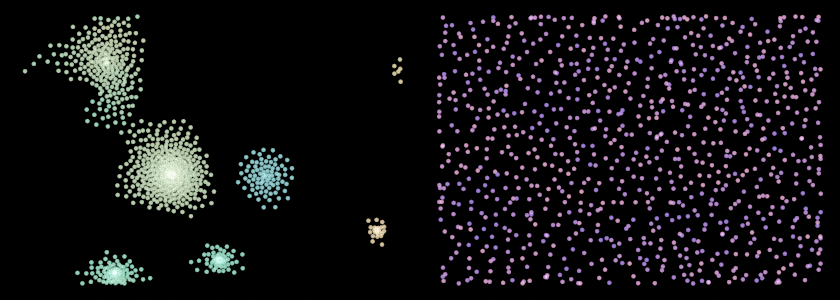

`examples/graphs/fx/fxBoids.json` at `--time 14`. Left, `alignment` 3 and `cohesion` 1.2 gather the boids into several swarms
that circle together (colour is the heading, so a swarm shows the whole colour wheel while it turns). Right, `alignment` and
`cohesion` 0 and `separation` 2.5 keep the boids evenly spread with random headings, like a gas.

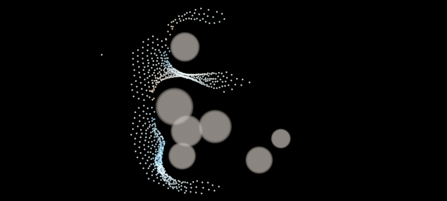

`examples/graphs/fx/fxBoidsRocks.json` at `--time 4.8`: 900 boids start on the left and are pulled towards a goal far to the right
(`goal` 1.5). Seven rocks (a `generate` plus a wrangle that sets `radius` from `rand`) are the second input of `boids` (`avoid` 6,
`avoidDistance` 1.2) and are merged into the picture as soft discs. The front of the flock has split in two round the cluster of
rocks and streams through the gaps. Colour is the heading.

### springs (one input)

Ropes, chains, cloth and soft bodies. The points of every input primitive are joined to the next point by a spring whose rest
length is the initial distance (closed primitives also join the last point to the first). With `neighborRadius` greater than 0
every pair of points that start closer than that is joined too, which turns any point cloud into a soft mesh. The solver is
position-based dynamics: Verlet integration, then `iterations` passes that move each pair of points towards its rest length, so it
stays stable however stiff the springs are and never explodes. Cached and stepped like `particles`, and a pure function of time.

| Parameter | Default | Meaning |
|---|---|---|
| `startTime`, `stepsPerSecond` | 0, 120 | as in `particles` (10 to 2000 steps per second) |
| `gravityX`, `gravityY` | 0, -4 | constant acceleration |
| `damping` | 0.2 | velocity decays by `exp(-damping * dt)` each step |
| `stiffness`, `iterations` | 1, 8 | `stiffness` is the fraction (0 to 1) of a spring's error removed per pass; more `iterations` (1 to 100) make the whole body stiffer and cost proportionally more |
| `restScale` | 1 | rest length as a fraction of the initial length (below 1 the springs are tense, above 1 the body sags) |
| `neighborRadius` | 0 | also join points that start closer than this (limit: 20 million springs) |
| `pinEnds` | 0 | 1: the first point of every open primitive stays where it is |
| `output` | `points` | `points`: the input geometry with moved points. `springs`: one two-point line per spring (see below) |
| `windForce`, `windScale`, `windSpeed` | 0, 0.2, 0.3 | a curl-noise acceleration (flutter): strength, feature size and evolution speed |
| `useBounds`, `boundsMinX`, `boundsMaxX`, `boundsMinY`, `boundsMaxY` | 0, -10, 10, -6, 6 | 1 keeps the points inside the box (a floor and walls) |

Points whose `pin` attribute is not 0 never move (a wrangle can set it, for example `pin = y > 3;` for the top edge of a cloth).
Input attributes `vx` and `vy` give the initial velocities. The output keeps the input geometry, so open primitives still draw as
lines, and has `vx`, `vy`, `speed` and `strain` (the average of the relative stretch `(length - rest) / rest` of the springs at a
point: positive stretched, negative squeezed).

With `output` set to `springs` the node returns the springs as geometry instead: one open two-point line per spring (so a mesh made
with `neighborRadius` can be drawn, which the points output cannot show), 2 points per spring, each end carrying all the attributes
of the point it belongs to, and `strain` replaced by the spring's own relative stretch (the same on both ends) plus `spring` (the
spring's index). The same simulation runs either way, so you can switch between the two. Put `curveSample` after it to turn the
lines into points that keep `strain`, `speed` and the rest; `scatter` would drop them.

Springs are solved in order on one thread, so the cost is springs times `iterations` times steps, about 10 ns per spring per pass:
3,000 points joined to their neighbours within 0.5 (45,000 springs) at 8 iterations cost 0.48 s per animated second. Scrubbing
backwards replays from the nearest saved copy, at most 16 steps at first; a body with tens of thousands of springs still costs that
much per replayed step and is better baked when it is cooked over and over.

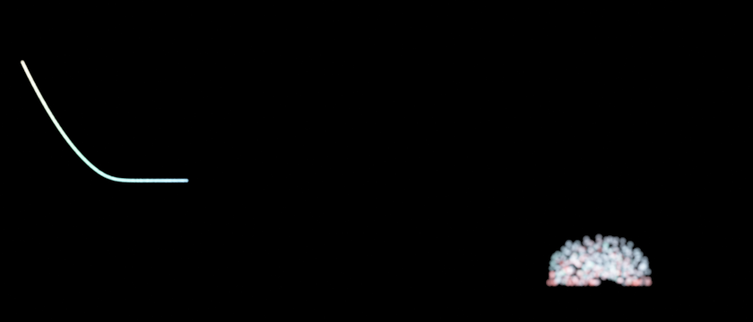

`examples/graphs/fx/fxSprings.json` at `--time 1.1`. Left, an 80-point `line` pinned at one end with `pinEnds`, released horizontal
under gravity -9, then `curveSample` (spacing 0.025) so the points keep `speed`, which colours it. Right, a disc of 160 random
points joined with `neighborRadius` 1 (1,032 springs) and `stiffness` 0.35, falling at gravity -24 onto a floor at y = -6
(`useBounds`), just after impact. Its `output` is `springs`, `curveSample` (spacing 0.1) puts points along every spring and a
`colorRamp` on `strain` colours them (red squeezed, green stretched).

### reactionDiffusion (no input)

The Gray-Scott reaction-diffusion model on a grid. Two chemicals diffuse and react: `u` is fed in at rate `feed`, and the catalyst
`v` consumes it (`u + 2v -> 3v`) and is removed at rate `feed + kill`. Depending on `feed` and `kill` the grid grows spots, stripes,
mazes, coral or solitons, the patterns of animal skins. The node makes a grid of `width` x `height` points with the attributes `u` and
`v` (both 0 to 1); colour them with `colorRamp` on `v` and give them a `radius` slightly larger than `cellSize`. It starts with `u` = 1
everywhere and `seedCount` squares of catalyst, then runs `stepsPerSecond` explicit steps per second of playhead time. It is cached
and stepped like `particles` and a pure function of time, on any thread count.

| Parameter | Default | Meaning |
|---|---|---|
| `startTime`, `stepsPerSecond` | 0, 400 | before `startTime` the grid is the initial state; steps per second (1 to 20,000) |
| `width`, `height` | 160, 90 | grid size in cells (8 to 2048, at most 4 million cells) |
| `cellSize`, `cx`, `cy` | 0.1, 0, 0 | distance between points and the centre of the grid in the plane |
| `feed`, `kill` | 0.055, 0.062 | the two rates that choose the pattern (see below) |
| `diffuseU`, `diffuseV` | 1, 0.5 | diffusion rates in cells per step; keep `diffuseV` below `diffuseU` or nothing forms |
| `stepSize` | 1 | time step; it is capped at `1.2 / max(diffuseU, diffuseV)` to keep the scheme stable |
| `periodic` | 1 | 1: the grid wraps around (it tiles); 0: the edges reflect |
| `seed`, `seedCount`, `seedSize` | 1, 12, 3 | random catalyst squares to start from: how many and their half-size in cells |

`feed` / `kill` pairs worth trying (after Pearson's classification of the model): 0.055 / 0.062 coral (the default); 0.029 / 0.057
mazes; 0.078 / 0.061 worms; 0.030 / 0.062 solitons; 0.037 / 0.065 spots that divide like cells ("mitosis"). Small changes make a
different pattern or none at all, so change them in steps of 0.001. Patterns take thousands of steps to form: with the default 400
steps per second, 10 s of playhead time is 4,000 steps. Raise `stepsPerSecond` to see the pattern sooner.

The output points are a regular grid in row order (the first row has the lowest `y`), and `u` and `v` are the only attributes, so the
result can be fed to `scatter`, `warp` or `render` like any other points. Cost is cells times steps: 12,100 cells and 12,000 steps (the
example) take about 480 ms, and a 512 x 512 grid costs about 35 ms per 100 steps (0.35 ms per step, including the output points). The step count is limited to 2,000,000.

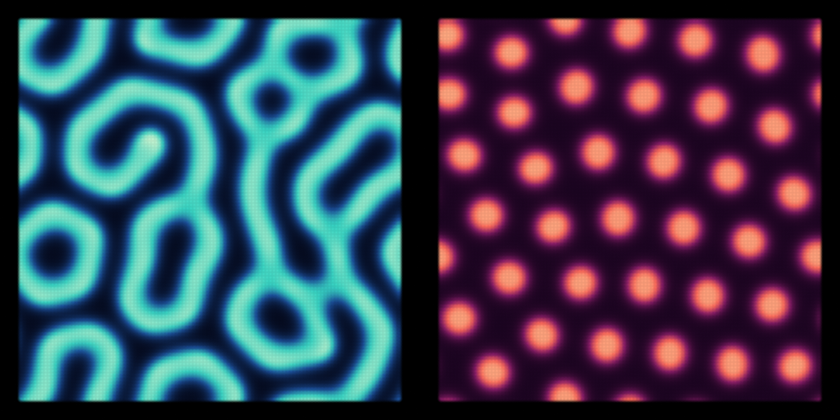

`examples/graphs/fx/fxReaction.json` at `--time 30` (12,000 steps of two 110 x 110 grids), the same seed and the same chemistry
except `feed` and `kill`. Left, 0.055 / 0.062 grows branching coral; right, 0.037 / 0.065 gives evenly spaced spots.

### lsystem (no input)

A Lindenmayer system: start from the `axiom` string, rewrite it `iterations` times with the `rules`, then draw the result with a
turtle that starts at (`startX`, `startY`) facing `startAngle` degrees from +x (90: up). Plants, trees, snowflakes and the
Sierpinski triangle all come from a few short rules.

| Symbol | Meaning |
|---|---|
| `F`, `G` | move forward `length` and draw a line |
| `f` | move forward without drawing (starts a new stroke) |
| `+`, `-` | turn left, turn right by `angle` degrees |
| `\|` | turn around (180 degrees) |
| `[`, `]` | save the turtle and start a branch, restore the turtle (the branch ends) |
| anything else (`X`, `A`, ...) | does nothing when drawing; it exists to be rewritten by the rules |

| Parameter | Default | Meaning |
|---|---|---|
| `axiom` | `X` | the start string; spaces are ignored |
| `rules` | `X=F[+X][-X]FX; F=FF` | rewrite rules `S=replacement`, separated by `;` or line breaks. `S` is one character. Several rules for the same `S` make the rewriting stochastic: one is picked at random for every occurrence, from `seed` |
| `iterations` | 5 | rewriting steps (0 to 30); the string is limited to 50 million symbols and the drawing to 20 million points |
| `angle`, `length` | 25, 0.1 | turn angle in degrees and the length of an `F` step |
| `branchScale` | 1 | every `[` multiplies the step length of that branch by this: 0.8 makes each generation of branches shorter |
| `angleJitter`, `lengthJitter` | 0, 0 | random variation of every turn (plus or minus this many degrees) and of every step (plus or minus this fraction), from `seed` |
| `seed` | 1 | seed of the random rule choice and the jitter |
| `startX`, `startY`, `startAngle` | 0, 0, 90 | where the turtle starts and which way it faces |

The output is one open polyline per stroke, that is per run of `F` between a `[`, `]` or `f` (a branch starts a new line at the
branch point, and the trunk continues in a new line after it). Every point has `depth` (the bracket depth, 0 for the trunk, an
integer attribute), `stroke` (the stroke's index) and `u` (0 to 1 in drawing order, so it grows with the plant). Run
`curveSample` on it to get points that keep these and colour them with `colorRamp` on `depth` or `u`. It is deterministic: the same
axiom, rules and seed always give the same drawing. The three plants below take 0.15 ms each to rewrite and draw (about 2,400,
540 and 2,200 points); the string grows by the size of the rules per iteration, so 8 iterations of a rule that doubles it is 256
times the work of none.

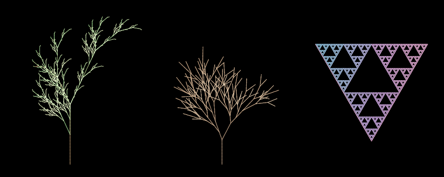

`examples/graphs/fx/fxLsystem.json`. Left: `X=F+[[X]-X]-F[-FX]+X; F=FF` at 25 degrees, 5 iterations, a fern-like plant coloured by
`depth`. Middle: three alternative rules for `X` at 24 degrees with `angleJitter` 9, `lengthJitter` 0.25 and `branchScale` 0.82, so
every branch is shorter than its parent and no two look alike. Right: `F=F-G+F+G-F; G=GG` at 120 degrees, the Sierpinski
triangle, coloured along its stroke by `u`. Each is sampled with `curveSample` and `spacing` 0.04 to 0.05.

### ribbon (one input)

Gives curves a width. Every input curve (polylines; cubics are flattened first, `tolerance` as in `scatter`) is offset to its left and
right by half the width at each point, and the offsets become new lines: a closed **outline**, two **edges**, or a line across the
curve at every point (**rungs**). Corners are mitred, up to twice the half width, so sharp turns do not pinch or spike.

| Parameter | Default | Meaning |
|---|---|---|
| `width`, `widthEnd` | 0.1, 0.1 | full width at the start and at the end of each curve; it changes linearly in between (by arc length) |
| `taper` | 0 | 0 to 0.5: pinch both ends of an open curve to a point over this fraction of its length (smooth); closed curves are not tapered |
| `widthAttrib` | empty | name of a point attribute that multiplies the width at each point (the node throws if the input has no such attribute) |
| `output` | `outline` | `outline`: one closed polyline per open curve (left side forward, right side back); two closed rings per closed curve. `edges`: two lines per curve, open for an open curve. `rungs`: one two-point line per curve point |
| `tolerance` | 0.1 | curve flattening tolerance |

Every output point keeps the attributes of the curve point it came from, with three added: `side` (1 on the left of the direction of
travel, -1 on the right), `u` (0 to 1 along the curve) and `width` (the width used at that point). The output has no filled area
(the geometry has no polygons), so to see a ribbon in the renderer, run `curveSample` on the outline as in the example. Cost is
linear in the points and the attributes.

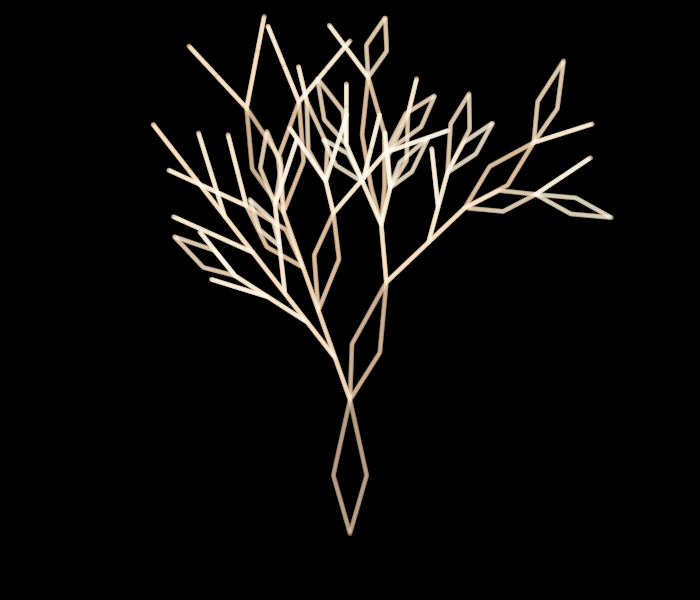

`examples/graphs/fx/fxRibbon.json`: an `lsystem` tree whose strokes get `w = 1 - depth * 0.13` from a `wrangle`; `ribbon` uses it
as `widthAttrib` (thinner towards the tips) with `width` 0.6 and `taper` 0.5, so every stroke becomes a thin leaf-shaped outline.

### trail (one input)

A motion streak behind every point: a polyline of `segments` segments starting at the point and running back along its velocity
(`vx`, `vy`) for `length` seconds. It is an extrapolation of the *current* velocity, a straight line, not a record of where the point
has been (that would need the input at earlier times, which a node cannot ask for). It is exact for points that move in a straight
line, such as `particles` without forces or `boids` over a short `length`, and it is a pure function of the input. The node throws if
the input has neither `vx` nor `vy`.

| Parameter | Default | Meaning |
|---|---|---|
| `length` | 0.3 | how many seconds of velocity the streak covers |
| `segments` | 8 | segments per streak (1 to 1000); each streak has `segments + 1` points |
| `fade` | 1 | 0 to 1: `alpha` is multiplied by `1 - fade * u` along the streak, so the tail disappears at 1 (an input without `alpha` is taken as 1) |
| `maxLength` | 0 | if above 0, longer streaks are shortened to this length in world units |

Every streak point keeps the attributes of its point (position aside), plus `u` (0 at the head, which sits on the point, to 1 at the
tail) and `trail` (the index of the point it belongs to). The output has one open polyline per input point. Put `curveSample` after
it to turn the lines into evenly spaced points that keep `Cd` and the faded `alpha`.

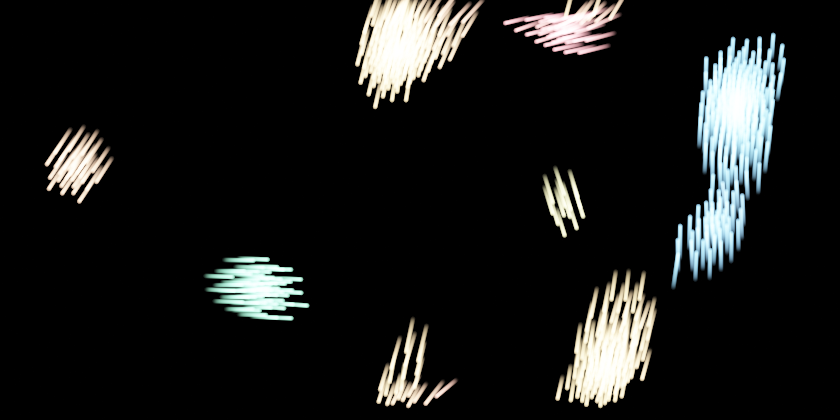

`examples/graphs/fx/fxTrails.json` at `--time 9`: the clustering flock of the boids example, coloured by heading, with `trail`
(`length` 0.45, 6 segments) and `curveSample` (`spacing` 0.04).

### render (one input)

Passes the geometry through unchanged and records how to draw it, as detail values named `render.*`. The editor's
viewport and `jitnodesCli --png` draw geometry that carries them with the splat renderer; anything else is drawn as
before (lines, dots, plain sprites). Choosing a *Color by* attribute in the editor switches back to the normal view.

| Parameter | Default | Meaning |
|---|---|---|
| `additive` | 1 | 1: light adds up (stars, glows, nebulae). 0: sprites are composited in index order over the background, like the plain viewport sprites |
| `fill` | 0 | 1: every closed primitive (at least 3 points; cubic curves are flattened) is also drawn as a filled, anti-aliased polygon (8 sub-rows per pixel row, exact horizontal coverage, nonzero winding), in the colour `Cd` and `alpha` of its first point. Shapes are drawn in primitive order before the sprites, with the same additive or over compositing. Open primitives are not drawn. See `brushLeaves.json` in [brushStrokes.md](brushStrokes.md) |
| `exposure` | 1 | brightness of additive images: the summed light `v` becomes `1 - exp(-exposure * v)`, so it saturates smoothly instead of clipping |
| `gamma` | 2.2 | additive images are brightened by `1 / gamma`; 1 keeps the exposure curve as is |
| `bloom`, `bloomRadius` | 0, 12 | additive only: adds a blurred copy of the picture (strength, and a radius in output pixels) for a soft glow |
| `background` | `#000000` | colour of empty space |
| `width`, `height` | 1400, 700 | size of the PNG written by `jitnodesCli` unless `--size WxH` is given |
| `viewCx`, `viewCy`, `viewWidth` | 0, 0, 0 | the world window the PNG shows (its centre and width; the height follows the aspect ratio). `viewWidth` 0 fits the bounds of the points. The editor ignores these and uses its own pan and zoom |

| Additive (`fxRenderAdditive.json`) | Over (`fxRenderOver.json`) |
|---|---|
| 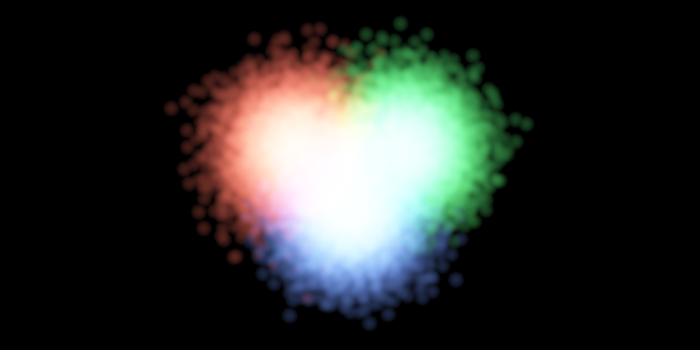 | 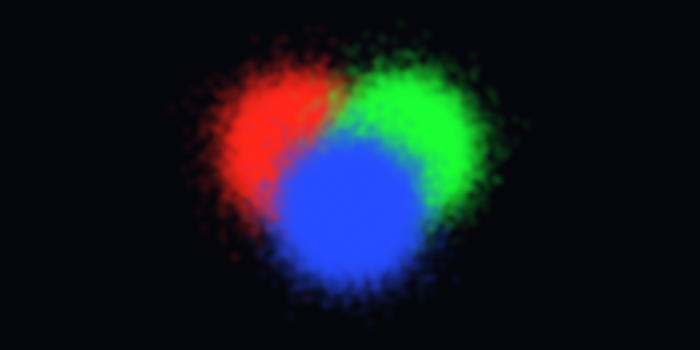 |

The same three clouds (30,000 soft sprites each, `alpha` 0.06) with `additive` 1 and 0. Additive: light adds up, so the
overlaps go towards white and the order of the sprites does not matter. Over: later sprites cover earlier ones, so the
last merged input (blue) wins. In additive mode the `background` is treated as light too and is brightened by `gamma`
along with everything else, so `#000000` is what a dark-sky picture needs; the over mode draws the colour as it is.

## From points to an image

A point is drawn when it has a `radius` attribute greater than 0 (world units) and `alpha` greater than 0. The sprite
attributes are the ones the plain viewport knows: `Cd.x/y/z` (colour, default white), `alpha` (default 1), `softness`
(0 is a hard disc, 1 fades smoothly from the centre; default 1), `aspect` (width over height) and `shape` (0.5 or more
draws a box). See [wrangle.md](wrangle.md#attribute-names-other-nodes-understand).

- **Additive**: every sprite adds `Cd * alpha * falloff` to a floating-point buffer, so a million faint sprites build up
  smooth gradients that a plain alpha-over viewport (limited to 5,000 sprites) cannot show. The sum is tone mapped
  (see `exposure`), optionally blooms, and is dithered when converted to 8 bits so dark gradients do not band.
- **Sub-pixel sprites** (radius under 0.75 pixel) are spread over the four nearest pixels with their energy kept
  (`alpha * area`), so tiny stars stay visible but dim, and do not flicker when the view moves.
- The picture is drawn for the **current view** in the editor (zoom in and the sprites get bigger and sharper) and is
  cached while nothing changes. Rendering runs on a thread pool, in horizontal bands.
- `writePng` (in `jitnodes/geo/raster.h`) writes the result as a PNG (Sub filter, LZ77 with the fixed Huffman code: about 2 to 6 times smaller than raw pixels, no zlib needed).

## The nebula graph

`examples/graphs/nebula.json` has four branches merged into one `render` node. The reference is a star-field nebula
panorama: dark space, coloured gas in wisps, a hot core, blue streaks and stars.

| Branch | Nodes | What it does |
|---|---|---|
| gas | `generate` 300k and `generate` 4k (tagged `puff = 1`), `merge`, `noise` (fbm), `noise` (ridged), `wrangle`, `warp` (curl), `colorRamp`, `wrangle` | Two layers share one chain, so they line up. The 300k small points carry the structure: two noise fields give the large soft masses (`gas`) and the bright creases (`ridge`); a wrangle combines them with a radial glow into a density and a colour index; the curl warp drags the points into wisps (the attributes ride along); the ramp colours them blue to violet to pink. The 4k large puffs (radius 1.4 to 3 units, very low alpha) fill the base glow smoothly under the fine points. The last wrangle sizes each layer by the `puff` flag, and fades the puffs out where `tone` is low so dark gaps stay empty |
| core | `circle`, `wrangle`, `scatter`, `noise`, `warp`, `wrangle`, `colorRamp`, `wrangle` | A circle bent into a lumpy closed shape, filled with 160k points by `scatter`, then the same treatment in warm colours |
| filaments | `line`, `wrangle`, `scatter`, `noise`, `warp`, `colorRamp`, `wrangle` | A line bent into a wave; `scatter` walks along it with some `spread`, producing the blue streak |
| stars | two `generate` + `wrangle` | 12k stars whose radius is `rand^8`-distributed (many tiny, a few big) and tinted by `rand2`, plus 50k sub-pixel dust points |

Wrangles drive the look because they are the cheap, fully animatable part: all of `alpha`, `radius` and the mixing
constants can be edited live. Animate a `noise` node's `phase` or a `warp` node's `phase` with `time` and the whole
nebula evolves.

## The DNA and frequency wave graph

`examples/graphs/dnaWave.json` draws a DNA double helix growing out of a glowing frequency wave, in about 1.9 million
sprites (cooking and drawing at 1400 x 778 and writing the PNG takes about 0.9 s). It has no noise-driven gas, no
simulation: every shape is a formula applied by a `wrangle` to uniform points from `generate`.

```
jitnodesCli examples/graphs/dnaWave.json --png dnaWave.png
```


The world window is 36 x 20 units (`viewWidth 36`), centred on the point where the wave meets the helix at x = 0. The wave
lies to the left (x from -18 to 1.5), the helix to the right (x from -1 to 20, cut off by the window). Every layer is
`generate` (or two nodes) + `wrangle`, merged into one additive `render` (`exposure 1`, `bloom 0.45`, background `#000000`).

| Layer | Nodes | How it works |
|---|---|---|
| strands | `generate` 260k (rect, height 1), `wrangle` shape, `noise` (`tx`), `wrangle` look | `rand > 0.5` picks strand `s` = +1 or -1. The strand's centre is `y = s * amp * sin(0.5 * x)` with `amp = 0.7 + 0.11 * clamp(x, 0, 14)` (the helix widens away from the core) plus a slight tilt; the old `y`, uniform in -0.5..0.5, becomes the position across the tube (`q`). The depth is `z = s * cos(0.5 * x)`: where it is positive the strand is in front |
| shading | in the strand look wrangle | `n = 2q` is the position across the tube, -1..1. A diffuse term `lit` is brightest slightly above the middle (`n = 0.3`) and darker at the edges, a specular term `spec` adds a soft white highlight at `n = 0.4`, and front strands (`front = 0.5 + 0.5 z`) are brighter, a little bigger and a little warmer than back strands. A `noise` value `tx` at scale 5 breaks the tube up into a speckled, scanned texture. `fade` dims the first 3 units so the helix emerges from the core. The colour goes from blue to green with `g = clamp((x - 6) / 12)` |
| base pairs | `generate` 90k (rect, height 2), `wrangle` shape, `wrangle` look | `x` is quantised to one rung every unit (`floor(x) + 0.5`, jittered a little by `rand`) and the old `y` (-1..1) becomes `t`, the position along the rung from one strand to the other (`y = amp * sin(0.5 x) * t`, the same formula as the strands, so the ends sit exactly on them). The depth along the rung is `0.5 + 0.5 * t * cos(0.5 x)`, which fades the rung from its front end to its back end |
| wave | `generate` 800k, `wrangle` shape, `wrangle` look | A hash of the curve index picks one of 36 sine curves per point: `ci = floor(rand * 36)`, then `sin(ci * k1 + k2) * 43758.5453` minus its floor gives four stable pseudo-random numbers `h1..h4` per curve (the wrangle language has no random of its own). They set the frequency (`2 + 10 h1^2`), amplitude (`0.25 + 0.75 h2`), phase and a slow beat envelope `0.5 + 0.5 cos(...)` that makes the curve swell and vanish like a wave packet. All curves share the overall envelope `env`, a Gaussian centred 7 units left of the core (width 7 on the far side, 3.8 towards the helix) on top of a small floor, so the wave narrows to a thin line at the left and at the core. 7 % of the points (`rand2 > 0.93`) are drawn larger and brighter, which gives the dotted outline |
| colour | in the wave look wrangle | The base colour is cyan, going teal-green at the far left (`gr`). The curve's `h3` picks its tint: `og` turns the curves with high `h3` orange and `vi` turns the lowest ones violet. Because the colour is a function of the curve, each curve keeps its colour along its whole length |
| axis and core | two `generate` + `wrangle` | A Gaussian-distributed band of 200k points squeezed to 0.03 units high draws the bright line along the axis (white-cyan at the core, green at the far left, radius and alpha falling off with distance from x = -0.5); 60k Gaussian points of larger radius make the soft flare around the core |
| lens flare | `generate` 120k tall Gaussian, `generate` 160k `disc` + two `wrangle` | A narrow, tall Gaussian column of points draws the vertical spike through the core (`spikeLook`). Five faint ghost rings lie on a diagonal through the core: the disc point `(x, y)` is scaled by a per-ghost radius and moved to the ghost's position along the line (`gi = floor(rand * 5)` picks the ghost; its offset, radius and colour come from nested `?:`). Points near the rim of the unit disc (`rho^3`) get most of the alpha, which makes the rings. Both layers use very low alpha so the flare stays subtle |
| glass | `generate` 240k (rect, the whole view) + `wrangle` | A faint layer laid over everything: a curved sheen across the top (`sheen`), two diagonal reflection streaks (`exp(-s * s)` of a distance to a slanted line) and a rim glow along the frame (`exp(-de * 1.2)`, `de` the distance to the nearest edge), all in a cool blue-white, sprites of radius 0.6 with alpha about 6e-5 |
| backdrop, bokeh, sparkle | three `generate` + `wrangle` | 3,000 huge, extremely faint navy sprites (radius 3 to 7) give the deep-blue glow, 18 soft discs of radius 0.5 to 1.6 are the bokeh, and 6,000 tiny bright points near the axis are the sparkle dust |

Tuning notes:

- **Names**: `a`, `b`, `c`, `d` are the wrangle's runtime parameters and cannot be assigned, so the wave code uses `ci`, `dx`, `wa`.
- **Brightness** is the number of overlapping sprites times `alpha`, and the additive render brightens it by `1 / gamma`
  (2.2), so tiny alphas still show: the glass layer's sum is about 0.02 and is visible. When you change a count, change its alpha
  the other way by the same factor.
- **Smoothness**: a wide, faint layer needs many points or a large radius. With 70,000 points of radius 0.5 the glass
  layer looked grainy; 240,000 points of radius 0.6 is smooth.
- **Colour per curve** works only because the hash depends on the curve index alone. Use a per-point random (`rand2`) for variation inside a curve.
- Every colour, count and strength is a plain number in a wrangle string or a `generate` parameter, so the picture is
  easy to adjust in the editor. Animate `x` offsets in the wave phase (add `time` to the `sin` argument in `waveShape`) and the wave moves.

## Writing your own look

The recipe the sample follows:

1. `generate` or `scatter` for the points. A bigger cloud is smoother, not slower to author.
2. One or two `noise` nodes for the structure (`fbm` for masses, `ridged` for veins). Use different `scale`, `seed`
   and `offsetX`.
3. A wrangle that turns the fields into a **colour index** (`tone`) and a **density** (`dens`): `clamp`, `lerp` and
   products work well, and `exp(0 - (x * x + y * y) * k)` makes a central glow.
4. `warp` with `mode = curl` to break up the regularity of the noise. It is the most expensive node (about 150 ms for
   500k points with 4 iterations; the gas now has 300k); put it after the structure is decided and before the colour ramp so it only runs once.
5. `colorRamp` on `tone`.
6. A wrangle for `radius`, `alpha` and `softness`. The total light is roughly
   `points per pixel * alpha`, so when a picture is too bright lower `alpha` (and `exposure`) rather than the count.
7. `merge` the branches, add `render`, set `viewWidth`, `exposure`, `bloom`.

Wrangle has no `rand`; use the `rand` and `rand2` attributes of `generate` and `scatter` instead, or `noise` at a high
`scale` for spatially coherent randomness.

## Performance and limits

Measured with `nebula.json` (8 threads, release build, `jitnodesCli --profile`): the curl `warp` of the gas is 150 ms,
the two gas `noise` nodes 35 ms each, `scatter` of the core 16 ms and a `generate` 2 ms. The whole
`jitnodesCli ... --png` run, cooking plus drawing the 646,000 sprites at 1400 x 700 plus writing the PNG, takes about
0.35 s.

- `relax` and `attribBlur` cost points times neighbours within `radius` (per iteration); keep `radius` within a few times the
  point spacing. `attractor` costs points times `iterations` times two trig calls: 400,000 points and 30 iterations take
  40 to 120 ms depending on the map. `wave` is as cheap as a `noise` octave.
- Sprites larger than a few hundred pixels across are slow in the additive renderer (cost is proportional to covered
  pixels); use many small sprites rather than a few huge ones, or `bloom` for large soft glows.
- Noise is 3D gradient noise computed in plain C++ (not JIT compiled), so `noise` and `warp` do not take part in kernel
  fusion; they run on the thread pool.
- `scatter` of a very thin closed shape is slow (rejection sampling); thicken the shape or use an open curve with
  `spread`.
- The `render` settings are detail values on the geometry, so put `render` last: a node that builds a new geometry from
  scratch (`generate`, `scatter`) starts without them.
