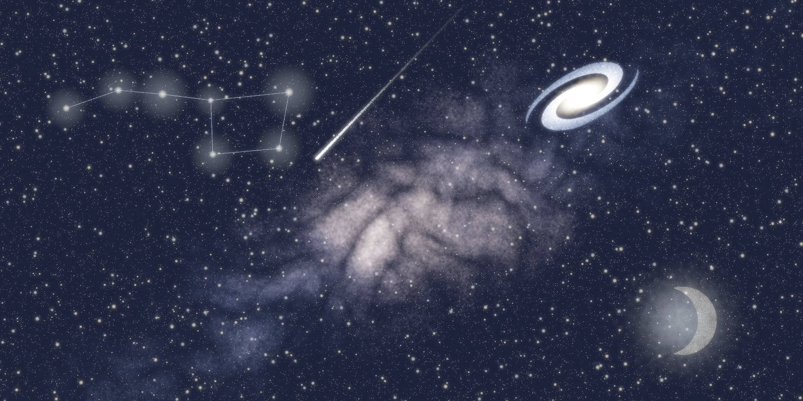

# Python example: a night sky

`examples/python/nightSky.py` builds a 38-node graph with the Python API, cooks it (about 800,000 points) and renders it to a PNG.
It is the same kind of graph as `examples/graphs/nebula.json`, but written as a script, so layers are made by small functions and the
Big Dipper is driven by a table of stars in the file. The API itself is described in [python.md](python.md).



The image is [`examples/python/nightSky.png`](../examples/python/nightSky.png) (1600 x 800). The graph cooks in about 0.13 s and the
render takes about 0.2 s.

## Running it

From `cmd.exe` (nothing here is PowerShell specific; use forward slashes and `/d/...` paths in Git Bash):

```
D:\code\curvy\3rdparty\python\python.exe -I D:\code\curvy\3rdparty\jitnodes\examples\python\nightSky.py D:\code\curvy\out\jitpy\python D:\code\curvy\sky.png
```

* The interpreter is the bundled Python 3.13 the module was built against. `-I` keeps it isolated from environment variables and the
  current folder.
* The first argument is the folder that holds the built module (`jitnodes.cp313-win_amd64.pyd`); the script puts it on `sys.path`.
  It is created by the build in [python.md](python.md#building-and-testing).
* The second argument is the output file. Without it the script writes `nightSky.png` next to itself.
* It prints one line, for example `38 nodes, 808014 points cooked in 0.13s, 1600x800 written to ... in 0.20s`.

NumPy is not needed for this example.

## How the script is organised

```
fieldStars, faintStars ─────────────────────────────┐
bandPoints → tilt → gas → lanes → wisps → mix → ramp → look ─┤
galaxyPoints → spiral → ramp → look, galaxyGlow → look ──────┤
dipperPoints → place → size ─┬─ core ───────────────────────┤
                             └─ halo ───────────────────────┼─ merge "sky" ─ render "image" ─ cook ─ render_png
dipperOutline → path → scatter → lines ─────────────────────┤
meteorLine → place → scatter → look ────────────────────────┤
moonDisc → craters → look, moonHalo → look ─────────────────┘
```

Every layer is a chain of nodes that ends in a `wrangle` setting how its points look (`radius`, `alpha`, `Cd`, `softness`). A `render` node
only draws points that have a `radius`, so a bare `generate` or `scatter` shows nothing until a look wrangle gives it one. All layers are
merged and rendered additively: the sprites are summed in linear light and tone mapped, so many faint points build up a glow.
The wrangle language is in [wrangle.md](wrangle.md), the fx nodes (`generate`, `scatter`, `noise`, `warp`, `colorRamp`, `render`) in
[fx.md](fx.md).

## The script, annotated

### Opening the module

```python
sys.path.insert(0, args[0])
import jitnodes as jn
```

The folder with the module comes from the command line, so the script runs against any build. An application that embeds Python (curvy)
gets the module through `PythonRuntime` instead; see [python.md](python.md#embedding-in-an-application).

### One helper makes the graph readable

```python
net = jn.Network()

def make(kind, name, *inputs, **params):
    node = net.add_node(kind, name)          # a Node handle
    for key, value in params.items():
        node[key] = value                    # float or string parameter, whichever the node declares
    for index, source in enumerate(inputs):
        source.connect(node, index)          # wire source to input `index` of node
    return node
```

* `net.add_node(type, name)` returns a handle; names become the node names in the saved graph and in error messages.
* `node[key] = value` writes a parameter. Attribute assignment (`node.count = 8`) does the same, but the item form is used when a parameter
  has the name of an engine method. `name` is one (`node.name()` is the node's name), so the noise node's attribute name is set as
  `gas["name"] = "gas"`.
* `source.connect(node, i)` wires to a given input. `a >> b` is the short form for input 0; the `merge` node takes any number of inputs, so
  the script connects each layer to a new input index.
* A mistake in a name raises at once: an unknown parameter is an `AttributeError`/`KeyError`, never a silently new attribute.

### Field stars and faint dust

```python
stars = make("generate", "fieldStars", count=6000, seed=21, width=42, height=22, shape="rect")
layers.append(make("wrangle", "fieldStarsLook", stars, code=(
    "sz = rand * rand * rand * rand; sz = sz * sz; radius = 0.02 + 0.11 * sz; alpha = 0.7 + 0.3 * rand2; "
    "Cd.x = lerp(0.75, 1, rand2); Cd.y = lerp(0.82, 0.95, rand2); Cd.z = lerp(1, 0.78, rand2); softness = 1;")))
```

`generate` makes random points in a box and gives each `rand` and `rand2` (uniform 0..1, a pure function of the seed and the point's index, so
the picture is the same on any thread count). Raising `rand` to the eighth power makes most stars tiny and a few large. Colours drift between
blue-white and warm white. `Cd` is the colour vector. A second `generate` of 22,000 points with a tiny `radius` is the dust of faint stars.

Wrangle names to avoid: `a`, `b`, `c`, `d` are the node's runtime parameters and cannot be assigned, so the script uses `bright`, `dist`
and so on for its temporaries (the first version of this script failed on a variable called `b`).

### The Milky Way

```python
band = make("generate", "bandPoints", count=450000, seed=4, width=66, height=12, shape="gaussian")
tilt = make("wrangle", "bandTilt", band, code=(f"gx = x * {math.cos(0.5):.5f} - ... x = gx + 1.5; y = gy - 0.5;"))
gas   = make("noise", "bandGas",   tilt, scale=0.16, octaves=6, seed=8, mode="fbm");   gas["name"] = "gas"
lanes = make("noise", "bandLanes", gas,  scale=0.35, octaves=5, seed=12, mode="ridged", offsetX=40); lanes["name"] = "lane"
wisps = make("warp", "bandWisps", lanes, amount=0.7, scale=0.1, octaves=2, iterations=2, seed=3, mode="curl")
```

* A gaussian cloud, wide and flat, is rotated by a wrangle (the rotation matrix is computed in Python and pasted in as numbers: the wrangle
  language has no `pi` and no `atan2`, so angles are better done in the script).
* Two `noise` nodes write attributes at each point's position: smooth `gas` (fbm) and creased `lane` (ridged), which becomes the dark dust
  lanes. The first noise node's output feeds the second, so the points carry both attributes.
* `warp` in `curl` mode moves the points along a divergence-free flow, which draws the cloud into wisps without bunching it up. The amount is
  kept low: a first attempt with a large amount turned the band into smoke.

```python
mix = make("wrangle", "bandMix", wisps, code=(
    "dist = sqrt(...); core = exp(0 - dist * dist); "
    "dens = clamp(gas * 0.9 + core * 0.4 + 0.05 - lane * lane * 0.7, 0.05, 1); "
    "tone = clamp(gas * 0.6 + core * 0.6 - lane * 0.2, 0, 1);"))
color = make("colorRamp", "bandColor", mix, attribute="tone", ramp="0 #141a4a, 0.35 #3a4fa8, 0.6 #8a86d0, 0.8 #e0b8c8, 1 #fff0d8")
layers.append(make("wrangle", "bandLook", color, code="radius = 0.05 + 0.08 * dens; alpha = 0.002 + 0.035 * dens * dens; softness = 1;"))
```

`dens` (how much matter) and `tone` (which colour) are computed from the noise and a bright core; `colorRamp` turns `tone` into `Cd`;
the look wrangle turns `dens` into sprite size and opacity. Splitting "what it is" from "how it looks" in two wrangles is the pattern used in
every layer. The sprites are very faint (alpha 0.002 to 0.037) because 450,000 of them overlap.

### The spiral galaxy

```python
"r = 0.1 + 3.0 * rand * sqrt(rand); side = rand2 > 0.5 ? 1 : 0; "
"ang = side * 3.14159265 + r * 1.7 + (rand2 - 0.25 - side * 0.5) * (1.2 + r * 0.8); "
"gx = r * cos(ang); gy = r * sin(ang) * 0.42; ..."
```

Each point picks a radius (denser toward the middle), one of two arms (`side`) and an angle that grows with the radius, so the arm winds
outward; the random offset (`rand2 - ...`) widens the arm. `gy` is flattened to 0.42 to tilt the disc away from us, then everything is
rotated and moved to the upper right in the final two assignments. A name is stored once, with its last value, so `x` and `y` are assigned
at the end from the temporaries `gx` and `gy`. A small gaussian `galaxyGlow` adds the haze. The outer arms still read a little like a ring;
tweaking `1.7` (the winding) is the quickest way to change that.

### The Big Dipper, driven by a table

```python
DIPPER = {"Alkaid": (-7.2, -0.6, 0.62), "Mizar": (-4.6, 0.3, 0.7), ...}      # x, y, brightness
DIPPER_PATH = ["Alkaid", "Mizar", "Alioth", "Megrez", "Dubhe", "Merak", "Phecda", "Megrez"]

def table(names, values, origin):
    ...  # x = sampleIndex == 0 ? -16.7 : sampleIndex == 1 ? -14.1 : ... : 0;
```

A wrangle cannot read a list, but `sampleIndex` is the element's index, so Python generates a chain of `? :` that picks the entry for each
point. A `generate` with `count=7` supplies seven points and the generated wrangle moves them onto the stars (`dipperPlace`); a second
wrangle writes a `bright` attribute the same way. Two look wranglers read the same node (the output fans out), one for a small bright core
and one for a large faint halo:

```python
layers.append(make("wrangle", "dipperCore", sized, code="radius = 0.1 + 0.16 * bright; alpha = 1; ..."))
layers.append(make("wrangle", "dipperHalo", sized, code="radius = 0.5 + 1.1 * bright; alpha = 0.06 + 0.1 * bright; ..."))
```

The outline is a `line` node with 8 points, moved onto the stars in path order by the same `table` helper (Megrez appears twice to close the
bowl), and then `scatter` with `count=0, lineCount=5000` walks the open polyline with faint dots. `scatter` only gives points a position,
`rand`, `rand2`, `u` and `srcPrim`, so a look wrangle sets the rest.

### The shooting star

```python
streakPlace = make("wrangle", "meteorPlace", streak, code="x = 3 - sampleIndex * 0.25; y = 9.6 - sampleIndex * 0.26;")
meteor = make("scatter", "meteorWalk", streakPlace, count=0, lineCount=5000, spread=0.05, seed=17)
... "radius = 0.012 + 0.04 * u * u; alpha = 0.02 + 0.5 * u * u * u; ..."
```

A 30-point line placed along a diagonal and walked with dots. `u` runs 0 to 1 along the curve, so cubing it makes the tail fade out and the
head bright; `spread` gives the streak some width.

### The crescent moon

```python
disc = make("generate", "moonDisc", count=110000, seed=41, cx=mx, cy=my, width=mr * 2, height=mr * 2, shape="disc")
craters = make("noise", "moonCraters", disc, scale=1.6, octaves=5, seed=6, mode="fbm");  craters["name"] = "crater"
"... lit = (rx + 0.55) * (rx + 0.55) + ry * ry > 1 ? 1 : 0; ... alpha = lit * (0.025 + 0.06 * crater); ..."
```

A dense disc of tiny sprites; `lit` is 1 outside a second, shifted disc, which cuts the crescent, and the noise value modulates the
brightness into craters. `lit` is stored as 0/1 by the `? :` (a bare comparison would be a NaN mask when used in arithmetic; see
[wrangle.md](wrangle.md#booleans-and-masks)). A wide gaussian with very low alpha is the halo.

### Merging and rendering

```python
everything = make("merge", "sky")
for index, layer in enumerate(layers):
    layer.connect(everything, index)
image = make("render", "image", everything, exposure=0.75, gamma=2.2, bloom=0.3, bloomRadius=10,
             width=1600, height=800, viewCx=0, viewCy=0, viewWidth=40, background="#02030a")
net.set_display_node(image)
```

`merge` concatenates the geometry of its inputs. `render` passes it through unchanged and records how to draw it (detail values
`render.*`): the world window (`viewWidth` 40 units wide, centred on 0; the height follows the aspect ratio so pixels stay square),
the image size, exposure, bloom and the background colour. Everything above is positioned in those world units: x runs about -20 to 20.

### Cooking and writing the image

```python
geometry = net.cook(image)           # runs every node this one depends on; releases the GIL while it works
size = geometry.render_png(out)      # (1600, 800)
```

`net.cook(node)` returns a `Geometry` (the node's cached result, read-only). `geometry.render_png(path, width=0, height=0)` draws the points that
have a `radius` with the settings of the `render` node in its chain, exactly as `jitnodesCli --png` does, and returns the image size; width
and height of 0 take the node's size. It runs on the machine's cores and releases the GIL.

## Things to try

* Change a parameter and cook again: `net["bandWisps"].amount = 2.0`, then `net.cook(image)` and `render_png` the new geometry. Nodes
  upstream of the change keep their cached result (`net["bandGas"].cook_count()` stays 1); the nodes downstream recook.
* Read the result as arrays (needs NumPy): `geometry.point_attrib("x")` and `geometry.point_attrib("alpha")` give zero-copy read-only views,
  for example to count the stars brighter than a limit.
* Turn a layer off with `net["moonLook"].set_bypassed(True)` and cook and render again.
* The script cannot save the graph yet: there is no Python binding for the graph file functions (`saveNetworkToFile`), which is why the
  command line tool `jitnodesCli` is the way to render a saved graph.

## What the example shows about the Python API

| Idea | Where |
|---|---|
| Handles: `net.add_node`, `node[...] = `, `a.connect(b, i)` | the `make` helper |
| Generating wrangle code from data (Python writes the program) | `table()`, the rotation matrices, `mx`/`my` |
| Fan-out and a merge of many inputs | `dipperSize` feeding core and halo, the `sky` merge |
| Cooking and the GIL | `net.cook(image)` |
| Getting an image out | `geometry.render_png(path)` |
| Errors are Python exceptions | an unknown parameter or a wrangle parse error (`RuntimeError: wrangle parse error at offset 1: cannot assign to parameter 'b'`) |
