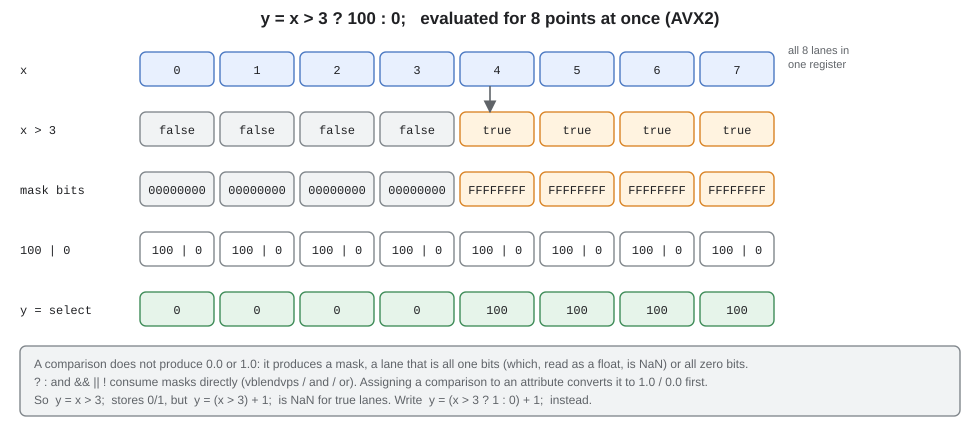
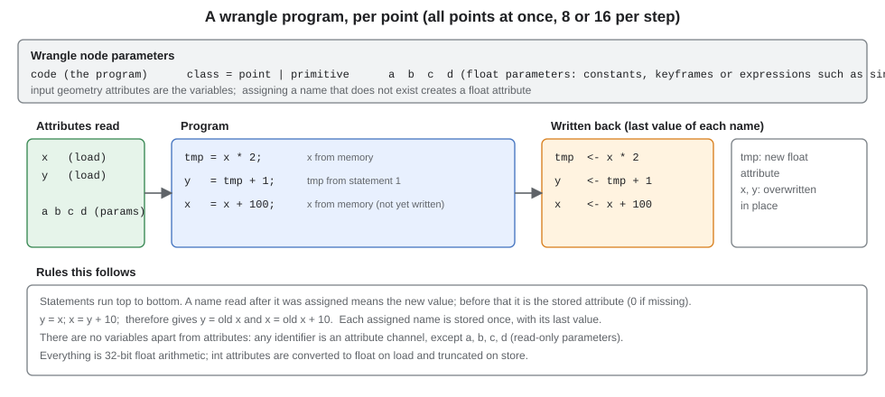

# The wrangle language

The `wrangle` node runs a short program on **every point (or every primitive) of its input geometry at once**. The
program is written in a small C/VEX-like language, compiled once to SIMD machine code (SSE2, AVX2 or AVX-512) and
executed over whole attribute arrays, so a million points take about a millisecond. This document is the complete
reference: what you can write, the types and functions available, the pitfalls, and many worked examples.
How the compiler works inside is in [architecture.md](architecture.md#the-jit-from-wrangle-text-to-machine-code).

The same language, with a different set of names, also drives [parameter expressions](#parameter-expressions)
(`sin(time) * 2` typed into a number field).

## Contents

1. [The node and its parameters](#the-node-and-its-parameters)
2. [A first program](#a-first-program)
3. [Syntax](#syntax)
4. [Types and names](#types-and-names)
5. [Operators](#operators)
6. [Functions](#functions)
7. [Booleans and masks](#booleans-and-masks)
8. [Attributes: reading, writing, creating](#attributes-reading-writing-creating)
9. [Order of evaluation](#order-of-evaluation)
10. [Parameters a, b, c, d and animation](#parameters-a-b-c-d-and-animation)
11. [Attribute names other nodes understand](#attribute-names-other-nodes-understand)
12. [Idioms: functions the language does not have](#idioms-functions-the-language-does-not-have)
13. [Examples](#examples)
14. [Parameter expressions](#parameter-expressions)
15. [Performance](#performance)
16. [Errors and troubleshooting](#errors-and-troubleshooting)
17. [Limits](#limits)
18. [Grammar](#grammar)

## The node and its parameters

| Parameter | Kind | Default | Meaning |
|---|---|---|---|
| `code` | text | empty | the program. An empty program is allowed and changes nothing |
| `class` | text | `point` | `point`: run over the points (`x`, `y`, `radius`, ...). `primitive`: run over the primitives and their attributes |
| `a`, `b`, `c`, `d` | float | 0 | four runtime parameters the program can read. Each can be a number, a keyframe curve or an expression (`time * 3`), and changing one never recompiles |

One input, one output. The output is the input geometry with the attributes your program wrote changed or added;
topology (which points make which primitives) never changes. A wrangle is *point-wise*, so a chain of wrangles and
`transform` nodes is fused into a single kernel (see [fusion](architecture.md#fusion-and-merge-flattening)).

## A first program

```
x = x * 2;
y = y + (x > a ? b : 0);
```

With a `line` of 8 points and `a = 5`, `b = 100`: every `x` is doubled, and every point whose new `x` exceeds 5 gets
100 added to `y`. In C++ (`examples/basicGraph.cpp`):

```cpp
net.node(wrangle).setString("code", "x = x * 2; y = y + (x > a ? b : 0);");
net.node(wrangle).setFloat("a", 5.0f);
net.node(wrangle).setFloat("b", 100.0f);
```

In the editor, select the wrangle and type the program into the multi-line `code` field; it is applied when the field
loses focus. A syntax error makes the next cook fail and the status line shows `wrangle parse error at offset N: ...`.

## Syntax

A program is a list of **assignments**, each ending with a semicolon:

```
name = expression;
```

- **Whitespace** (spaces, tabs, newlines) is free.
- **Comments are not supported.** `#`, `//` and `/* */` are syntax errors. Put documentation in the node's name or
  elsewhere.
- **Statements are assignments only.** There is no `if`/`else` statement, no loops, no function definitions, no
  declarations. Conditionals are the `? :` expression; see [Booleans and masks](#booleans-and-masks).
- **Identifiers** start with a letter or underscore and continue with letters, digits and underscores. A dot followed
  by a letter is part of the name, so `N.x`, `Cd.y` and `group.top` are single identifiers (attribute names), not
  member accesses.
- **Numbers** are decimal floats: `3`, `0.5`, `.5`, `5.`, `1e3`, `2.5e-1`. There is no suffix (`1.5f` is an error),
  no hex, and no special constants: `pi` is *not* defined in a wrangle (write `3.14159265`).
- **Parentheses** group; **function calls** are `name(arg, arg, ...)`.
- Case matters (`X` is not `x`).

Errors are reported as `wrangle parse error at offset N: message` where `N` is the character offset in the text.

## Types and names

There is exactly one value type in an expression: a **32-bit float**. Everything else is about where the values live.

| Concept | How it is written | Notes |
|---|---|---|
| Number | `3.5` | float32 constant, baked into the machine code |
| Attribute value | `x`, `radius`, `N.x`, `group.top` | any identifier except `a b c d`: reads (and, as an assignment target, writes) the attribute of that name for the current point |
| Runtime parameter | `a`, `b`, `c`, `d` | read-only floats from the node's parameters; **cannot be assigned**, and therefore cannot be used as attribute names either |
| Boolean | `x > 3`, `a && b`, `!x` | a per-lane **mask**, not 0.0/1.0; see [below](#booleans-and-masks) |
| Vector | `N.x`, `N.y`, `N.z` | not a type: a vector attribute is just float components named `name.x`, `name.y`, `name.z` |
| Group | `group.top` | not a type: a float or int attribute named `group.<name>`; non-zero means "in the group" |

Attribute *storage* types matter at the edges of a program:

| Storage | Load | Store |
|---|---|---|
| `float32` (default for anything the program creates) | as is | as is |
| `int32` (made by `attribCreate` with `type = int`, groups made by library code) | converted to float | **truncated toward zero**; out of the int range gives `INT_MIN` |

Because arithmetic is in float, integers are exact up to 2^24 = 16,777,216. Inside one program an assigned value keeps
its full float precision and is only truncated when it is stored: after `n = n * 3.9; m = n;` with an int `n` of 7,
`m` is 27.3 while `n` is stored as 27. Between *nodes* the truncation always happens, also when the nodes are fused into
one kernel: a second wrangle reading `n` sees 27.

There are no strings, no integer arithmetic (`/` is always float division), no arrays, no vectors-as-values, no
user-defined variables. Temporary values are ordinary attributes: assign them, read them, and they remain in the
geometry (see [Attributes](#attributes-reading-writing-creating)).

## Operators

From lowest to highest precedence:

| Precedence | Operators | Associativity | Notes |
|---|---|---|---|
| 1 (lowest) | `c ? a : b` | right | `x < 1 ? 10 : x < 2 ? 20 : 30` chains in the false branch |
| 2 | `\|\|` | left | operands are treated as booleans (non-zero is true) |
| 3 | `&&` | left | same |
| 4 | `==` `!=` `<` `>` `<=` `>=` | **none** | no chaining: `1 < x < 3` is a syntax error; write `x > 1 && x < 3` |
| 5 | `+` `-` | left | |
| 6 | `*` `/` | left | `x / 0` is `inf` (and `0 / 0` is NaN); there is **no `%` operator** |
| 7 | unary `-` `!` | right | bind tighter than `*`, so `-x * 2` is `(-x) * 2`; `!x > 1` is `(!x) > 1` |
| 8 (highest) | `( )` and calls | | |

`!x` is true when `x` is zero. `&&`, `||` and `?:` conditions treat any non-zero value (including NaN) as true.

## Functions

All functions take and return floats and are evaluated per point. Arity is checked at parse time
(`max() expects 2 argument(s)`); an unknown name is `unknown function 'foo'`.

| Function | Result | Notes |
|---|---|---|
| `min(a, b)` | the smaller | `a < b ? a : b`: with a NaN the second argument wins |
| `max(a, b)` | the larger | `a > b ? a : b`: with a NaN the second argument wins |
| `abs(a)` | absolute value | |
| `sqrt(a)` | square root | NaN for negative input |
| `clamp(v, lo, hi)` | `min(max(v, lo), hi)` | `lo` should not exceed `hi` |
| `lerp(a, b, t)` | `a + (b - a) * t` | `t` is not clamped; `lerp(10, 20, 0.5)` is 15 |
| `floor(a)`, `ceil(a)` | round down / up | |
| `sin(a)`, `cos(a)` | trigonometry, radians | polynomial approximation in the JIT: about 5e-6 absolute error for `|a|` up to a few hundred; accuracy degrades for very large arguments |
| `exp(a)` | e^a | about 1e-5 relative error; the argument saturates at about ±88.37, so the result is finite (about 2.4e38 at most) |
| `log(a)` | natural logarithm | about 1e-5 error; `log(0)` is `-inf`, `log` of a negative is NaN |
| `pow(a, b)` | `a^b` | computed as `exp(b * log(a))`, so only meaningful for `a > 0`. **Negative bases give garbage, and so does `pow(0, 0)`** (about 2.4e38); use `a * a` or `abs` where that matters. `pow(2, x)`, `pow(x, 0.5)` and `pow(x, 3)` for positive `x` are fine |

Not available (use the [idioms](#idioms-functions-the-language-does-not-have)): `tan`, `asin`/`acos`/`atan`/`atan2`,
`round`, `trunc`, `fract`, `mod`/`%`, `sign`, `step`, `smoothstep`, `fit`, `saturate`, `length`, `dot`, `distance`,
`rand`, `noise`, `sinh`/`cosh`/`tanh`, vector functions.

The JIT and the scalar interpreter give the same results except for the last digits of `sin`, `cos`, `exp`, `log`
and `pow` (the interpreter uses the C library). Results do not depend on the instruction set.

## Booleans and masks



The generated code has no branches. A comparison produces a **mask** per lane: all one bits when true, all zero
bits when false. `c ? a : b` blends `a` and `b` by that mask, and `&&`, `||`, `!` combine masks with bitwise
operations. The consequences:

- **Assigning a comparison stores 1 or 0**: `y = x > 3;` works as expected, as do `y = x > 1 && x < 3;` and `y = !x;`.
  Groups use this: `group.left = x < 4.5;`.
- **A mask is not a number.** Read as a float, an all-ones lane is NaN. Using a comparison in arithmetic therefore
  gives NaN for true points:

  ```
  y = (x > 1) * 5;        // NaN where x > 1      -- wrong
  y = (x > 1 ? 1 : 0) * 5;   // 0 or 5            -- right
  ```

  The same goes for `(x > 0) == (x < 2)` (NaN never equals NaN, so it is always false) and for
  `(x < 1) + (x < 2)`. Convert with `? 1 : 0` whenever you want a number.
- **Conditions accept any value:** `x ? 5 : 7` is 5 where `x` is non-zero. The parser turns a non-comparison condition
  into `x != 0`.
- **Both branches of `? :` are always evaluated** for every point (there is no short-circuiting), so
  `x > 0 ? 1 / x : 0` computes `1 / x` everywhere and then selects. That is harmless for division (it gives `inf`
  that is discarded) but remember it for expensive branches.
- `!x` where `x` is itself a comparison is another mask; `!!x` normalises any value to a mask (and assigns as 0/1).

## Attributes: reading, writing, creating

The attributes of the input geometry are the variables. For `class = point` they are the point attributes; for
`class = primitive` the primitive attributes (a `line` has one primitive; `x` and `y` do not exist at primitive level).

- **Reading** an attribute gives its value for the current point. Points always have `x` and `y`.
- **Reading a name that does not exist reads 0 and creates the attribute** (zero filled, float). A misspelled name
  therefore silently adds an attribute to the geometry; use the viewport's *Color by* list or
  `jitnodesCli` (it prints the attributes) to spot strays. `pi` is the classic example: `y = pi;` gives 0 and creates `pi`.
- **Writing** (`name = expr;`) stores the result into the attribute, creating a float attribute if needed. Each
  assigned name is stored **once**, with the value of its *last* assignment in the program.
- **Existing storage types are kept.** Assigning to an int attribute truncates; assigning to a float attribute never
  rounds. Mixed int and float attributes in one program are fine.
- **Vector attributes** are components: `N.x = cos(x); N.y = 1; len = sqrt(N.x * N.x + N.y * N.y);`.
- **Groups** are attributes named `group.<name>`; any non-zero value is membership. The `blast` node deletes by group.
- **Temporaries stay in the geometry.** `tmp = x * 2; y = tmp + 1;` leaves a `tmp` attribute. It costs a little memory and
  travels downstream with the geometry. There is no way to drop an attribute inside the language, so reuse an attribute
  you want to keep as scratch space where that is natural, or accept the extra array.
- **Detail values** (geometry-wide numbers) are not visible to wrangles.
- **Topology is read-only:** you cannot add or remove points or primitives, or read a neighbour's value. Anything that
  needs neighbours (smoothing, resampling) is a topology node (`resample`, `subdivide`, ...).

### String attributes
A string attribute (type `string`, see `design.md` "string attributes") holds text per point or primitive, stored as ids into a table
that belongs to the attribute. A program can compare one with a literal on either side of `==` or `!=`, and nothing else:

```
tree = label == "tree";             // 1 where the text is "tree"
other = "rock" != label && x > 1;   // the literal may come first; combines with && || ?: like any comparison
blank = label == "";                // the empty string, which is what a new element starts with
```

- The literal is turned into a number before the kernel runs: its id in the attribute's table at that moment, or -1 when the table
  does not contain it, so `label == "nothing"` is false everywhere and `label != "nothing"` true everywhere. The compiled kernel does
  not depend on the text, so changing a literal does not recompile, and the same kernel serves geometries whose tables differ.
- A string attribute is **read-only**: `label = ...;` fails with "string attribute 'label' cannot be assigned". Using `label` in
  arithmetic is allowed but gives the id, which means nothing outside its geometry.
- Comparing an attribute that is missing or is not a string attribute with a literal fails the cook ("'x' is compared with the string
  "a" but is not a string attribute"). A literal anywhere else (`label + "a"`, `label < "a"`) is a parse error. The escapes are `\"` and `\\`.
- It works in fused chains of wrangles and on the interpreter the same as on the JIT; the test is `wrangleComparesStringAttributesWithLiterals`.

## Order of evaluation



Statements run top to bottom, for all points in parallel. Within one program:

- a name read **after** it was assigned means the new value;
- a name read **before** (or never assigned) means the attribute as it was on the node's input.

So the classic swap and rotation mistakes are visible:

```
// Wrong: the second line sees the NEW x
x = x * cos(a) - y * sin(a);
y = x * sin(a) + y * cos(a);

// Right: compute both from the old values, then assign
nx = x * cos(a) - y * sin(a);
ny = x * sin(a) + y * cos(a);
x = nx;
y = ny;
```

With `a = 1.5708` (90 degrees) and points `(0,1) (1,1) (2,1)` the wrong version gives `(-1,-1) (-1,-1) (-1,-1)`; the right
one gives `(-1,0) (-1,1) (-1,2)` (plus the temporaries `nx`, `ny`). And `y = x; x = y + 10;` gives `y` = old `x`, `x` = old
`x` + 10.

## Parameters a, b, c, d and animation

`a`, `b`, `c` and `d` are four **runtime parameters**: constants of the machine code that are read from a parameter block.
Changing one (typing a number, dragging in an animation, moving the playhead) does **not** recompile anything, which
is why they are the right place for anything you want to tweak or animate. Typing a literal into `code` instead is
fine for fixed values but compiles a new kernel (about 0.1 ms) every time the text changes.

Each of the four can be:

- a **number**: `a = 3`;
- a **keyframe curve** (the `key` / `...` buttons in the editor);
- an **expression** in the [parameter expression language](#parameter-expressions): `time * 2`,
  `sin(time * 6.28) * 0.5 + 0.5`, `transform1.tx * 2`, `parent.amount` inside a subnet.

```
// code of the wobble wrangle in examples/graphs/wobble.json
x = x + sin(y * 2 + a) * b;
y = y + cos(x * 2 + a) * b;
```
with `b = 0.35` and `a` = the expression `time * 3`: the phase advances three radians per second, and only this node
(and what depends on it) recooks as the playhead moves.

Because `a`-`d` are reserved, **do not use them as temporary names**: `d = sqrt(x * x + y * y);` is rejected with
`cannot assign to parameter 'd'`. Use `dist`, `r`, `t`, ...

## Attribute names other nodes understand

The language has no built-in attributes except `x` and `y`, but several nodes and the editor read specific names:

| Name(s) | Class | Read by | Meaning |
|---|---|---|---|
| `x`, `y` | point | everything | position (`z` and others work as ordinary channels) |
| `group.<name>` | point / primitive | `blast` | non-zero = in group `<name>` |
| `scale`, `angle` | point (on the *target* input of `copyToPoints`) | `copyToPoints` | per-instance scale (multiplied with the node's `scale`) and rotation in radians (added to its `angle`) |
| `copyIndex` | point, primitive | *written by* `copyToPoints` | which target point an instance came from (int) |
| `rand`, `rand2` | point | *written by* `generate`, `scatter` | independent uniform random numbers in 0..1 per point (the language has no `rand` of its own); see [fx.md](fx.md) |
| `radius` | point | editor viewport, `render` | presence turns on sprite drawing: disc radius in world units |
| `Cd.x`, `Cd.y`, `Cd.z` | point | editor viewport (sprites) | colour 0-1, default white |
| `alpha` | point | editor viewport (sprites) | opacity 0-1, default 1 |
| `softness` | point | editor viewport (sprites) | 0 hard disc, 1 radial gradient (default 1) |
| `aspect` | point | editor viewport (sprites) | width over height (default 1) |
| `shape` | point | editor viewport (sprites) | 0.5 or more draws a box and ignores `softness` |
| any attribute | point / primitive | editor *Color by* list | colours the geometry through a colour map; `N.x`/`N.y` also give `N (length)` |

`resample` and `subdivide` carry attributes onto the new points (floats interpolated, ints taking the nearer point's
value). After a `merge`, an attribute that exists in only one input reads as 0 in the other, so set sprite attributes
explicitly on every branch.

## Idioms: functions the language does not have

All of these were run against the compiler; `x` is the point's `x`.

| You want | Write | Check |
|---|---|---|
| fractional part | `f = x - floor(x);` | `x = 1.25` gives 0.25 |
| modulo `x mod m` | `r = x - floor(x / m) * m;` | `x mod 3` over 0..6 gives 0 1 2 0 1 2 0 |
| round to nearest | `r = floor(x + 0.5);` | 0.6 gives 1, 2.4 gives 2 |
| sign (-1, 0, 1) | `s = (x > 0 ? 1 : 0) - (x < 0 ? 1 : 0);` | |
| saturate | `s = clamp(x, 0, 1);` | |
| `step(edge, x)` | `s = x >= a ? 1 : 0;` | |
| `smoothstep(e0, e1, x)` | `t = clamp((x - a) / (b - a), 0, 1); s = t * t * (3 - 2 * t);` | the smoothstep curve between `a` and `b` |
| remap / fit | `y = lerp(a, b, clamp((x - c) / (d - c), 0, 1));` | maps `c..d` onto `a..b` |
| triangle / ping-pong wave | `t = x - floor(x / 2) * 2; y = abs(t - 1);` | period 2, values 1 0.5 0 0.5 1 ... |
| tangent | `t = sin(x) / cos(x);` | |
| sigmoid | `y = 1 / (1 + exp(0 - x));` | 0.5 at 0 |
| distance from origin | `r = sqrt(x * x + y * y);` | |
| integer power | `y = x * x * x;` | cheaper and exact; avoids `pow` |
| cheap pseudo-random | `r = sin(x * 12.9898 + 78.233) * 43758.5453; r = r - floor(r);` | values in 0..1 that look random; the large multiplier amplifies the approximation error of `sin` so values differ in the last digits between the JIT and the interpreter |
| angle without `atan` | keep the angle as an attribute (`ang = x * 6.2832 / n`) and derive `cos(ang)`, `sin(ang)` | |
| `value != 0` as number | `v = !!x ? 1 : 0;` or simply `x != 0 ? 1 : 0` | |

## Examples

The outputs shown were produced by running the programs on a `line` node (points `x = 0 ... length`, `y = 0`
unless noted).

**1. Scale and offset** (`count = 5`, `length = 4`)
```
x = x * 2 + 1;
```
`x`: 1 3 5 7 9.

**2. A sine wave with an amplitude parameter** (`a = 2`)
```
y = sin(x * 1.5) * a;
```
`y` for `x = 0 1 2 3 4`: 0, 1.995, 0.282, -1.955, -0.559.

**3. A threshold** (`a = 2`, `b = 10`)
```
y = x > a ? b : 0;
```
`y`: 0 0 0 10 10.

**4. A range test stored as a number**
```
k = (x > 1 && x < 3) ? 1 : 0;
```
`k` for `x = 0 1 2 3 4`: 0 0 1 0 0. (Writing `k = x > 1 && x < 3;` gives the same.)

**5. Intermediate values and a chained conditional**
```
y = x < 1 ? 10 : x < 2 ? 20 : 30;
```
`y` for `x = 0..4`: 10 20 30 30 30.

**6. Remap a range** (`a = 0`, `b = 100`, `c = 1`, `d = 3`)
```
y = lerp(a, b, clamp((x - c) / (d - c), 0, 1));
```
`y` for `x = 0..4`: 0 0 50 100 100.

**7. A triangle wave**
```
t = x - floor(x / 2) * 2;
y = abs(t - 1);
```
For `x = 0, 0.5, 1, 1.5, 2, 2.5, 3` (`count = 7`, `length = 3`): `y` = 1 0.5 0 0.5 1 0.5 0.

**8. Vectors and a derived length**
```
N.x = x;
N.y = 1;
len = sqrt(N.x * N.x + N.y * N.y);
```
`len` for `x = 0..3`: 1 1.414 2.236 3.162. In the editor, *Color by* then offers `N (length)`.

**9. Groups and `blast`** (a `line` with 10 points over 0..9, then a `blast` node with `group = left`)
```
group.left = x < 4.5;
```
`blast` deletes the points in the group, leaving the five points with `x` from 5 to 9 (set `keepGroup` to 1 to keep the
other half instead). The group attribute may be float or int.

**10. An int attribute** (`attribCreate` with `name = n`, `type = int`, `value = 7`)
```
n = n / 2;
x = x + n;
```
`n` becomes 3 (7 / 2 = 3.5, truncated on store) and `x` is shifted by the *float* 3.5, because inside the program `n`
still holds 3.5.

**11. A primitive wrangle** (`class = primitive`; a line has one primitive)
```
w = 1 + 2;
```
creates a primitive attribute `w` = 3; point attributes are untouched. Primitive wrangles cannot read `x` or `y`:
those are point attributes.

**12. Animation with `a`** (`a` = expression `time * 2`)
```
x = x + sin(y * 3 + a) * 0.2;
```
A ripple that travels as the playhead moves; see `examples/graphs/wobble.json` for a complete graph (`circle`,
`subdivide`, animated `wrangle`, `transform`, `null`).

**13. Radial pulse on a circle** (`circle` node, `a` = expression `time * 4`, `b` = 0.3)
```
r = sqrt(x * x + y * y);
k = 1 + b * sin(r * 6 + a);
x = x * k;
y = y * k;
```

**14. Drawing with sprites** (this is the sun of `examples/graphs/clouds.json`: a `line` with 2 points, then)
```
radius = lerp(2.8, 0.7, x);
alpha  = lerp(0.4, 1, x);
softness = lerp(1, 0.35, x);
Cd.x = 1; Cd.y = 0.93; Cd.z = 0.65;
x = 9.5; y = 6.4;
```
Two soft discs at the same place, a large faint halo and a small bright core, in warm white. The viewport draws every
point that has `radius` as a sprite; the `x` and `y` assignments at the end (after `lerp` has used the old `x`)
move both points to the sun's position. A sky is built the same way with `shape = 1` (boxes) and a gradient:
```
y = x * 10 - 1;  radius = 0.13;  aspect = 70;  shape = 1;  alpha = 1;
Cd.x = lerp(0.8, 0.22, x);  Cd.y = lerp(0.92, 0.48, x);  Cd.z = lerp(1, 0.92, x);
x = 6;
```

**15. Per-instance variation for `copyToPoints`** (wrangle on the *target* points)
```
scale = 0.5 + x * 0.1;
angle = x * 0.3;
```
Each instance of the copied geometry is scaled and rotated by its target point's attributes.

**16. Reusing one program for many nodes.** Kernels are cached by structure, constants, attribute names and types, but
not by parameter values, so a graph with a hundred wranglers that run the same code and differ only in `a`-`d`
compiles one kernel. (Programs that touch different attributes, such as `x = x * 2;` and `y = y * 2;`, compile separately.)

## Parameter expressions

Every float parameter of every node (`radius`, `tx`, `count`, a wrangle's `a`...) can hold an **expression** instead of
a number. It uses the same parser, operators and functions as above, with these differences:

| | Wrangle code | Parameter expression |
|---|---|---|
| Form | statements `name = expr;` | one expression (`sin(time) * 2`), no assignment, no semicolon |
| Evaluated | per point, in the kernel | once per cook, on the CPU, in the scalar interpreter |
| Names | attributes of the geometry, `a`-`d` | the node's own parameter names, `time`, `frame`, `pi`, `node.param`, `parent.param` |
| `pi` | not defined | 3.14159265 |
| Math functions | JIT approximations | exact C library functions |
| Comparisons | masks | a comparison as the *whole* expression gives 1 or 0; inside a larger expression the same mask rules apply |

Symbols:

- `time`: the playhead in seconds; `frame`: `time * fps` (fps defaults to 24); `pi`.
- another parameter of the same node by name (`a` inside the expression of `b`).
- `nodeName.param`: a parameter of another node of the same network, by the node's *name* (`line1.length * 0.5`).
  The reference is rewritten when the node is renamed.
- `parent.param`: inside a subnet, a promoted parameter of the owning subnet node.

Dependencies are tracked: editing the referenced parameter recooks the referencing node, and only expressions that
mention `time` or `frame` (directly or through references) are re-evaluated when the playhead moves. An unknown
symbol, a reference to a missing node and a cycle (`a` uses `b`, `b` uses `a`) are errors with the offending name:
`unknown symbol 'foo' in expression on wr`, `expression references unknown node 'nope'`,
`parameter expression cycle at wr.a`.

Examples: `sin(time * 2 * pi) * 0.5 + 0.5` (a 1 Hz pulse), `frame % 24` is **not** valid (no `%`; use
`frame - floor(frame / 24) * 24`), `clamp(time, 0, 1) > 0.5 ? 10 : 20`, `line1.length * 2`, `parent.amount * 2`.
A number or empty text removes the expression; an expression and a keyframe curve exclude each other.

## Performance

A wrangle costs almost nothing to set up and very little to run, because the language was designed to compile to a
tight loop:

- **Compile cost:** about 0.08-0.17 ms per distinct kernel (measured: 0.08 ms for arithmetic, 0.13 ms for `sin + cos`,
  0.17 ms for `exp + log + pow`), once. The kernel cache key is the program's structure, its constants, and the names and types of the
  attributes it touches, **not** the values of `a`-`d`; editing `a`-`d` never recompiles, editing a number or a name
  inside `code` does.
- **Run cost** over 4,194,304 points on one thread with AVX2 (Ryzen 9 7900X, `kernelBench`, 2026-10-17):

| Program shape | JIT (AVX2) | per point | interpreter | speed-up |
|---|---:|---:|---:|---:|
| arithmetic: `x*s+t; y*s-x*0.5` | 0.56 ms | 0.13 ns | 65.1 ms | 116x |
| conditional: `y + (x>th ? off : 0) + sqrt(abs(x))` | 0.69 ms | 0.17 ns | 93.4 ms | 139x |
| three nested `?:` levels | 0.95 ms | 0.23 ns | 191.2 ms | 227x |
| `sin(x*0.01) + cos(y*0.1)` | 4.35 ms | 1.04 ns | 70.2 ms | 19x |
| `exp + log + pow` | 12.9 ms | 3.07 ns | 122.1 ms | 15x |

Rules of thumb that follow:

- **Arithmetic, comparisons, `min`/`max`/`abs`/`sqrt`/`floor`/`ceil`/`select` are nearly free**: such kernels are
  limited by memory bandwidth, not by instructions. Stacking more of them costs little.
- **`sin`, `cos`, `exp`, `log` and `pow` are the expensive operations** (roughly 8-25 times an arithmetic kernel);
  `pow` is `exp` plus `log`. Prefer `x * x` to `pow(x, 2)`, and compute a shared `sin` once (assign it to a temporary) —
  although identical subexpressions are already shared automatically within one program (and across a fused chain).
- **Both branches of `? :` always run**, so branch-heavy code costs the sum of the branches; cheap conditionals are free.
- **Chains fuse.** `transform -> wrangle -> transform` is one pass over memory (about 2.1 ms for 1M points instead of
  2.8 ms unfused, and about 50 ms with the interpreter), and fused values never leave registers. Several small wranglers
  are not slower than one big one.
- **Only channels the program touches are read or written**, and a kernel clones only the attributes it assigns
  (copy-on-write), so a wrangle that sets one attribute of a geometry with fifty attributes copies one array.
- **Time-varying programs** should animate `a`-`d`, not edit the code text, so nothing recompiles and only the
  time-dependent nodes recook per frame.
- **Dead code is removed:** an assignment whose result is overwritten before the end of the program, or never used,
  produces no instructions (it still creates the attribute if it is the last assignment to its name).
- **Large geometries use threads:** ranges of 32,768 or more elements are split over the thread pool, though simple
  kernels are bandwidth-bound and gain little (see [architecture.md](architecture.md#performance)).

## Errors and troubleshooting

| Message (after `wrangle parse error at offset N:`) | Cause |
|---|---|
| `expected assignment target` | a statement does not start with an identifier: a stray `;;`, a comment (`#`, `//`), a number |
| `expected '='` / `expected ';'` | missing operator or semicolon, or an unsupported operator such as `%` or a chained comparison |
| `cannot assign to parameter 'a'` | assigning to `a`, `b`, `c` or `d` (also when you meant a temporary name) |
| `unexpected character 'c'` | a character that is not part of the language (`#`, `{`, `[`, `%`, a quote ...) where an operand was expected |
| `unexpected end of input` | an expression is cut off (`y = x +` at the end) |
| `unknown function 'foo'` | only the 13 listed functions exist |
| `foo() expects N argument(s)` | wrong argument count |
| `bad number` | a malformed numeric literal |
| `expected ')'` | unbalanced parentheses |

Other things that look like bugs but are not:

| Symptom | Reason |
|---|---|
| NaN where a condition was true | a comparison was used in arithmetic; see [Booleans and masks](#booleans-and-masks) |
| the second line of a rotation or swap is wrong | a read after an assignment sees the new value; use temporaries ([Order of evaluation](#order-of-evaluation)) |
| a new attribute appeared that you never assigned | you read a name that did not exist (a typo, `pi`): reading creates it |
| `pow(x, 2)` is huge for negative `x` | `pow` is `exp(b*log(a))`, defined for `a > 0` only: use `x * x` |
| `exp(100)` is 2.4e38, not `inf` | the vector `exp` saturates; the interpreter would give `inf` |
| int attribute is off by one | stores truncate toward zero: `7 * 0.5 = 3.5` stores 3; add 0.5 before storing to round |
| editing a slider is instant but editing a constant in the code stutters on a huge graph | a changed literal is a new kernel (0.1 ms); move it to `a`-`d` |
| results differ in the last digits between "JIT on" and "JIT off" | `sin cos exp log pow` use different implementations (documented ~1e-5 error) |
| "input 0 is not connected" | the wrangle has no input wired; it needs geometry |

## Limits

- No control flow other than `? :`, no loops, no local variables, no functions, no comments.
- No operators `%`, `^`, `&`, `|`, `<<`, bit tricks, compound assignment (`+=`) or increment.
- No access to other points, primitives, neighbours or detail values, no random or noise functions, no matrix or vector
  values, and strings only as the literal in a comparison (see [String attributes](#string-attributes)).
- Float32 only: precision about seven decimal digits, integers exact to 2^24.
- Attributes cannot be deleted, renamed or retyped from a wrangle (use `attribCreate` for int attributes ahead of time).
- The JIT targets x86-64 (SSE2, AVX2, AVX-512). Other hosts run the same programs on the scalar interpreter, identically
  but slowly (see [architecture.md](architecture.md#the-jit-from-wrangle-text-to-machine-code)).

## Grammar

```
program     := { assignment }
assignment  := identifier '=' expression ';'
expression  := conditional
conditional := or [ '?' expression ':' expression ]
or          := and { '||' and }
and         := comparison { '&&' comparison }
comparison  := additive [ ( '==' | '!=' | '<' | '>' | '<=' | '>=' ) additive ]
             | additive ( '==' | '!=' ) string        (additive must be a string attribute)
             | string ( '==' | '!=' ) additive
string      := '"' { any character but '"' and newline, or '\"' or '\\' } '"'
additive    := term { ( '+' | '-' ) term }
term        := unary { ( '*' | '/' ) unary }
unary       := '-' unary | '!' unary | primary
primary     := number | identifier | identifier '(' [ expression { ',' expression } ] ')' | '(' expression ')'
identifier  := ( letter | '_' ) { letter | digit | '_' | '.' letter }
number      := decimal float: digits [ '.' digits ] [ ( 'e' | 'E' ) [ '+' | '-' ] digits ]   (may start with '.')
function    := min | max | abs | sqrt | clamp | lerp | floor | ceil | sin | cos | exp | log | pow
```

The source of truth is `src/jit/exprParser.cpp` (about 240 lines), and the semantics of every operation are defined by
`evalOp()` in `include/jitnodes/jit/opEval.h`.
